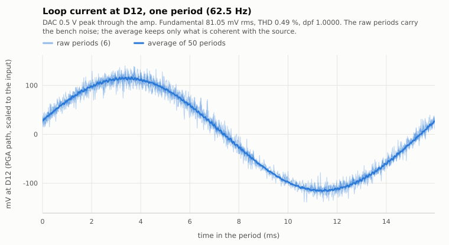
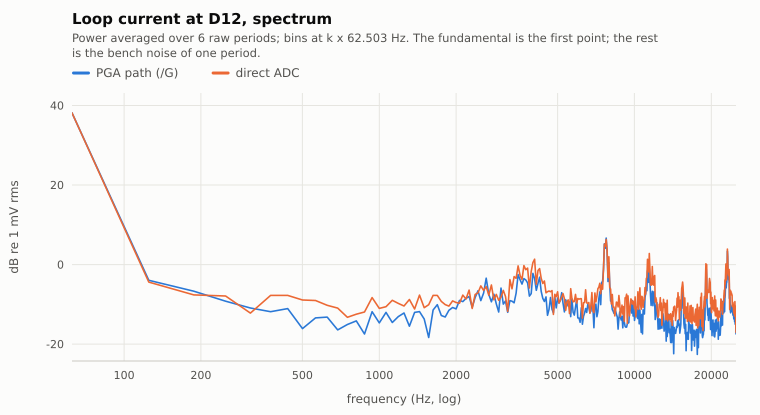
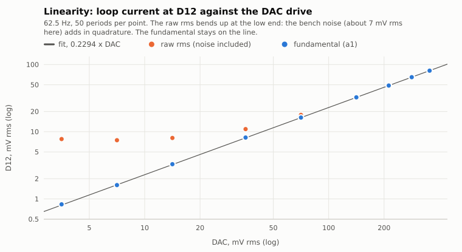
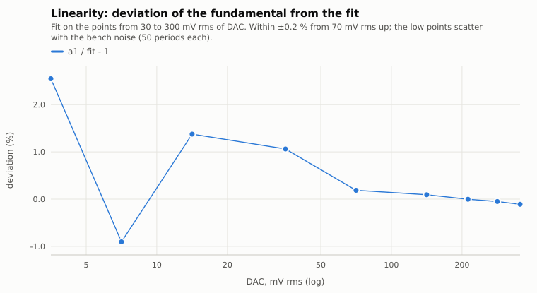
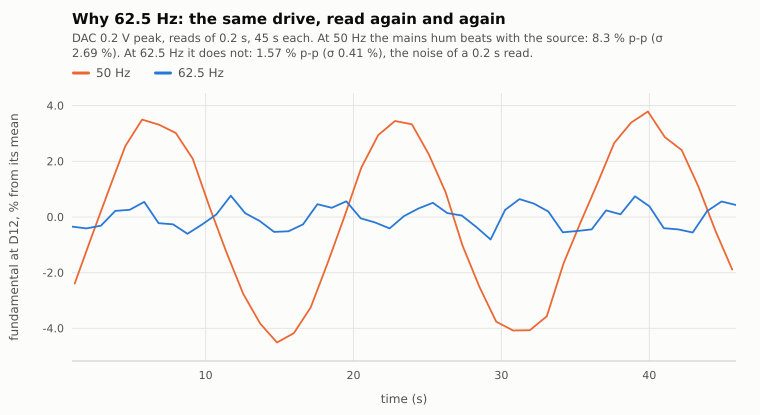
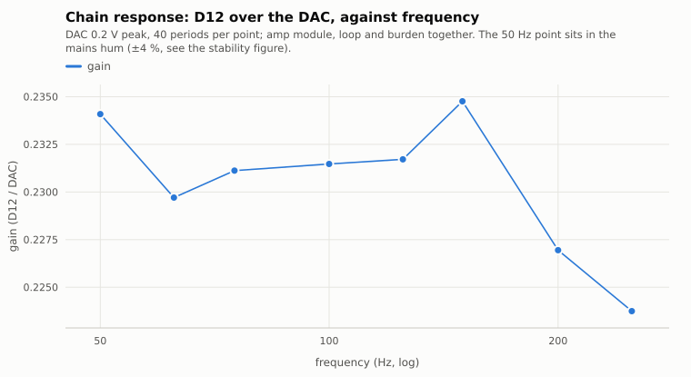
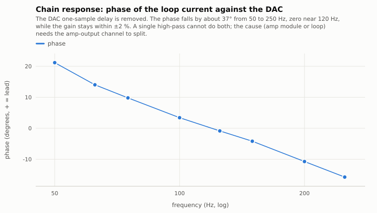
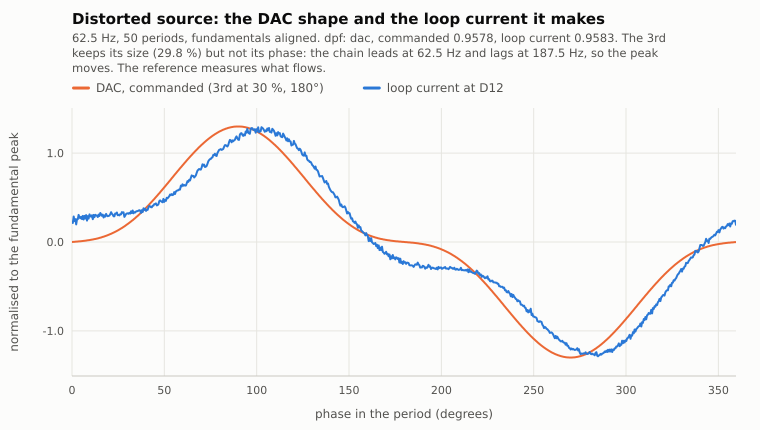
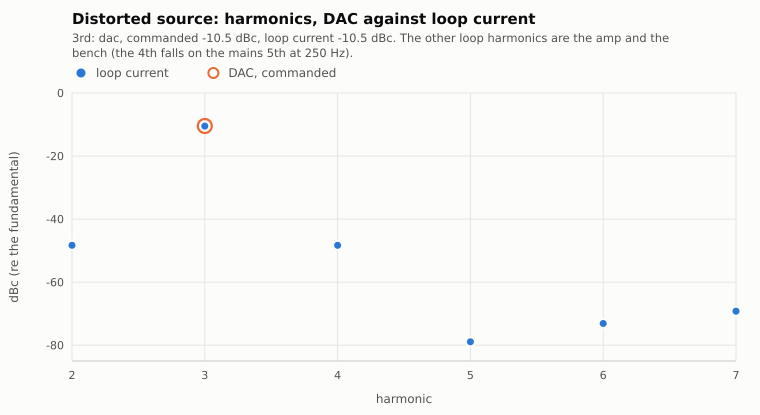
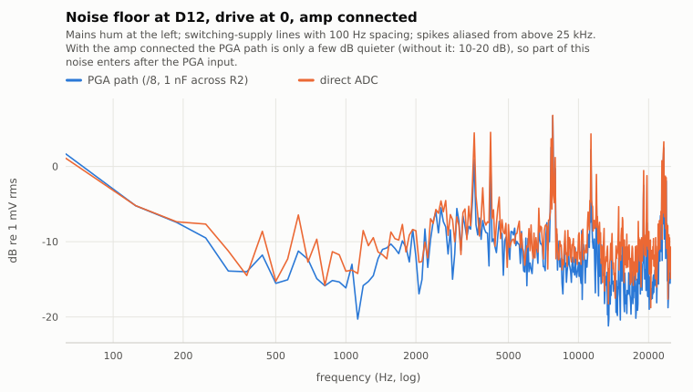

# LoopSource bring-up, 2026-11-01: first current in the loop

Plan: digitalSpine `todo/fluxStationLoopSource.md` (§7.1 holds the earlier loopback results).
Front end: [`opamp2_frontend.md`](opamp2_frontend.md). Figures and the data behind each one:
[`figures/`](figures/) (SVG + CSV, `summary.json`).

## Setup

| | |
|---|---|
| Board | NUCLEO-L476RG, `LoopSource.elf`, branch `loop-source` (not committed at the time of the run) |
| Clock | MSI locked to the X2 crystal (`clk`: lse=1), DAC and ADC both on TIM6, 50 002.45 SPS |
| Source | DAC (A2) → the amp module → the 200-turn loop → the burden |
| Input | burden → 47 µF → D12, biased at 0.207 V (150 k / 10 k, 10 µF, 10 k); OPAMP2 PGA ×8 (`pga 8 ext`), 1 nF from D11 to A3 |
| Frequency | 62.5 Hz (n = 800 samples a period) unless stated; 50 Hz for comparison |
| Drive | DAC up to 0.5 V peak (D12 up to 81 mV rms) |
| Cross-check | oscilloscope on D12: 32 mV rms, 205.90 mV avg; the board: 32.41 mV rms fundamental, 205.9 mV DC |

## Results in one table

| Quantity | Value |
|---|---|
| Chain gain, D12 / DAC, 62.5 Hz | 0.2294 |
| Linearity of the fundamental, 70–350 mV rms of DAC | within ±0.2 % of the fit |
| Fundamental at 0.5 V peak of DAC | 81.05 mV rms (raw 81.42 mV), THD 0.49 %, dpf 1.0000 |
| Repeat reads of 0.2 s, 45 s, 62.5 Hz | 1.57 % p-p, σ 0.41 % |
| Same at 50 Hz | 8.3 % p-p, σ 2.7 % (the mains hum beats with the source) |
| Chain gain, 62.5–250 Hz | 0.2237 … 0.2348 (±2 %) |
| Chain phase, 50 → 250 Hz | +21° → −16°, zero near 120 Hz |
| Distorted source, 3rd at 30 %, 180° | loop current: 3rd at 29.8 %, dpf 0.9583 (DAC commanded: 0.9578) |
| Bench noise at D12, drive at 0 | ≈ 7 mV rms, spikes to ±30 mV; most of it above 2 kHz |
| Underruns, lost halves, ADC overruns | 0 in every run |

## The loop current



The raw periods carry the bench noise. The average of 50 periods keeps only what is coherent with
the source: the synchronous averaging of §5.2 of the plan, at work.



## Linearity



The fundamental follows the drive on a straight line over two decades. The raw rms leaves the line
at the low end, where the bench noise is larger than the signal: that is why the reference uses
the coherent part (`a1`, `rmsh`).



## Why 62.5 Hz



The same drive, read again and again. At 50 Hz the mains hum is almost at the source frequency,
so it beats with it: ±4 % with a period of about 17 s. At 62.5 Hz the hum is not coherent, and only
the noise of a 0.2 s read remains. A Flux board's 79.9 ms capture also holds a whole number of
cycles at 62.5 Hz (5), as at 50 Hz (4); at 60 Hz it does not (4.8).

## Frequency response of the chain





The gain is flat within ±2 %; the phase falls by about 37°. The control loop regulates the
magnitude, so the phase does not matter for the reference. The cause needs the amp-output
channel (stage 2, ADS ch1) to split between the amp module and the loop.

## A distorted source: the dpf cross-check





The DAC adds a 3rd harmonic at 30 %, 180° (`harm 3 0.3 180`). The loop current keeps its size
(29.8 %) but not its phase: the chain leads at 62.5 Hz and lags at 187.5 Hz. The reference reads
the dpf on the current that flows (0.9583), not on the DAC command; that is the value to compare
with the Flux boards' dpf at the 50 Hz points.

## Noise floor



With the amp connected, the PGA path is only a few dB quieter than the direct input (without the
amp it was 10–20 dB quieter, `opamp2_frontend.md`). So part of this noise enters after the PGA
input, probably through the amp's ground or supply. The coherent reading does not see it.

## Reproduce

```
python3 tools/loop_figs.py --out docs/loop/figures --max-amp 0.5   # about 4 minutes; close cutecom
python3 tools/loop_figs.py --out docs/loop/figures --render-only    # redraw from the CSV files
python3 tools/loop_snap.py --snaps 4 --avg 50                       # interactive HTML snapshot
```

The campaign leaves the board at 62.5 Hz, pure sine, `amp 0.2`.

## Open points

1. Find the noise path that the amp adds (ground or supply); one ground point at the bottom of Rs.
2. The cause of the chain phase (amp module or loop): needs the amp-output channel.
3. The control loop (`set <A>`), then the faults and the keep-alive, before the source runs alone.
4. The DC calibration with a DMM (plan §7 step 5); the scope agrees within its own resolution.
5. One Flux board at 62.5 Hz and at 50 Hz: the clamp's frequency effect (plan §6.1).
