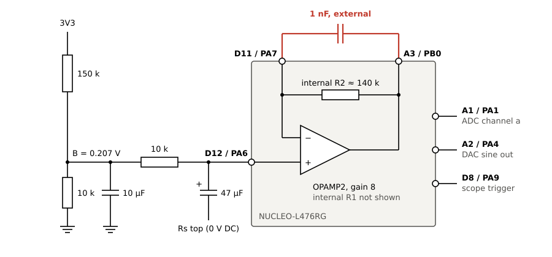

# LoopSource: pins on the NUCLEO-L476RG

This document applies to the `LoopSource.elf` image. The firmware is in `Loop/`. Written 2026-11-02.

## Pins to connect

| Header | Connector | STM32 | Use | ADC channel |
|---|---|---|---|---|
| **A2** | CN8-3 | PA4 | DAC1 OUT1, the sine output | – |
| **A1** | CN8-2 | PA1 | Single-ended ADC input | `a` |
| **D12** | CN5-5 | PA6 | OPAMP2 VINP, the PGA input | `i` |
| **D11** | CN5-4 | PA7 | OPAMP2 VINM. **One side of the 1 nF capacitor.** | `m` |
| **A3** | CN8-4 | PB0 | OPAMP2 VOUT, the PGA output. **Other side of the 1 nF capacitor.** | `p` |
| **D8** | CN5-1 | PA9 | Scope trigger, 0 to VDD. High during each `read` capture. | – |
| **D13** | CN5-6 | PA5 | LD2. On while the amplitude is not 0. | – |

The ADC also reads VREFINT (channel `vref`) to measure VDDA. VREFINT is internal and has no pin.

## The 1 nF capacitor

**Connect 1 nF from D11 to A3. Do not connect it to GND.**

- **Command:** use `pga 8 ext`. With plain `pga 8`, D11 is not connected inside the MCU and the capacitor does nothing.
- **Function:** the capacitor is across the internal R2 (about 140 k at gain 8). The gain falls from 8 to 1 above about 1.1 kHz.
- **Measured result:** above 1 kHz, the PGA path is 10–20 dB below the direct input.
- **Wiring:** use short, twisted leads. D11 is a feedback node.
- **`pga std` mode:** this mode uses a different external network on A3 and D11. See `docs/loop/opamp2_frontend.md`.

## Pins used on the board

These pins do not need wires for LoopSource.

| STM32 | Use | Note |
|---|---|---|
| PA2, PA3 | USART2, ST-LINK VCP, 460800 8N1 | Not on D1 and D0 by default (SB62 and SB63 are off) |
| PA13, PA14 | SWD, ST-LINK | Flash and debug |
| PC14, PC15 | X2 crystal, 32.768 kHz | The sample clock locks to this crystal |
| PC0, PC1 | A5, A4, analog mode | No ADC channel uses them now |

## Limits

- **A3:** do not load it with more than 450 µA in PGA mode. PB0 is also the BatTester SYNC output, so do not leave both connections on the pin.
- **A2:** the DAC output range is 0.2 V to VREF+ − 0.2 V. The minimum load is 5 kΩ.
- **D12:** the input must not go below 0 V. At gain 8, the bias is 0.21 V and the maximum linear input is 0.39 V p-p.
- **D13, D12, D11:** these are the SPI1 pins. A shield that uses SPI1 conflicts with the PGA.
- **OPAMP1:** do not use it. Its output is PA3, the ST-LINK VCP RX.
- **D8:** the firmware sets the edges in an interrupt. The estimated delay is up to 0.2 ms. This value is not measured.

## Scope trigger timing

**The scope trigger is armed with 2 cycles of delay, to give the amplitude time to stabilize.**

D8 goes high at the start of the capture, not at the `read` command and not at the `amp` command. The sequence after a change of amplitude is:

| Step | Duration | D8 |
|---|---|---|
| The DAC ramps to the new amplitude | 1 cycle | Low |
| The DAC plays the new amplitude, no capture | 2 cycles | Low |
| `read` captures | n cycles | **High** |

- **One cycle:** 20 ms at 50 Hz, 16 ms at 62.5 Hz.
- **`read` with no change of amplitude:** the delay is between 1 and 2 cycles from the command, because the capture starts on a period boundary.
- **Setting:** `kReadSettlePeriods` in `Loop/Inc/loop_cfg.hpp`.
- **Limit:** the delay covers the DAC ramp. An analog transient in the amp module, the loop or the 47 µF input network can last longer than 2 cycles.

## Free pins

LoopSource does not use these pins: **A0, D2, D3, D4, D5, D6, D7, D9, D10, D14, D15**.

A0 (PA0) is the BatTester AUTOSTART strap. It has no function in LoopSource.

## References

- `Loop/Src/main.cpp`, `Loop/Src/adc_in.cpp`, `Loop/Src/pga.cpp`: pin use in the firmware.
- `docs/loop/opamp2_frontend.md`: input design and measured gains.
- UM1724, Table 23: Arduino connectors on the NUCLEO-L476RG. Section 7 also has the solder bridges.
