# Introduction

The STM32 Nucleo-64 boards based on the MB1136 reference board (NUCLEO-F030R8, NUCLEO-F070RB, NUCLEO-F072RB, NUCLEO-F091RC, NUCLEO-F103RB,

NUCLEO-F302R8, NUCLEO-F303RE, NUCLEO-F334R8, NUCLEO-F401RE,

NUCLEO-F410RB, NUCLEO-F411RE, NUCLEO-F446RE, NUCLEO-L010RB,

NUCLEO-L053R8, NUCLEO-L073RZ, NUCLEO-L152RE, NUCLEO-L452RE,

NUCLEO-L476RG) provide an affordable and flexible way for users to try out new concepts and build prototypes with the STM32 microcontrollers in the LQFP64 package, choosing from the various combinations of performance, power consumption, and features. The ARDUINO ® Uno V3 connectivity support and the ST morpho headers provide an easy means of expanding the functionality of the Nucleo open development platform with a wide choice of specialized shields. The STM32 Nucleo boards do not require any separate probe as they integrate the ST-LINK/V2-1 debugger and programmer. The STM32 Nucleo boards come with the comprehensive free software libraries and examples available with the STM32Cube MCU Packages.

Figure 1. STM32 Nucleo-64 board

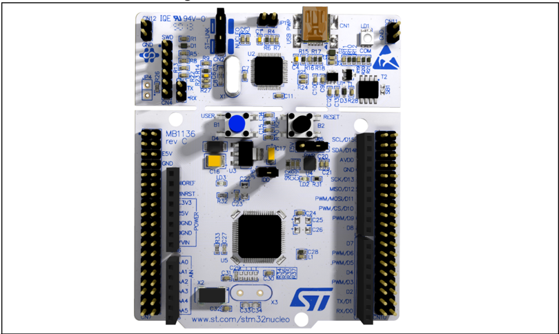

Picture is not contractual.

## UM1724 User manual

## STM32 Nucleo-64 boards (MB1136)

1

## Contents

|   1 | Features . . . . . . . . . . . . . . . . . . . . . . . . . . . . . . . . . . . . . . . . . . . .   | . . . . . .                                                                                                                                                 | . 6   |
|-----|----------------------------------------------------------------------------------------------------|-------------------------------------------------------------------------------------------------------------------------------------------------------------|-------|
|   2 | Ordering information . . . . . . . . . . . . . . . . . . . . . . . . . . . . . . . . . .           | . . . . .                                                                                                                                                   | . 7   |
|     | 2.1                                                                                                | Codification . . . . . . . . . . . . . . . . . . . . . . . . . . . . . . . . . . . . . . . . . . . . . . . .                                                | . 8   |
|   3 | Development environment . . . . . . . . . . . . . . . . . . . . . . . . . . . . . . .              | . . . .                                                                                                                                                     | . 9   |
|     | 3.1                                                                                                | System requirements . . . . . . . . . . . . . . . . . . . . . . . . . . . . . . . . . . . . . . . .                                                         | . 9   |
|     | 3.2                                                                                                | Development toolchains . . . . . . . . . . . . . . . . . . . . . . . . . . . . . . . . . . . . . .                                                          | . 9   |
|     | 3.3                                                                                                | Demonstration software . . . . . . . . . . . . . . . . . . . . . . . . . . . . . . . . . . . . . .                                                          | . 9   |
|     | 3.4                                                                                                | EDA resources . . . . . . . . . . . . . . . . . . . . . . . . . . . . . . . . . . . . . . . . . . . . .                                                     | . 9   |
|   4 | Conventions . . . . . . . . . . . . . . . . . . . . . . . . . . . . . . . . . . . . . . . . . .    | . . . .                                                                                                                                                     | 10    |
|   5 | Safety recommendations . . . . . . . . . . . . . . . . . . . . . . . . . . . . . . .               | . . . . .                                                                                                                                                   | 11    |
|     | 5.1                                                                                                | Targeted audience . . . . . . . . . . . . . . . . . . . . . . . . . . . . . . . . . . . . . . . . . .                                                       | .11   |
|     | 5.2                                                                                                | Handling the board . . . . . . . . . . . . . . . . . . . . . . . . . . . . . . . . . . . . . . . . . .                                                      | .11   |
|   6 | Quick start . . . . . . . . . . . . . . . . . . . . . . . . .                                      | . . . . . . . . . . . . . . . . . . . . . . .                                                                                                               | 12    |
|     | 6.1                                                                                                | Getting started . . . . . . . . . . . . . . . . . . . . . . . . . . . . . . . . . . . . . . . . . . . . .                                                   | 12    |
|     | 6.2                                                                                                | Hardware configuration variants . . . . . . . . . . . . . . . . . . . . . . . . . . . . . . . .                                                             | 12    |
|   7 | Hardware layout and configuration . . . . . . . . . . . . . . . . . . . . . . .                    | . . . . .                                                                                                                                                   | 13    |
|     | 7.1                                                                                                | Board diagram and layout . . . . . . . . . . . . . . . . . . . . . . . . . . . . . . . . . . . .                                                            | 13    |
|     | 7.2                                                                                                | Mechanical dimensions . . . . . . . . . . . . . . . . . . . . . . . . . . . . . . . . . . . . . .                                                           | 16    |
|     | 7.3                                                                                                | Pre-cut PCB . . . . . . . . . . . . . . . . . . . . . . . . . . . . . . . . . . . . . . . . . . . . . . .                                                   | 17    |
|     | 7.4                                                                                                | Embedded ST-LINK/V2-1 . . . . . . . . . . . . . . . . . . . . . . . . . . . . . . . . . . . . .                                                             | 17    |
|     |                                                                                                    | 7.4.1 Driver . . . . . . . . . . . . . . . . . . . . . . . . . . . . . . . . . . . . . . . . . . . . . . . . . .                                            | . 18  |
|     |                                                                                                    | 7.4.2 ST-LINK/V2-1 firmware upgrade . . . . . . . . . . . . . . . . . . . . . . . . . . . . .                                                               | . 18  |
|     |                                                                                                    | 7.4.3 Mass storage interface . . . . . . . . . . . . . . . . . . . . . . . . . . . . . . . . . . . .                                                        | . 18  |
|     |                                                                                                    | 7.4.4 Using the ST-LINK/V2-1 to program and debug the STM32 on board                                                                                        | . 18  |
|     |                                                                                                    | 7.4.5 Using ST-LINK/V2-1 to program and debug an external STM32 application . . . . . . . . . . . . . . . . . . . . . . . . . . . . . . . . . . . . . . . . | . 19  |
|     |                                                                                                    | 7.5.1 Power supply input from the USB connector . . . . . . . . . . . . . . . . . . . .                                                                     | . 21  |

|                                                                          |                                                                                                                                             | 7.5.2                                                                                                                                       | External power supply inputs: VIN and E5V . . . . . . . . . . . . . . . . . . . .                                | . 22   |
|--------------------------------------------------------------------------|---------------------------------------------------------------------------------------------------------------------------------------------|---------------------------------------------------------------------------------------------------------------------------------------------|------------------------------------------------------------------------------------------------------------------|--------|
|                                                                          |                                                                                                                                             | 7.5.3                                                                                                                                       | External power supply input: +3.3V . . . . . . . . . . . . . . . . . . . . . . . . . . .                         | . 23   |
|                                                                          |                                                                                                                                             | 7.5.4                                                                                                                                       | External power supply output . . . . . . . . . . . . . . . . . . . . . . . . . . . . . . .                       | . 23   |
|                                                                          |                                                                                                                                             |                                                                                                                                             | 7.6 LEDs . . . . . . . . . . . . . . . . . . . . . . . . . . . . . . . . . . . . . . . . . . . . . . . . . . . . | 24     |
|                                                                          | 7.7                                                                                                                                         | Push-buttons                                                                                                                                | . . . . . . . . . . . . . . . . . . . . . . . . . . . . . . . . . . . . . . . . . . . . . .                      | 24     |
|                                                                          | 7.8                                                                                                                                         | JP6 (IDD) . . . . . . . . . . . . .                                                                                                         | . . . . . . . . . . . . . . . . . . . . . . . . . . . . . . . . . . . .                                          | 24     |
|                                                                          | 7.9                                                                                                                                         | OSC clock                                                                                                                                   | . . . . . . . . . . . . . . . . . . . . . . . . . . . . . . . . . . . . . . . . . . . . . . . .                  | 25     |
|                                                                          |                                                                                                                                             | 7.9.1 OSC clock supply .                                                                                                                    | . . . . . . . . . . . . . . . . . . . . . . . . . . . . . . . . . . . . . . . .                                  | 25     |
|                                                                          |                                                                                                                                             | 7.9.2                                                                                                                                       | OSC 32 KHz clock supply . . . . . . . . . . . . . . . . . . . . . . . . . . . . . . . . . .                      | . 26   |
|                                                                          | 7.10                                                                                                                                        | USART communication . .                                                                                                                     | . . . . . . . . . . . . . . . . . . . . . . . . . . . . . . . . . . . .                                          | 26     |
|                                                                          | 7.11                                                                                                                                        | Solder bridges . . . . . . . . .                                                                                                            | . . . . . . . . . . . . . . . . . . . . . . . . . . . . . . . . . . . .                                          | 27     |
|                                                                          | 7.12                                                                                                                                        | Extension connectors . . . .                                                                                                                | . . . . . . . . . . . . . . . . . . . . . . . . . . . . . . . . . . . .                                          | 29     |
|                                                                          | 7.13                                                                                                                                        | ARDUINO ® connectors . .                                                                                                                    | . . . . . . . . . . . . . . . . . . . . . . . . . . . . . . . . . . . .                                          | 38     |
|                                                                          | 7.14                                                                                                                                        | ST morpho connector . . . .                                                                                                                 | . . . . . . . . . . . . . . . . . . . . . . . . . . . . . . . . . . . .                                          | 54     |
| 8                                                                        | Nucleo-64 boards information .                                                                                                              | Nucleo-64 boards information .                                                                                                              | . . . . . . . . . . . . . . . . . . . . . . . . . . . . . . .                                                    | 64     |
|                                                                          | 8.1                                                                                                                                         | Product marking . . . . . . . .                                                                                                             | . . . . . . . . . . . . . . . . . . . . . . . . . . . . . . . . . . . .                                          | 64     |
|                                                                          | 8.2                                                                                                                                         | Product history . . . . . . . . .                                                                                                           | . . . . . . . . . . . . . . . . . . . . . . . . . . . . . . . . . . . .                                          | 65     |
|                                                                          | 8.3                                                                                                                                         | Board revision history . . . .                                                                                                              | . . . . . . . . . . . . . . . . . . . . . . . . . . . . . . . . . . . .                                          | 83     |
| 9                                                                        | Federal Communications Commission (FCC) and ISED Canada Compliance Statements . . . . . . . . . . . . . . . . . . . . . . . . . . . . . . . | Federal Communications Commission (FCC) and ISED Canada Compliance Statements . . . . . . . . . . . . . . . . . . . . . . . . . . . . . . . | . . . . . .                                                                                                      | 85     |
|                                                                          | 9.1                                                                                                                                         | FCC Compliance Statement                                                                                                                    | . . . . . . . . . . . . . . . . . . . . . . . . . . . . . . . . . . .                                            | 85     |
|                                                                          | 9.2                                                                                                                                         | ISED Compliance Statement                                                                                                                   | . . . . . . . . . . . . . . . . . . . . . . . . . . . . . . . . . .                                              | 86     |
| 10                                                                       | Product disposal . .                                                                                                                        | . . . . . . . .                                                                                                                             | . . . . . . . . . . . . . . . . . . . . . . . . . . . . . . . . .                                                | 87     |
| Revision history . . . . . . . . . . . . . . . . . . . . . . . . . . . . | Revision history . . . . . . . . . . . . . . . . . . . . . . . . . . . .                                                                    | Revision history . . . . . . . . . . . . . . . . . . . . . . . . . . . .                                                                    | . . . . . . . . . . . . . . . . . . . . . . . .                                                                  | 88     |

3

## List of tables

| Table 1.   | Ordering information . . . . . . . . . . . . . . . . . . . . . . . . . . . . . . . . . . . . . . . . . . . .                                                                                                                                | . . 7   |
|------------|---------------------------------------------------------------------------------------------------------------------------------------------------------------------------------------------------------------------------------------------|---------|
| Table 2.   | Codification explanation . . . . . . . . . . . . . . . . . . . . . . . . . . . . . . . . . . . . . . . . .                                                                                                                                  | . . 8   |
| Table 3.   | ON/OFF conventions . . . . . . . . . . . . . . . . . . . . . . . . . . . . . . . . . . . . . . . . . . .                                                                                                                                    | . 10    |
| Table 4.   | Jumper states . . . . . . . . . . . . . . . . . . . . . . . . . . . . . . . . . . . . . . . . . . . . . . . . .                                                                                                                             | . 17    |
| Table 5.   | Debug connector CN4 (SWD) . . . . . . . . . . . . . . . . . . . . . . . . . . . . . . . . . . . .                                                                                                                                           | . 20    |
| Table 6.   | JP1 configuration table . . . . . . . . . . . . . . . . . . . . . . . . . . . . . . . . . . . . . . . . . .                                                                                                                                 | . 21    |
| Table 7.   | External power sources . . . . . . . . . . . . . . . . . . . . . . . . . . . . . . . . . . . . . . . . .                                                                                                                                    | . 22    |
| Table 8.   | Power-related jumper . . . . . . . . . . . . . . . . . . . . . . . . . . . . . . . . . . . . . . . . . . .                                                                                                                                  | . 22    |
| Table 9.   | +3.3 V external power source. . . . . . . . . . . . . . . . . . . . . . . . . . . . . . . . . . . . .                                                                                                                                       | . 23    |
| Table 10.  | Solder bridges. . . . . . . . .                                                                                                                                                                                                             | . 27    |
| Table 11.  | . . . . . . . . . . . . . . . . . . . . . . . . . . . . . . . . . . . . . . . . ARDUINO ® connectors on NUCLEO-F030R8, NUCLEO-F070RB, NUCLEO-F072RB, NUCLEO-F091RC. . . . . . . . . . . . . . . . . . . . . . . . . . . . . . . . . . . . . | . .     |
|            | . . . . . . . .                                                                                                                                                                                                                             | 38      |
| Table 12.  | ARDUINO ® connectors on NUCLEO-F103RB. . . . . . . . .                                                                                                                                                                                      | . 40    |
| Table 13.  | ARDUINO ® connectors on NUCLEO-F302R8 . . . . . . . . . . . . . . . . . . . . . . . .                                                                                                                                                       | . 41    |
| Table 14.  | ARDUINO ® connectors on NUCLEO-F303RE. . . . . . . . . . . . . . . . . . . . . . . .                                                                                                                                                        | . 42    |
| Table 15.  | ARDUINO ® connectors on NUCLEO-F334R8 . . . . . . . . . . . . . . . . . . . . . . . .                                                                                                                                                       | . 43    |
| Table 16.  | ARDUINO ® connectors on NUCLEO-F401RE and NUCLEO-F411RE . . . . .                                                                                                                                                                           | . 44    |
| Table 17.  | ARDUINO ® connectors on NUCLEO-L053R8 . . . . . . . . . . . . . . . . . . . . . . . .                                                                                                                                                       | . 46    |
| Table 18.  | ARDUINO ® connectors on NUCLEO-L010RB and NUCLEO-L073RZ . . . . .                                                                                                                                                                           | . 47    |
| Table 19.  | ARDUINO ® connectors on NUCLEO-F446RE. . . . . . . . . . . . . . . . . . . . . . . .                                                                                                                                                        | . 48    |
| Table 20.  | ARDUINO ® connectors on NUCLEO-F410RB. . . . . . . . . . . . . . . . . . . . . . . .                                                                                                                                                        | . 50    |
| Table 21.  | ARDUINO ® connectors on NUCLEO-L152RE . . . . . . . . . . . . . . . . . . . . . . . .                                                                                                                                                       | . 51    |
| Table 22.  | ARDUINO ® connectors on NUCLEO-L452RE . . . . . . . . . . . . . . . . . . . . . . . .                                                                                                                                                       | . 52    |
| Table 23.  | ARDUINO ® connectors on NUCLEO-L476RG. . . . . . . . . . . . . . . . . . . . . . . .                                                                                                                                                        | . 53    |
| Table 24.  | ST morpho connector on NUCLEO-F030R8 . . . . . . . . . . . . . . . . . . . . . . . . .                                                                                                                                                      | . 54    |
| Table 25.  | ST morpho connector on NUCLEO-F070RB . . . . . . . . . . . . . . . . . . . . . . . . .                                                                                                                                                      | . 55    |
| Table 26.  | ST morpho connector on NUCLEO-F072RB, NUCLEO-F091RC, NUCLEO-F303RE, NUCLEO-F334R8.                                                                                                                                                          | . 56    |
| Table 27.  | ST morpho connector on NUCLEO-F103RB . . . . . . . . . . . . . . . . . . . . . . . . .                                                                                                                                                      | . 57    |
| Table 28.  | ST morpho connector on NUCLEO-F302R8 . . . . . . . . . . . . . . . . . . . . . . . . .                                                                                                                                                      | . 58    |
| Table 29.  | ST morpho connector on NUCLEO-F401RE, NUCLEO-F411RE, NUCLEO-F446RE. . . . . . . . . . . . . . . . . . . . . . . . .                                                                                                                         | . 59    |
| Table 30.  | . . . . . ST morpho connector on NUCLEO-L010RB, NUCLEO-L053R8, NUCLEO-L073RZ, NUCLEO-L152RE. . . . . . . . . . . . . . .                                                                                                                    | . 60    |
| Table 31.  | ST morpho connector on NUCLEO-L452RE . . . . . . . . . . . . . . . . . . . . . . . . .                                                                                                                                                      | . 61    |
| Table 32.  | ST morpho connector on NUCLEO-L476RG . . . . . . . . . . . . . . . . . . . . . . . . .                                                                                                                                                      | . 62    |
| Table 33.  | ST morpho connector on NUCLEO-F410RB . . . . . . . . . . . . . . . . . . . . . . . . .                                                                                                                                                      | . 63    |
| Table 34.  | Product history . . . . . . . . . . . . . . . . . . . . . . . . . . . . . . . . . . . . . . . . . . . . . . . .                                                                                                                             | . 65    |
| Table 35.  | Board revision history . . . . . . . . . . . . . . . . . . . . . . . . . . . . . . . . . . . . . . . . . . .                                                                                                                                | . 83    |
| Table 36.  | Document revision history . . . . . . . . . . . . . . . . . . . . . . . . . . . . . . . . . . . . . . .                                                                                                                                     | . 88    |

## List of figures

| Figure 1.   | STM32 Nucleo-64 board. . . . . . . . . . . . . . . . . . . . . . . . . . . . . . . . . . . .             | . . 1   |
|-------------|----------------------------------------------------------------------------------------------------------|---------|
| Figure 2.   | Hardware block diagram. . . . . . . . . . . . . . . . . . . . . . . . . . . . . . . . . . . .            | . 13    |
| Figure 3.   | Top layout . . . . . . . . . . . . . . . . . . . . . . . . . . . . . . . . . . . . . . . . . . . . . . . | . 14    |
| Figure 4.   | Bottom layout . . . . . . . . . . . . . . . . . . . . . . . . . . . . . . . . . . . . . . . . . . . .    | . 15    |
| Figure 5.   | STM32 Nucleo board mechanical dimensions . . . . . . . . . . . . . . . . . . .                           | . 16    |
| Figure 6.   | Updating the list of drivers in the Device Manager . . . . . . . . . . . . . . . .                       | . 18    |
| Figure 7.   | Connecting the STM32 Nucleo board to program the on-board STM32                                          | . 19    |
| Figure 8.   | Using ST-LINK/V2-1 to program the STM32 on an external application                                       | . 20    |
| Figure 9.   | NUCLEO-F030R8. . . . . . . . . . . . . . . . . . . . . . . . . . . . . . . . . . . . . . . . .           | . 29    |
| Figure 10.  | NUCLEO-F070RB . . . . . . . . . . . . . . . . . . . . . . . . . . . . . . . . . . . . . . . .            | . 29    |
| Figure 11.  | NUCLEO-F072RB . . . . . . . . . . . . . . . . . . . . . . . . . . . . . . . . . . . . . . . .            | . 30    |
| Figure 12.  | NUCLEO-F091RC . . . . . . . . . . . . . . . . . . . . . . . . . . . . . . . . . . . . . . . .            | . 30    |
| Figure 13.  | NUCLEO-F103RB . . . . . . . . . . . . . . . . . . . . . . . . . . . . . . . . . . . . . . . .            | . 31    |
| Figure 14.  | NUCLEO-F302R8. . . . . . . . . . . . . . . . . . . . . . . . . . . . . . . . . . . . . . . . .           | . 31    |
| Figure 15.  | NUCLEO-F303RE . . . . . . . . . . . . . . . . . . . . . . . . . . . . . . . . . . . . . . . .            | . 32    |
| Figure 16.  | NUCLEO-F334R8. . . . . . . . . . . . . . . . . . . . . . . . . . . . . . . . . . . . . . . . .           | . 32    |
| Figure 17.  | NUCLEO-F401RE . . . . . . . . . . . . . . . . . . . . . . . . . . . . . . . . . . . . . . . .            | . 33    |
| Figure 18.  | NUCLEO-F411RE . . . . . . . . . . . . . . . . . . . . . . . . . . . . . . . . . . . . . . . .            | . 33    |
| Figure 19.  | NUCLEO-L053R8. . . . . . . . . . . . . . . . . . . . . . . . . . . . . . . . . . . . . . . . .           | . 34    |
| Figure 20.  | NUCLEO-L073RZ and NUCLEO-L010RB . . . . . . . . . . . . . . . . . . . . . .                              | . 34    |
| Figure 21.  | NUCLEO-L152RE. . . . . . . . . . . . . . . . . . . . . . . . . . . . . . . . . . . . . . . . .           | . 35    |
| Figure 22.  | NUCLEO-L452RE. . . . . . . . . . . . . . . . . . . . . . . . . . . . . . . . . . . . . . . . .           | . 35    |
| Figure 23.  | NUCLEO-L476RG . . . . . . . . . . . . . . . . . . . . . . . . . . . . . . . . . . . . . . . .            | . 36    |
| Figure 24.  | NUCLEO-F446RE . . . . . . . . . . . . . . . . . . . . . . . . . . . . . . . . . . . . . . . .            | . 36    |
| Figure 25.  | NUCLEO-F410RB . . . . . . . . . . . . . . . . . . . . . . . . . . . . . . . . . . . . . . . .            | . 37    |

5

## 1 Features

The STM32 Nucleo board offers the following features:

- Arm ®  Cortex ®(a)  core-based STM32 microcontroller in LQFP64 package
- Three LEDs:
- -USB communication (LD1), user LED (LD2), power LED (LD3)
- Two push-buttons: USER and RESET
- Two types of extension resources
- -ARDUINO ®  Uno V3 connectivity
- -ST morpho extension pin headers for full access to all STM32 I/Os
- Flexible board power supply:
- -USB VBUS or external source (3.3 V, 5 V, 7-12 V)
- -Power management access point
- On-board ST-LINK/V2-1 debugger and programmer with SWD connector
- -Selection-mode switch using the kit as a standalone ST-LINK/V2-1
- USB re-enumeration capability. Three different interfaces are supported on USB:
- -Virtual COM port
- -Mass storage
- -Debug port
- Comprehensive free software libraries and examples available with the STM32Cube MCU Package

a. Arm and Cortex are registered trademarks of Arm Limited (or its subsidiaries) in the US and/or elsewhere.

## 2 Ordering information

To order an STM32 Nucleo-64 board, refer to Table 1 . Additional information is available from the datasheet and reference manual of the target STM32.

Table 1. Ordering information

| Order code    | Board reference   | Targeted STM32   |
|---------------|-------------------|------------------|
| NUCLEO-F030R8 | MB1136            | STM32F030R8T6    |
| NUCLEO-F070RB | MB1136            | STM32F070RBT6    |
| NUCLEO-F072RB | MB1136            | STM32F072RBT6    |
| NUCLEO-F091RC | MB1136            | STM32F091RCT6    |
| NUCLEO-F103RB | MB1136            | STM32F103RBT6    |
| NUCLEO-F302R8 | MB1136            | STM32F302R8T6    |
| NUCLEO-F303RE | MB1136            | STM32F303RET6    |
| NUCLEO-F334R8 | MB1136            | STM32F334R8T6    |
| NUCLEO-F401RE | MB1136            | STM32F401RET6    |
| NUCLEO-F410RB | MB1136            | STM32F410RBT6    |
| NUCLEO-F411RE | MB1136            | STM32F411RET6    |
| NUCLEO-F446RE | MB1136            | STM32F446RET6    |
| NUCLEO-L010RB | MB1136            | STM32L010RBT6    |
| NUCLEO-L053R8 | MB1136            | STM32L053R8T6    |
| NUCLEO-L073RZ | MB1136            | STM32L073RZT6    |
| NUCLEO-L152RE | MB1136            | STM32L152RET6    |
| NUCLEO-L452RE | MB1136            | STM32L452RET6    |
| NUCLEO-L476RG | MB1136            | STM32L476RGT6    |

90

### 2.1 Codification

The meaning of the codification is explained in Table 2 .

Table 2. Codification explanation

| NUCLEO-XXYYRT   | Description                                                                                                                            | Example: NUCLEO-L452RE   |
|-----------------|----------------------------------------------------------------------------------------------------------------------------------------|--------------------------|
| XX              | MCU series in STM32 Arm Cortex MCUs                                                                                                    | STM32L4 Series           |
| YY              | STM32 product line in the series                                                                                                       | STM32L452                |
| R               | STM32 package pin count                                                                                                                | 64 pins                  |
| T               | STM32 flash memory size: - 8 for 64 Kbytes - B for 128 Kbytes - C for 256 Kbytes - E for 512 Kbytes - G for 1 Mbyte - Z for 192 Kbytes | 512 Kbytes               |

## 3 Development environment

### 3.1 System requirements

- Multi-OS support: Windows ®  10 or 11, Linux ®  64-bit, or macOS ®
- USB Type-A or USB Type-C ®  to Micro-B cable, or USB Type-A or USB Type-C ®  to Mini-B cable, or USB Type-A or USB Type-C ®  to USB Type-C ®  cable (depending on the board reference)

macOS ®  is a trademark of Apple Inc., registered in the U.S. and other countries and regions.

Linux ® is a registered trademark of Linus Torvalds.

Windows ®  is a trademark of the Microsoft group of companies

### 3.2 Development toolchains

- IAR Systems - IAR Embedded Workbench ®(a)
- Keil ® : MDK-ARM (a)
- STMicroelectronics - STM32CubeIDE

### 3.3 Demonstration software

The demonstration software, included in the STM32Cube MCU Package corresponding to the on-board microcontroller, is preloaded in the STM32 flash memory for easy demonstration of the device peripherals in standalone mode. The latest versions of the demonstration source code and associated documentation can be downloaded from www.st.com .

### 3.4 EDA resources

All board design resources, including schematics, EDA databases, manufacturing files, and the bill of materials are available from the corresponding product page at www.st.com .

a. On Windows ®  only.

Note:

90

## 4 Conventions

Table 3 provides the conventions used for the ON and OFF settings in the present document.

Table 3. ON/OFF conventions

| Convention            | Definition                                         |
|-----------------------|----------------------------------------------------|
| Jumper JP1 ON         | Jumper fitted                                      |
| Jumper JP1 OFF        | Jumper not fitted                                  |
| Solder bridge SBx ON  | SBx connections closed by solder or 0-ohm resistor |
| Solder bridge SBx OFF | SBx connections left open                          |

In this document, the references are 'STM32 Nucleo board' and 'STM32 Nucleo boards' for all information that is common to all sale types.

## 5 Safety recommendations

### 5.1 Targeted audience

This product targets users with at least basic electronics or embedded software development knowledge such as engineers, technicians, or students. This board is not a toy and is not suited for use by children.

### 5.2 Handling the board

This product contains a bare printed circuit board and like all products of this type, the user must be careful about the following points:

- The connection pins on the board might be sharp. Be careful when handling the board to avoid hurting yourself.
- This board contains static-sensitive devices. To avoid damaging it, handle the board in an ESD.proof environment.
- While powered, do not touch the electric connections on the board with your fingers or anything conductive. The board operates at a voltage level that is not dangerous, but components might be damaged when shorted.
- Do not put any liquid on the board and avoid operating the board close to water or at a high humidity level.
- Do not operate the board if it is dirty or dusty.

90

## 6 Quick start

The STM32 Nucleo board is a low-cost and easy-to-use development platform used to quickly evaluate and start development with an STM32 microcontroller in an LQFP64 package.

Before installing and using the product, accept the Evaluation Product License Agreement from the www.st.com/epla web page.

For more information on the STM32 Nucleo board and to access the demonstration software, visit www.st.com/stm32nucleo website .

### 6.1 Getting started

Follow the sequence below to configure the STM32 Nucleo board and launch the demo software:

1. Check the jumper position on the board, JP1 off, JP5 (PWR) on U5V, JP6 on (IDD), CN2 on (NUCLEO) selected.
2. For correct identification of all device interfaces from the host PC, install the Nucleo USB driver available from the www.st.com/stm32nucleo web page, before connecting the board.
3. Connect the STM32 Nucleo board to a PC with a USB cable 'Type-A to Mini-B' through USB connector CN1 to power the board. The red LED LD3 (PWR) and LD1 (COM) must light up. LD1 (COM) and green LED LD2 must blink.
4. Press button B1 (left button).
5. Observe the blinking frequency of LED LD2 at different frequencies, by clicking on the button B1.
6. The demonstration software and several software examples on how to use the STM32 Nucleo board features are available at the www.st.com/stm32nucleo web page.
7. Develop the application using the available examples.

### 6.2 Hardware configuration variants

The board can be delivered with different configurations of the oscillator of the target STM32. For all the details concerning high-speed configurations of the oscillator refer to Section 7.9.1 . For all the details concerning low-speed configurations of the oscillator refer to Section 7.9.2 .

## 7 Hardware layout and configuration

The STM32 Nucleo board is designed around the STM32 microcontrollers in a 64-pin LQFP package.

Figure 2 shows the connections between the STM32 and its peripherals (ST-LINK/V2-1, push-button, LED, ARDUINO ®  connectors, and ST morpho connector).

Figure 3 and Figure 4 show the location of these features on the STM32 Nucleo board. Figure 5 shows the mechanical dimensions of the STM32 Nucleo board.

### 7.1 Board diagram and layout

Figure 2. Hardware block diagram

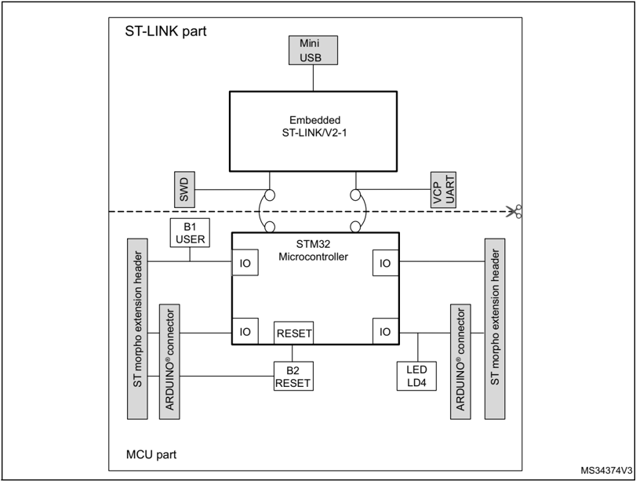

90

Figure 3. Top layout

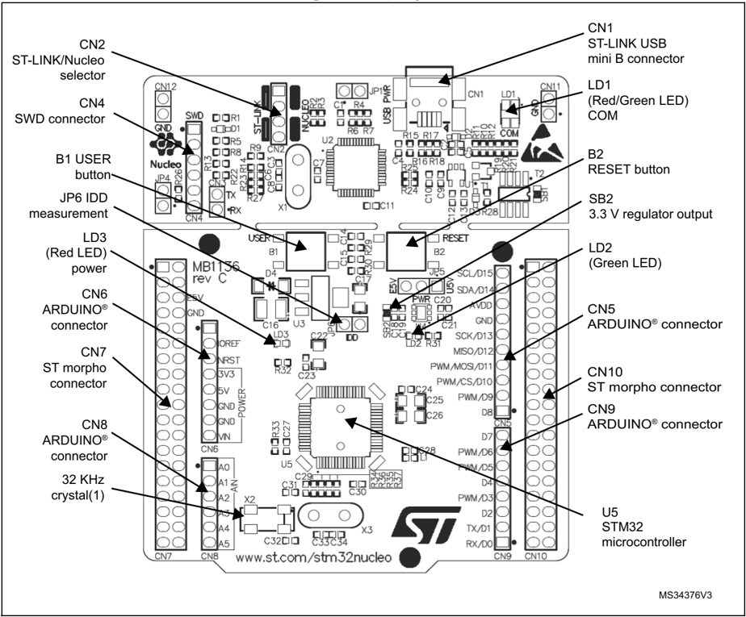

1. Crystal might be present or not depending on the board version. Refer to Section 7.9.2 .

Figure 4. Bottom layout

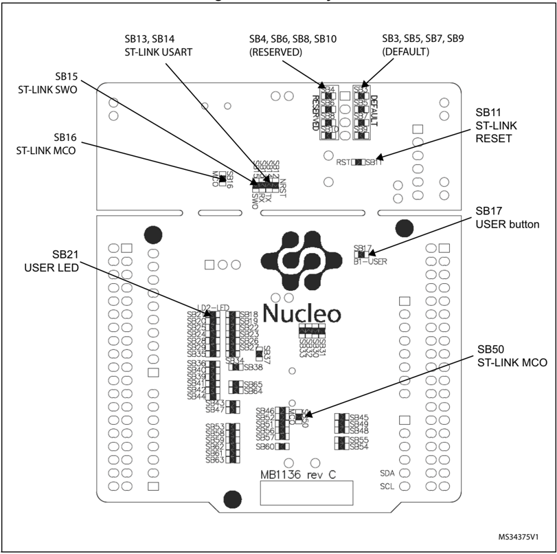

90

### 7.2 Mechanical dimensions

Figure 5. STM32 Nucleo board mechanical dimensions

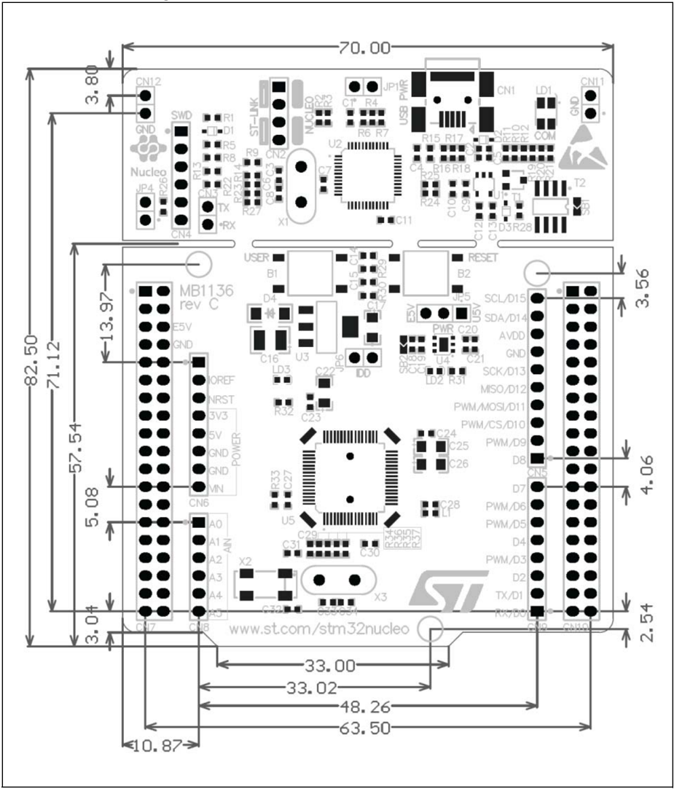

### 7.3 Pre-cut PCB

The STM32 Nucleo board is divided into two parts: the ST-LINK part and the target STM32 part. The ST-LINK part of the PCB can be cut out to reduce the board size. In this case, the remaining target STM32 part can only be powered by VIN, E5V, and +3.3V on the ST morpho connector CN7, or VIN and +3.3V on ARDUINO ®  connector CN6. It is still possible to use the ST-LINK part to program the main STM32 using wires between CN4 and SWD signals available on the ST morpho connector (SWCLK CN7 pin 15 and SWDIO CN7 pin 13).

### 7.4 Embedded ST-LINK/V2-1

The ST-LINK/V2-1 programming and debugging tool is integrated into the STM32 Nucleo board.

The embedded ST-LINK/V2-1 supports only SWD for STM32 devices. For information about debugging and programming features, refer to the user manual ST-LINK/V2 in-circuit debugger/programmer for STM8 and STM32 (UM1075), which describes in detail all the STLINK/V2 features.

The changes versus the ST-LINK/V2 version are listed below.

- New features supported on ST-LINK/V2-1:
- -USB software re-enumeration
- -Virtual COM port interface on USB
- -Mass storage interface on USB
- -USB power management request for more than 100 mA power on USB
- Features not supported on ST-LINK/V2-1:
- -SWIM interface
- -Minimum supported application voltage limited to 3 V

There are two different ways to use the embedded ST-LINK/V2-1 depending on the jumper states (see Table 4 and Figure 7.4.1 ):

- Program/debug the on-board STM32 ( Section 7.4.2 )
- Program/debug an MCU in an external application board using a cable connected to SWD connector CN4 ( Section 7.4.5 ).

Table 4. Jumper states

| Jumper state         | Description                                                               |
|----------------------|---------------------------------------------------------------------------|
| Both CN2 jumpers ON  | ST-LINK/V2-1 functions enabled for on-board programming (default)         |
| Both CN2 jumpers OFF | ST-LINK/V2-1 functions enabled for external CN4 connector (SWD supported) |

90

#### 7.4.1 Driver

Before connecting the Nucleo-64 board to a Windows ®  PC via USB, a driver for STLINK/V2-1 must be installed. It can be downloaded from the www.st.com website.

In case the STM32 Nucleo-64 board is connected to the PC before installing the driver, the PC device manager might report some Nucleo interfaces as 'Unknown'.

To recover from this situation, after installing the dedicated driver, the association of 'Unknown' USB devices found on the STM32 Nucleo-64 board to this dedicated driver, must be updated in the device manager manually.

Note: It is recommended to proceed using a USB Composite Device, as shown in Figure 6.

Figure 6. Updating the list of drivers in the Device Manager

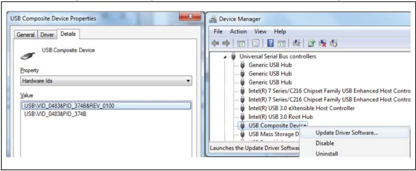

#### 7.4.2 ST-LINK/V2-1 firmware upgrade

The ST-LINK/V2-1 embeds a firmware upgrade mechanism for the in-situ upgrade through the USB port. As the firmware might evolve during the lifetime of the ST-LINK/V2-1 product (for example new functionality, bug fixes, support for new microcontroller families), it is recommended to visit www.st.com website before starting to use the STM32 Nucleo board and periodically, to stay updated with the latest firmware version.

#### 7.4.3 Mass storage interface

The ST-LINK/V2-1 provides an optional mass storage interface, allowing the user to program a target application (binary or hex file) through a virtual mass storage disk. The availability of this interface can be selected during the firmware upgrade, as detailed in the technical note Overview of ST-LINK derivatives (TN1235). Make sure that the host PC system (including antivirus applications) allows the mass storage disk before activating the interface.

#### 7.4.4 Using the ST-LINK/V2-1 to program and debug the STM32 on board

To program the STM32 on the board, plug in the two jumpers on CN2, as shown in red in Figure 7 . Do not use the CN4 connector as this could disturb communication with the STM32 microcontroller of the STM32 Nucleo board.

Figure 7. Connecting the STM32 Nucleo board to program the on-board STM32

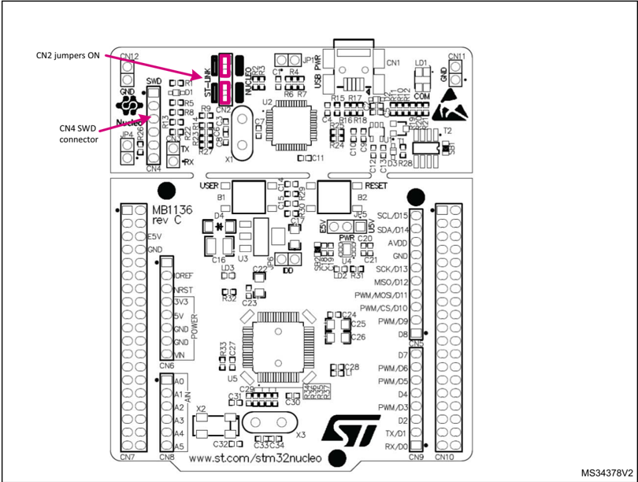

#### 7.4.5 Using ST-LINK/V2-1 to program and debug an external STM32 application

It is very easy to use the ST-LINK/V2-1 to program the STM32 on an external application. Simply remove the two jumpers from CN2 as illustrated in Figure 8: Using ST-LINK/V2-1 to program the STM32 on an external application , and connect the application to the CN4 debug connector according to Table 5 .

Note: SB12 NRST (target STM32 RESET) must be OFF if CN4 pin 5 is used in the external application.

90

Table 5. Debug connector CN4 (SWD)

|   Pin | CN4        | Designation           |
|-------|------------|-----------------------|
|     1 | VDD_TARGET | VDD from application  |
|     2 | SWCLK      | SWD clock             |
|     3 | GND        | ground                |
|     4 | SWDIO      | SWD data input/output |
|     5 | NRST       | RESET of target STM32 |
|     6 | SWO        | Reserved              |

Figure 8. Using ST-LINK/V2-1 to program the STM32 on an external application

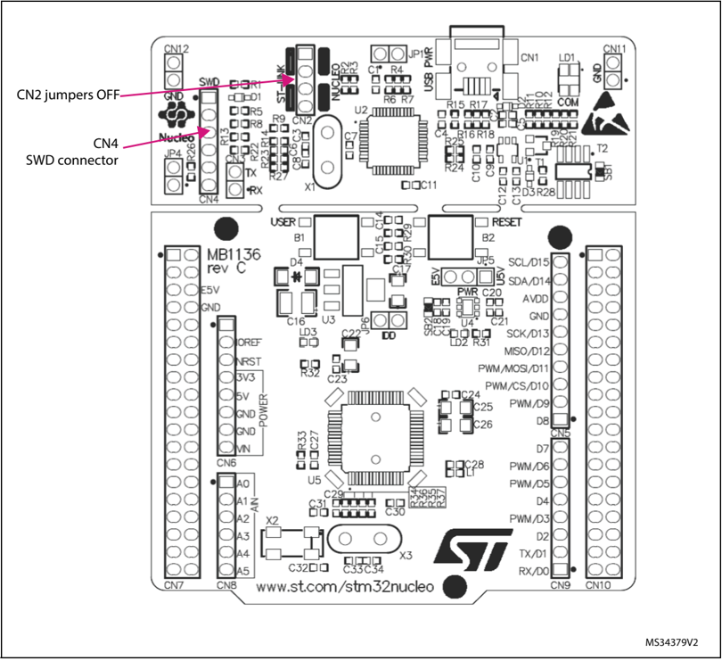

### 7.5 Power supply and power selection

The power supply is provided either by the host PC through the USB cable, or by an external source: VIN (From 7 V to 12 V), E5V (5 V), or +3.3V power supply pins on CN6 or CN7. In case VIN, E5V, or +3.3V is used to power the STM32 Nucleo board, using an external power supply unit or auxiliary equipment, this power source must comply with the standard EN-62368-1: 2014/A11:2017, and must be safety extralow voltage (SELV) with limited power capability.

#### 7.5.1 Power supply input from the USB connector

The ST-LINK/V2-1 supports USB power management allowing to request more than 100 mA current to the host PC.

All parts of the STM32 Nucleo board and shield can be powered from the ST-LINK USB connector CN1 (U5V or VBUS). Note that only the ST-LINK part is power supplied before the USB enumeration as the host PC only provides 100 mA to the board at that time. During the USB enumeration, the STM32 Nucleo board requires 300 mA of current to the host PC. If the host can provide the required power, the targeted STM32 microcontroller is powered and the red LED LD3 is turned ON, thus the STM32 Nucleo board and its shield can consume a maximum of 300 mA current, not more. If the host is not able to provide the required current, the targeted STM32 microcontroller and the MCU part including the extension board are not power supplied. As a consequence, the red LED LD3 remains turned OFF. In such a case it is mandatory to use an external power supply as explained in the next Section 7.5.2: External power supply inputs: VIN and E5V .

When the board is power supplied by USB (U5V) a jumper must be connected between pin 1 and pin 2 of JP5 as shown in Table 8 .

JP1 is configured according to the maximum current consumption of the board when powered by USB (U5V). JP1 jumper can be set in case the board is powered by USB and maximum current consumption on U5V does not exceed 100 mA (including an eventual extension board or ARDUINO ®  shield). In such a condition, USB enumeration always succeeds since no more than 100 mA is requested from the PC. Possible configurations of JP1 are summarized in Table 6 .

Table 6. JP1 configuration table

| Jumper state   | Power supply          | Allowed current   |
|----------------|-----------------------|-------------------|
| JP1 jumper OFF | USB power through CN1 | 300 mA max        |
| JP1 jumper ON  | USB power through CN1 | 100 mA max        |

##### Warning:

If the maximum current consumption of the NUCLEO and its extension boards exceeds 300 mA, it is mandatory to power the NUCLEO using an external power supply connected to E5V or VIN.

In case the board is powered by a USB charger, there is no USB enumeration, so the led LD3 remains set to OFF permanently and the target STM32 is not powered. In this specific case, the jumper JP1 needs to be set to ON, to allow target STM32 to be powered anyway.

Note:

90

#### 7.5.2 External power supply inputs: VIN and E5V

The external power sources VIN and E5V are summarized in Table 7. When the board is power supplied by VIN or E5V, the jumper configuration must be the following:

- Jumper on JP5 pin 2 and pin 3
- Jumper removed on JP1

Table 7. External power sources

| Input power name   | Connectors pins      | Voltage range    | Max current   | Limitation                                                                                                                                                                                                |
|--------------------|----------------------|------------------|---------------|-----------------------------------------------------------------------------------------------------------------------------------------------------------------------------------------------------------|
| VIN                | CN6 pin 8 CN7 pin 24 | 7 V to 12 V      | 800 mA        | From 7 V to 12 V only and input current capability is linked to input voltage: 800 mA input current when Vin = 7 V 450 mA input current when 7 V < Vin <= 9 V 250 mA input current when 9 V < Vin <= 12 V |
| E5V                | CN7 pin 6            | 4.75 V to 5.25 V | 500 mA        | -                                                                                                                                                                                                         |

Table 8. Power-related jumper

| Jumper   | Description                                                                                   | Description                                                                                   |
|----------|-----------------------------------------------------------------------------------------------|-----------------------------------------------------------------------------------------------|
| JP5      | U5V (ST-LINK VBUS) is used as a power source when JP5 is set as shown below (Default setting) | U5V (ST-LINK VBUS) is used as a power source when JP5 is set as shown below (Default setting) |
| JP5      |                                                                                               | 1 2 3 E5V U5V                                                                                 |
| JP5      | VIN or E5V is used as a power source when JP5 is set as shown below.                          | VIN or E5V is used as a power source when JP5 is set as shown below.                          |
| JP5      |                                                                                               | 1 2 3 E5V U5V                                                                                 |

##### Using VIN or E5V as an external power supply

VIN or E5V can be used as an external power supply in case the current consumption of the STM32 Nucleo and extensions boards exceeds the allowed current on USB. In this condition, it is still possible to use the USB for communication, programming, or debugging only, but it is mandatory to power supply the board first using VIN or E5V and then connect the USB cable to the PC. Proceeding this way ensures that the enumeration occurs thanks to the external power source.

The following power sequence procedure must be respected:

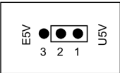

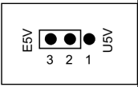

1. Connect the jumper between pin 2 and pin 3 of JP5
2. Check that JP1 is removed
3. Connect the external power source to VIN or E5V
4. Power on the external power supply 7 V&lt; VIN &lt; 12 V to VIN, or 5 V for E5V
5. Check that LD3 is turned ON
6. Connect the PC to USB connector CN1

If this order is not respected, the board might be supplied by VBUS first then by VIN or E5V, and the following risks might be encountered:

1. If more than 300 mA current is needed by the board, the PC might be damaged or the current supply can be limited by the PC. As a consequence, the board is not powered correctly.
2. 300 mA is requested at enumeration (since JP1 must be OFF) so there is a risk that the request is rejected and the enumeration does not succeed if the PC cannot provide such current. Consequently, the board is not power supplied (LED LD3 remains OFF).

#### 7.5.3 External power supply input: +3.3V

It can be of interest to use the +3.3V (CN6 pin 4 or CN7 pin 12 and pin 16) directly as power input for instance in case the 3.3V is provided by an extension board. When the STM32 Nucleo board is power supplied by +3.3V, the ST-LINK is not powered, thus the programming and debug features are unavailable. The +3.3V external power source is summarized in Table 9.

Table 9. +3.3 V external power source

| Input power name   | Connectors pins                 | Voltage range   | Limitation                                                       |
|--------------------|---------------------------------|-----------------|------------------------------------------------------------------|
| +3.3V              | CN6 pin 4 CN7 pin 12 and pin 16 | 3 V to 3.6 V    | Used when the ST-LINK part of the PCB is cut or SB2 and SB12 OFF |

Two different configurations are possible when using +3.3V to power the board:

- ST-LINK is removed (PCB cut) or
- SB2 (3.3V regulator) and SB12 (NRST) are OFF.

#### 7.5.4 External power supply output

When powered by USB, VIN, or E5V, the +5V (CN6 pin 5 or CN7 pin 18) can be used as an output power supply for an ARDUINO ®  shield or an extension board. In this case, the maximum current of the power source specified in Table 7 must be respected.

The +3.3V (CN6 pin 4 or CN7 pin 12 and 16) can be used also as power supply output. The current is limited by the maximum current capability of the regulator U4 (500 mA max).

90

### 7.6 LEDs

The tricolor LED (green, orange, red) LD1 (COM) provides information about ST-LINK communication status. LD1 default color is red. LD1 turns to green to indicate that communication is in progress between the PC and the ST-LINK/V2-1, with the following setup:

- Slow blinking Red/Off: at power-on before USB initialization
- Fast blinking Red/Off: after the first correct communication between the PC and ST-LINK/V2-1 (enumeration)
- Red LED On: when the initialization between the PC and ST-LINK/V2-1 is complete
- Green LED On: after a successful target communication initialization
- Blinking Red/Green: during communication with the target
- Green On: communication finished and successful
- Orange On: Communication failure

User LD2 : the green LED is a user LED connected to ARDUINO ®  signal D13 corresponding to STM32 I/O PA5 (pin 21) or PB13 (pin 34) depending on the STM32 target. Refer to Table 11 to Table 23 when:

- the I/O is HIGH value, the LED is on
- the I/O is LOW, the LED is off

LD3 PWR : the red LED indicates that the STM32 part is powered and +5V power is available.

### 7.7 Push-buttons

B1 USER : the user button is connected to the I/O PC13 (pin 2) of the STM32 microcontroller.

B2 RESET : this push-button is connected to NRST, and is used to RESET the STM32 microcontroller.

Note: The blue and black plastic hats that are placed on the push-buttons can be removed if necessary, for example, when a shield or an application board is plugged into the top of the Nucleo board. This will avoid pressure on the buttons and consequently a possible permanent target STM32 RESET.

### 7.8 JP6 (IDD)

Jumper JP6, labeled IDD, is used to measure the STM32 microcontroller consumption by removing the jumper and connecting an ammeter:

- Jumper ON: STM32 microcontroller is powered (default).
- Jumper OFF: an ammeter must be connected to measure the STM32 microcontroller current. If there is no ammeter, the STM32 microcontroller is not powered.

### 7.9 OSC clock

#### 7.9.1 OSC clock supply

There are four ways to configure the pins corresponding to the external high-speed clock (HSE):

- MCO from ST-LINK : MCO output of ST-LINK MCU is used as an input clock. This frequency cannot be changed, it is fixed at 8 MHz and connected to PF0/PD0/PH0-OSC_IN of the STM32 microcontroller.

The following configuration is needed:

- -SB55 OFF and SB54 ON
- -SB16 and SB50 ON
- -R35 and R37 removed
- HSE oscillator on-board from X3 crystal (not provided): for typical frequencies and its capacitors and resistors, refer to the STM32 microcontroller datasheet. Refer to the AN2867 Application note for oscillator design guide for STM32 microcontrollers.The X3 crystal has the following characteristics: 8 MHz, 16 pF, 20 ppm, and DIP footprint. It is recommended to use 9SL8000016AFXHF0 manufactured by Hong Kong X'tals Limited.

The following configuration is needed:

- -SB54 and SB55 OFF
- -R35 and R37 soldered
- -C33 and C34 soldered with 20 pF capacitors
- -SB16 and SB50 OFF
- Oscillator from external PF0/PD0/PH0 : from an external oscillator through pin 29 of the CN7 connector.

The following configuration is needed:

- -SB55 ON
- -SB50 OFF
- -R35 and R37 removed
- HSE not used : PF0/PD0/PH0 and PF1/PD1/PH1 are used as GPIOs instead of clocks

The following configuration is needed:

- -SB54 and SB55 ON
- -SB16 and SB50 (MCO) OFF
- -R35 and R37 removed

There are two possible default configurations of the HSE pins, depending on the version of the STM32 Nucleo board hardware.

The board version MB1136 C-01 or MB1136 C-02 is mentioned on the sticker, placed on the bottom side of the PCB.

The board marking MB1136 C-01 corresponds to a board, configured as HSE not used.

The board marking MB1136 C-02 (or higher) corresponds to a board, configured to use ST-LINK MCO as the clock input.

90

Note:

For NUCLEO-L476RG and NUCLEO-L452RE the ST-LINK MCO output is not connected to OSCIN to reduce power consumption in low power mode. Consequently, NUCLEO-L476RG and NUCLEO-L452RE configurations correspond to HSE not used.

#### 7.9.2 OSC 32 KHz clock supply

There are three ways to configure the pins corresponding to the low-speed clock (LSE):

- On-board oscillator: X2 crystal. Refer to the Oscillator design guide for STM8S, STM8A and STM32 microcontrollers application note ( AN2867) for oscillator design guide for STM32 microcontrollers. It is recommended to use ABS25-32.768KHZ-6-T, manufactured by Abracon Corporation.
- Oscillator from external PC14 : from external oscillator through the pin 25 of CN7 connector.

The following configuration is needed:

- -SB48 and SB49 ON
- -R34 and R36 removed
- LSE not used : PC14 and PC15 are used as GPIOs instead of low-speed clocks.

The following configuration is needed:

- -SB48 and SB49 ON
- -R34 and R36 removed

There are three possible default configurations of the LSE depending on the version of the STM32 Nucleo board hardware.

The board version MB1136 C-01 or MB1136 C-02 is mentioned on the sticker placed on the bottom side of the PCB.

The board marking MB1136 C-01 corresponds to a board configured as LSE not used.

The board marking MB1136 C-02 (or higher) corresponds to a board configured with an onboard 32 KHz oscillator.

The board marking MB1136 C-03 (or higher) corresponds to a board using a new LSE crystal (ABS25) and C26, C31, and C32 value update.

### 7.10 USART communication

The USART2 interface available on PA2 and PA3 of the STM32 microcontroller can be connected to ST-LINK MCU, ST morpho connector, or ARDUINO ®  connector. The choice can be changed by setting the related solder bridges. By default, the USART2 communication between the target STM32 and ST-LINK MCU is enabled, to support virtual COM port (SB13 and SB14 ON, SB62 and SB63 OFF). If the communication between the target STM32 PA2 (D1) or PA3 (D0) and shield or extension board is required, SB62 and SB63 must be ON, while SB13 and SB14 must be OFF. In such a case, it is possible to connect another USART to the ST-LINK MCU using flying wires between the ST morpho connector and CN3. For instance, on NUCLEO-F103RB it is possible to use USART3 available on PC10 (TX) and PC11 (RX). Two flying wires need to be connected as follows:

- PC10 (USART3_TX) available on CN7 pin 1 to CN3 pin RX
- PC11 (USART3_RX) available on CN7 pin 2 to CN3 pin TX

### 7.11 Solder bridges

Table 10. Solder bridges

| Bridge                       | State (1)   | Description                                                                                                                                                           |
|------------------------------|-------------|-----------------------------------------------------------------------------------------------------------------------------------------------------------------------|
| SB54, SB55 (X3 crystal) (2)  | OFF         | X3, C33, C34, R35, and R37 provide a clock as shown in electrical schematics PF0/PD0/PH0, PF1/PD1/PH1 are disconnected from CN7.                                      |
| SB54, SB55 (X3 crystal) (2)  | ON          | PF0/PD0/PH0 and PF1/PD1/PH1 are connected to CN7. (R35, R37, and SB50 must not be fitted).                                                                            |
| SB3, SB5, SB7,SB9 (DEFAULT)  | ON          | Reserved, do not modify.                                                                                                                                              |
| SB4,SB6, SB8,SB10 (RESERVED) | OFF         | Reserved, do not modify.                                                                                                                                              |
| SB48, SB49 (X2 crystal) (3)  | OFF         | X2, C31, C32, R34, and R36 deliver a 32 KHz clock. PC14 and PC15 are not connected to CN7.                                                                            |
| SB48, SB49 (X2 crystal) (3)  | ON          | PC14 and PC15 are only connected to CN7. Remove only R34 and R36.                                                                                                     |
| SB17 (B1-USER)               | ON          | B1 push button is connected to PC13.                                                                                                                                  |
| SB17 (B1-USER)               | OFF         | B1 push button is not connected to PC13.                                                                                                                              |
| SB12 (NRST)                  | ON          | The NRST signal of the CN4 connector is connected to the NRST pin of the STM32.                                                                                       |
| SB12 (NRST)                  | OFF         | The NRST signal of the CN4 connector is not connected to the NRST pin of the STM32.                                                                                   |
| SB15 (SWO)                   | ON          | The SWO signal of the CN4 connector is connected to PB3.                                                                                                              |
| SB15 (SWO)                   | OFF         | The SWO signal is not connected.                                                                                                                                      |
| SB11 (STM_RST)               | OFF         | No incidence on STM32F103CBT6 (ST-LINK MCU) NRST signal.                                                                                                              |
| SB11 (STM_RST)               | ON          | STM32F103CBT6 (ST-LINK MCU) NRST signal is connected to GND.                                                                                                          |
| SB1 (USB-5V)                 | OFF         | USB power management is functional.                                                                                                                                   |
| SB1 (USB-5V)                 | ON          | USB power management is disabled.                                                                                                                                     |
| SB2 (3.3 V)                  | ON          | Output of voltage regulator LD39050PU33R is connected to 3.3V.                                                                                                        |
| SB2 (3.3 V)                  | OFF         | Output of voltage regulator LD39050PU33R is not connected.                                                                                                            |
| SB21 (LD2-LED)               | ON          | Green user LED LD2 is connected to D13 of ARDUINO ® signal.                                                                                                           |
| SB21 (LD2-LED)               | OFF         | Green user LED LD2 is not connected.                                                                                                                                  |
| SB56,SB51 (A4 and A5)        | ON          | PC1 and PC0 (ADC in) are connected to A4 and A5 (pin 5 and pin 6) on ARDUINO ® connector CN8 and ST morpho connector CN7. Thus SB46 and SB52 must be OFF.             |
| SB56,SB51 (A4 and A5)        | OFF         | PC1 and PC0 (ADC in) are disconnected to A4 and A5 (pin 5 and pin 6) on ARDUINO ® connector CN8 and ST morpho connector CN7.                                          |
| SB46,SB52 (I2C on A4 and A5) | OFF         | PB9 and PB8 (I2C) are disconnected to A4 and A5 (pin 5 and pin 6) on ARDUINO ® connector CN8 and ST morpho connector CN7.                                             |
| SB46,SB52 (I2C on A4 and A5) | ON          | PB9 and PB8 (I2C) are connected to A4 and A5 (pin 5 and pin 6) on ARDUINO ® connector CN8 and ST morpho connector CN7 as I2C signals. Thus SB56 and SB51 must be OFF. |

90

Table 10. Solder bridges (continued)

| Bridge                     | State (1)   | Description                                                                                                                                                                 |
|----------------------------|-------------|-----------------------------------------------------------------------------------------------------------------------------------------------------------------------------|
| SB45 (VBAT/VLCD)           | ON          | VBAT or VLCD on STM32 is connected to VDD.                                                                                                                                  |
| SB45 (VBAT/VLCD)           | OFF         | VBAT or VLCD on STM32 is not connected to VDD.                                                                                                                              |
| SB57 (VDDA/VREF+)          | ON          | VDDA/VREF+ on STM32 is connected to VDD.                                                                                                                                    |
| SB57 (VDDA/VREF+)          | OFF         | VDDA/VREF+ on STM32 is not connected to VDD and can be provided from pin 8 of CN5 (Used for external VREF+ provided by ARDUINO ® shield)                                    |
| SB62, SB63 (USART)         | OFF         | PA2 and PA3 on STM32 are disconnected to D1 and D0 (pin 2 and pin 1) on ARDUINO ® connector CN9 and ST morpho connector CN10.                                               |
| SB62, SB63 (USART)         | ON          | PA2 and PA3 on STM32 are connected to D1 and D0 (pin 2 and pin 1) on ARDUINO ® connector CN9 and ST morpho connector CN10 as USART signals. Thus SB13 and SB14 must be OFF. |
| SB13, SB14 (ST-LINK-USART) | ON          | PA2 and PA3 on STM32F103CBT6 (ST-LINK MCU) are connected to PA3 and PA2 on STM32 to have USART communication between them. Thus SB61, SB62, and SB63 must be OFF.           |
| SB13, SB14 (ST-LINK-USART) | OFF         | PA2 and PA3 on STM32F103CBT6 (ST-LINK MCU) are disconnected to PA3 and PA2 on STM32.                                                                                        |
| SB16,SB50(MCO) (2)         | OFF         | MCO on STM32F103CBT6 (ST-LINK MCU) are disconnected to PF0/PD0/PH0 on STM32.                                                                                                |
| SB16,SB50(MCO) (2)         | ON          | MCO on STM32F103CBT6 (ST-LINK MCU) are connected to PF0/PD0/PH0 on STM32.                                                                                                   |

2. The default configuration depends on the board version. Refer to Section 7.9.1: OSC clock supply for details.
3. The default configuration depends on the board version. Refer to Section 7.9.2: OSC 32 KHz clock supply for details.

All the other solder bridges present on the STM32 Nucleo board are used to configure several I/Os and power supply pins for compatibility of features and pinout with STM32 supported.

All STM32 Nucleo boards are delivered with the solder-bridges configured according to the target supported STM32.

### 7.12 Extension connectors

Figure 9 to Figure 25 show the signals connected by default to ARDUINO ®  Uno V3 connectors (CN5, CN6, CN8, CN9) and to ST morpho connector (CN7 and CN10), for each STM32 Nucleo board.

Figure 9. NUCLEO-F030R8

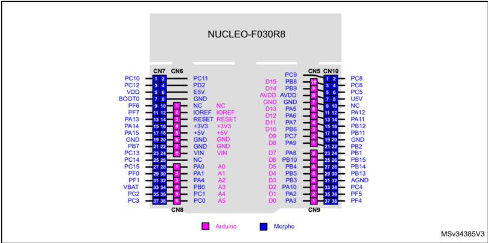

Figure 10. NUCLEO-F070RB

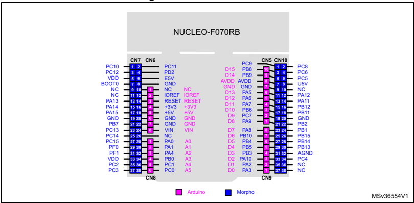

90

Figure 11. NUCLEO-F072RB

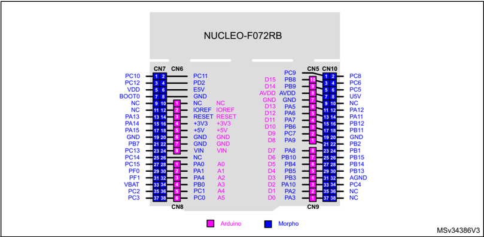

Figure 12. NUCLEO-F091RC

Figure 13. NUCLEO-F103RB

Figure 14. NUCLEO-F302R8

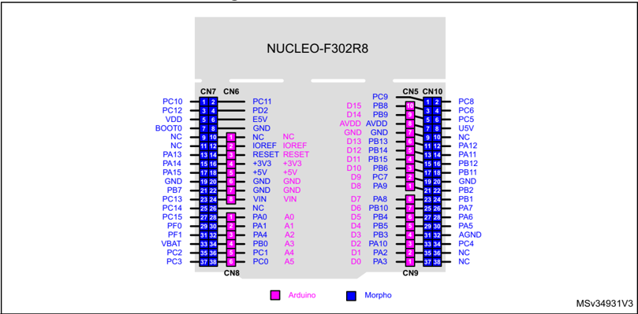

90

Figure 15. NUCLEO-F303RE

Figure 16. NUCLEO-F334R8

Figure 17. NUCLEO-F401RE

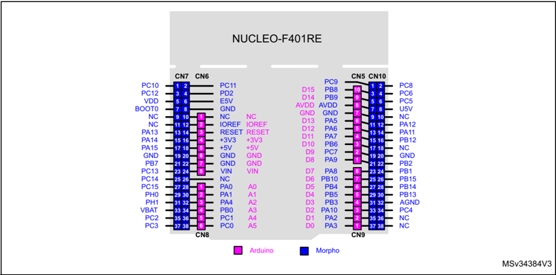

Figure 18. NUCLEO-F411RE

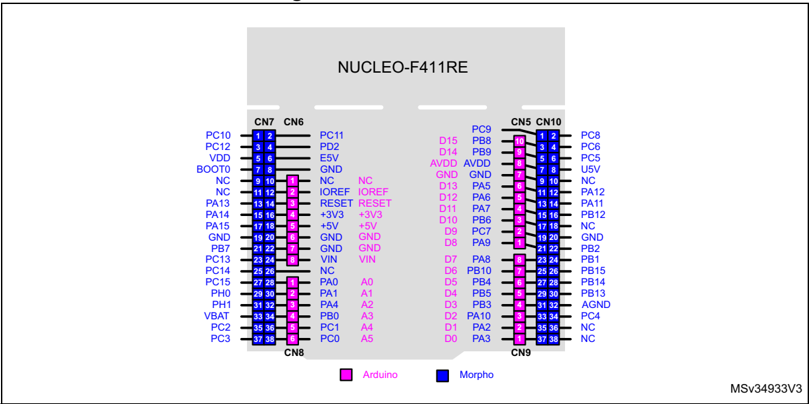

90

Figure 19. NUCLEO-L053R8

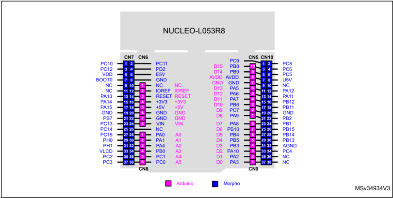

Figure 20. NUCLEO-L073RZ and NUCLEO-L010RB

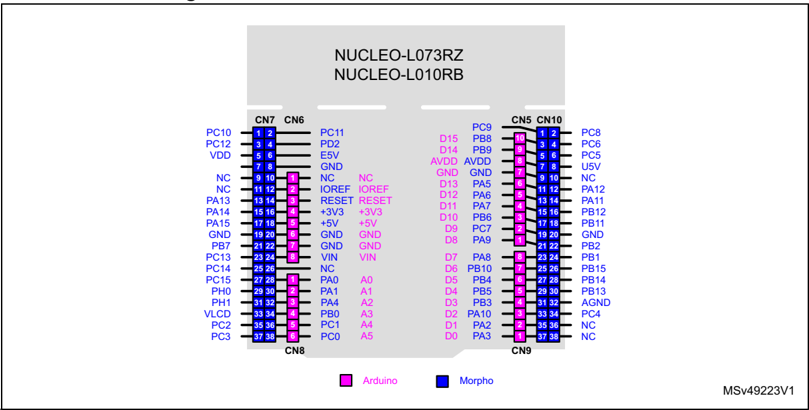

Figure 21. NUCLEO-L152RE

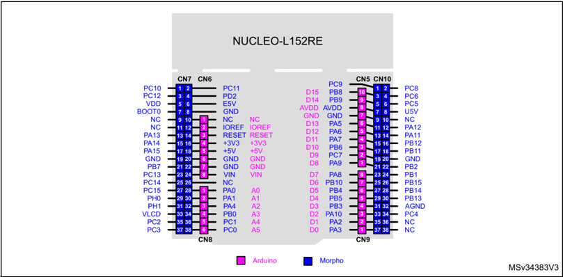

Figure 22. NUCLEO-L452RE

90

Figure 23. NUCLEO-L476RG

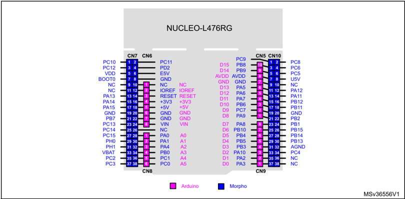

Figure 24. NUCLEO-F446RE

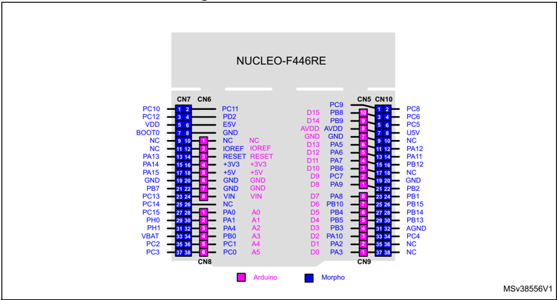

Figure 25. NUCLEO-F410RB

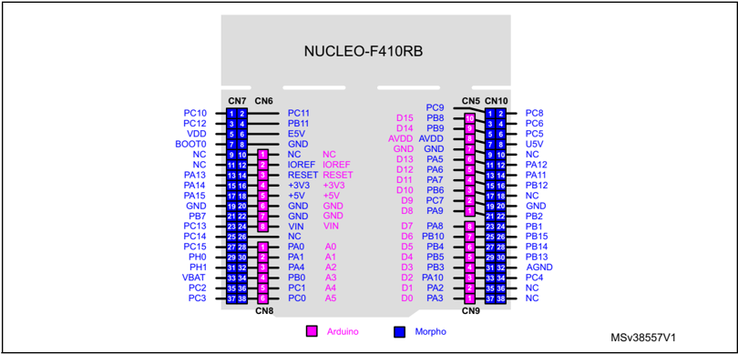

90

### 7.13 ARDUINO ®  connectors

CN5, CN6, CN8, and CN9 are female connectors compatible with ARDUINO ®  standard. Most shields designed for ARDUINO ®  can fit the STM32 Nucleo boards.

The ARDUINO ®  connectors on the STM32 Nucleo board support the ARDUINO ®  Uno V3.

For compatibility with ARDUINO ®  Uno V1, apply the following modifications:

- SB46 and SB52 must be ON,
- SB51 and SB56 must be OFF to connect I 2 C on A4 (pin 5) and A5 (pin 6 of CN8).
- Caution 1: The I/Os of the STM32 microcontroller are 3.3 V compatible instead of 5 V for ARDUINO ® Uno V3.
- Caution 2: SB57 must be removed before implementing the ARDUINO ®  shield with VREF+ power being          provided on CN5 pin 8. Refer to Table 10: Solder bridges for details on SB57.

Table 11 to Table 23 show the pin assignment of each main STM32 microcontroller on ARDUINO ®  connectors.

Table 11. ARDUINO ®  connectors on NUCLEO-F030R8, NUCLEO-F070RB, NUCLEO-F072RB, NUCLEO-F091RC

| Connector        | Pin              | Pin name         | STM32 pin        | Function                         |
|------------------|------------------|------------------|------------------|----------------------------------|
| Left connectors  | Left connectors  | Left connectors  | Left connectors  | Left connectors                  |
| CN6 power        | 1                | NC               | -                | -                                |
| CN6 power        | 2                | IOREF            | -                | 3.3V Ref                         |
| CN6 power        | 3                | RESET            | NRST             | RESET                            |
| CN6 power        | 4                | +3.3V            | -                | 3.3V input/output                |
| CN6 power        | 5                | +5V              | -                | 5V output                        |
| CN6 power        | 6                | GND              | -                | ground                           |
| CN6 power        | 7                | GND              | -                | ground                           |
| CN6 power        | 8                | VIN              | -                | Power input                      |
| CN8 analog       | 1                | A0               | PA0              | ADC_IN0                          |
| CN8 analog       | 2                | A1               | PA1              | ADC_IN1                          |
| CN8 analog       | 3                | A2               | PA4              | ADC_IN4                          |
| CN8 analog       | 4                | A3               | PB0              | ADC_IN8                          |
| CN8 analog       | 5                | A4               | PC1 or PB9 (1)   | ADC_IN11 (PC1) or I2C1_SDA (PB9) |
| CN8 analog       | 6                | A5               | PC0 or PB8 (1)   | ADC_IN10 (PC0) or I2C1_SCL (PB8) |
| Right connectors | Right connectors | Right connectors | Right connectors | Right connectors                 |
| CN5 digital      | 10               | D15              | PB8              | I2C1_SCL                         |
| CN5 digital      | 9                | D14              | PB9              | I2C1_SDA                         |
| CN5 digital      | 8                | AREF             | -                | AVDD                             |
| CN5 digital      | 7                | GND              | -                | ground                           |

Table 11. ARDUINO ®  connectors on NUCLEO-F030R8, NUCLEO-F070RB, NUCLEO-F072RB, NUCLEO-F091RC (continued)

| Connector   |   Pin | Pin name   | STM32 pin   | Function               |
|-------------|-------|------------|-------------|------------------------|
| CN5 digital |     6 | D13        | PA5         | SPI1_SCK               |
| CN5 digital |     5 | D12        | PA6         | SPI1_MISO              |
| CN5 digital |     4 | D11        | PA7         | TIM17_CH1 or SPI1_MOSI |
| CN5 digital |     3 | D10        | PB6         | TIM16_CH1N or SPI1_CS  |
| CN5 digital |     2 | D9         | PC7         | TIM3_CH2               |
| CN5 digital |     1 | D8         | PA9         | -                      |
| CN9 digital |     8 | D7         | PA8         | -                      |
| CN9 digital |     7 | D6         | PB10        | TIM2_CH3 (2)           |
| CN9 digital |     6 | D5         | PB4         | TIM3_CH1               |
| CN9 digital |     5 | D4         | PB5         | -                      |
| CN9 digital |     4 | D3         | PB3         | TIM2_CH2 (3)           |
| CN9 digital |     3 | D2         | PA10        | -                      |
| CN9 digital |     2 | D1         | PA2         | USART2_TX              |
| CN9 digital |     1 | D0         | PA3         | USART2_RX              |

2. PWM is not supported by D6 on STM32F030 and STM32F070 since the timer is not available on PB10.

3. PWM is not supported by D3 on STM32F030 and STM32F070 since the timer is not available on PB3.

90

Table 12. ARDUINO ®  connectors on NUCLEO-F103RB

| Connector        | Pin              | Pin name         | STM32 pin        | Function                       |
|------------------|------------------|------------------|------------------|--------------------------------|
| Left connectors  | Left connectors  | Left connectors  | Left connectors  | Left connectors                |
| CN6 power        | 1                | NC               | -                | -                              |
| CN6 power        | 2                | IOREF            | -                | 3.3V Ref                       |
| CN6 power        | 3                | RESET            | NRST             | RESET                          |
| CN6 power        | 4                | +3.3V            | -                | 3.3V input/output              |
| CN6 power        | 5                | +5V              |                  | 5V output                      |
| CN6 power        | 6                | GND              |                  | ground                         |
| CN6 power        | 7                | GND              |                  | ground                         |
| CN6 power        | 8                | VIN              |                  | Power input                    |
| CN8 analog       | 1                | A0               | PA0              | ADC_0                          |
| CN8 analog       | 2                | A1               | PA1              | ADC_1                          |
| CN8 analog       | 3                | A2               | PA4              | ADC_4                          |
| CN8 analog       | 4                | A3               | PB0              | ADC_8                          |
| CN8 analog       | 5                | A4               | PC1 or PB9 (1)   | ADC_11 (PC1) or I2C1_SDA (PB9) |
| CN8 analog       | 6                | A5               | PC0 or PB8 (1)   | ADC_10 (PC0) or I2C1_SCL (PB8) |
| Right connectors | Right connectors | Right connectors | Right connectors | Right connectors               |
| CN5 digital      | 10               | D15              | PB8              | I2C1_SCL                       |
| CN5 digital      | 9                | D14              | PB9              | I2C1_SDA                       |
| CN5 digital      | 8                | AREF             |                  | AVDD                           |
| CN5 digital      | 7                | GND              | -                | ground                         |
| CN5 digital      | 6                | D13              | PA5              | SPI1_SCK                       |
| CN5 digital      | 5                | D12              | PA6              | SPI1_MISO                      |
| CN5 digital      | 4                | D11              | PA7              | TIM3_CH2 or SPI1_MOSI          |
| CN5 digital      | 3                | D10              | PB6              | TIM4_CH1 or SPI1_CS            |
| CN5 digital      | 2                | D9               | PC7              | TIM3_CH2                       |
| CN5 digital      | 1                | D8               | PA9              | -                              |
| CN9 digital      | 8                | D7               | PA8              |                                |
| CN9 digital      | 7                | D6               | PB10             | TIM2_CH3                       |
| CN9 digital      | 6                | D5               | PB4              | TIM3_CH1                       |
| CN9 digital      | 5                | D4               | PB5              | -                              |
| CN9 digital      | 4                | D3               | PB3              | TIM2_CH2                       |
| CN9 digital      | 3                | D2               | PA10             | -                              |
| CN9 digital      | 2                | D1               | PA2              | USART2_TX                      |
| CN9 digital      | 1                | D0               | PA3              | USART2_RX                      |

1. Refer to Table 10: Solder bridges for details.

Table 13. ARDUINO ®  connectors on NUCLEO-F302R8

| Connector        | Pin              | Pin name         | STM32 pin        | Function                        |
|------------------|------------------|------------------|------------------|---------------------------------|
| Left connectors  | Left connectors  | Left connectors  | Left connectors  | Left connectors                 |
| CN6 power        | 1                | NC               | -                | -                               |
| CN6 power        | 2                | IOREF            | -                | 3.3V Ref                        |
| CN6 power        | 3                | RESET            | NRST             | RESET                           |
| CN6 power        | 4                | +3.3V            | -                | 3.3V input/output               |
| CN6 power        | 5                | +5V              | -                | 5V output                       |
| CN6 power        | 6                | GND              | -                | ground                          |
| CN6 power        | 7                | GND              | -                | ground                          |
| CN6 power        | 8                | VIN              | -                | Power input                     |
| CN8 analog       | 1                | A0               | PA0              | ADC_IN1                         |
| CN8 analog       | 2                | A1               | PA1              | ADC_IN2                         |
| CN8 analog       | 3                | A2               | PA4              | ADC_IN5                         |
| CN8 analog       | 4                | A3               | PB0              | ADC_IN11                        |
| CN8 analog       | 5                | A4               | PC1 or PB9 (1)   | ADC_IN7 (PC1) or I2C1_SDA (PB9) |
| CN8 analog       | 6                | A5               | PC0 or PB8 (1)   | ADC_IN6 (PC0) or I2C1_SCL (PB8) |
| Right connectors | Right connectors | Right connectors | Right connectors | Right connectors                |
| CN5 digital      | 10               | D15              | PB8              | I2C1_SCL                        |
| CN5 digital      | 9                | D14              | PB9              | I2C1_SDA                        |
| CN5 digital      | 8                | AREF             | -                | AVDD                            |
| CN5 digital      | 7                | GND              | -                | ground                          |
| CN5 digital      | 6                | D13              | PB13             | SPI2_SCK                        |
| CN5 digital      | 5                | D12              | PB14             | SPI2_MISO                       |
| CN5 digital      | 4                | D11              | PB15             | TIM15_CH2 or SPI2_MOSI          |
| CN5 digital      | 3                | D10              | PB6              | TIM16_CH1N or SPI2_CS           |
| CN5 digital      | 2                | D9               | PC7              | -                               |
| CN5 digital      | 1                | D8               | PA9              | -                               |
| CN9 digital      | 8                | D7               | PA8              | -                               |
| CN9 digital      | 7                | D6               | PB10             | TIM2_CH3                        |
| CN9 digital      | 6                | D5               | PB4              | TIM16_CH1                       |
| CN9 digital      | 5                | D4               | PB5              | -                               |
| CN9 digital      | 4                | D3               | PB3              | TIM2_CH2                        |
| CN9 digital      | 3                | D2               | PA10             | -                               |
| CN9 digital      | 2                | D1               | PA2              | USART2_TX                       |
| CN9 digital      | 1                | D0               | PA3              | USART2_RX                       |

90

#### Warning: PWM is not supported by D9 on STM32F302 since the timer is not available on PC7.

Table 14. ARDUINO ®  connectors on NUCLEO-F303RE

| Connector        | Pin              | Pin name         | STM32 pin        | Function                          |
|------------------|------------------|------------------|------------------|-----------------------------------|
| Left connectors  | Left connectors  | Left connectors  | Left connectors  | Left connectors                   |
| CN6 power        | 1                | NC               | -                | -                                 |
| CN6 power        | 2                | IOREF            | -                | 3.3V Ref                          |
| CN6 power        | 3                | RESET            | NRST             | RESET                             |
| CN6 power        | 4                | +3.3V            | -                | 3.3V input/output                 |
| CN6 power        | 5                | +5V              | -                | 5V output                         |
| CN6 power        | 6                | GND              | -                | ground                            |
| CN6 power        | 7                | GND              | -                | ground                            |
| CN6 power        | 8                | VIN              | -                | Power input                       |
| CN8 analog       | 1                | A0               | PA0              | ADC1_IN1                          |
| CN8 analog       | 2                | A1               | PA1              | ADC1_IN2                          |
| CN8 analog       | 3                | A2               | PA4              | ADC2_IN1                          |
| CN8 analog       | 4                | A3               | PB0              | ADC3_IN12                         |
| CN8 analog       | 5                | A4               | PC1 or PB9 (1)   | ADC12_IN7 (PC1) or I2C1_SDA (PB9) |
| CN8 analog       | 6                | A5               | PC0 or PB8 (1)   | ADC12_IN6 (PC0) or I2C1_SCL (PB8) |
| Right connectors | Right connectors | Right connectors | Right connectors | Right connectors                  |
| CN5 digital      | 10               | D15              | PB8              | I2C1_SCL                          |
| CN5 digital      | 9                | D14              | PB9              | I2C1_SDA                          |
| CN5 digital      | 8                | AREF             | -                | AVDD                              |
| CN5 digital      | 7                | GND              | -                | ground                            |
| CN5 digital      | 6                | D13              | PA5              | SPI1_SCK                          |
| CN5 digital      | 5                | D12              | PA6              | SPI1_MISO                         |
| CN5 digital      | 4                | D11              | PA7              | TIM17_CH1 or SPI1_MOSI            |
| CN5 digital      | 3                | D10              | PB6              | TIM4_CH1 or SPI1_CS               |
| CN5 digital      | 2                | D9               | PC7              | TIM3_CH2                          |
| CN5 digital      | 1                | D8               | PA9              | -                                 |

Table 14. ARDUINO ®  connectors on NUCLEO-F303RE (continued)

| Connector   |   Pin | Pin name   | STM32 pin   | Function   |
|-------------|-------|------------|-------------|------------|
| CN9 digital |     8 | D7         | PA8         | -          |
| CN9 digital |     7 | D6         | PB10        | TIM2_CH3   |
| CN9 digital |     6 | D5         | PB4         | TIM3_CH1   |
| CN9 digital |     5 | D4         | PB5         | -          |
| CN9 digital |     4 | D3         | PB3         | TIM2_CH2   |
| CN9 digital |     3 | D2         | PA10        | -          |
| CN9 digital |     2 | D1         | PA2         | USART2_TX  |

1. Refer to Table 10: Solder bridges for details.

Table 15. ARDUINO ®  connectors on NUCLEO-F334R8

| Connector        | Pin              | Pin name         | STM32 pin        | Function                        |
|------------------|------------------|------------------|------------------|---------------------------------|
| Left connectors  | Left connectors  | Left connectors  | Left connectors  | Left connectors                 |
| CN6 power        | 1                | NC               | -                | -                               |
| CN6 power        | 2                | IOREF            | -                | 3.3V Ref                        |
| CN6 power        | 3                | RESET            | NRST             | RESET                           |
| CN6 power        | 4                | +3.3V            | -                | 3.3V input/output               |
| CN6 power        | 5                | +5V              | -                | 5V output                       |
| CN6 power        | 6                | GND              | -                | ground                          |
| CN6 power        | 7                | GND              | -                | ground                          |
| CN6 power        | 8                | VIN              | -                | Power input                     |
| CN8 analog       | 1                | A0               | PA0              | ADC1_IN1                        |
| CN8 analog       | 2                | A1               | PA1              | ADC1_IN2                        |
| CN8 analog       | 3                | A2               | PA4              | ADC2_IN1                        |
| CN8 analog       | 4                | A3               | PB0              | ADC1_IN11                       |
| CN8 analog       | 5                | A4               | PC1 or PB9 (1)   | ADC_IN7 (PC1) or I2C1_SDA (PB9) |
| CN8 analog       | 6                | A5               | PC0 or PB8 (1)   | ADC_IN6 (PC0) or I2C1_SCL (PB8) |
| Right connectors | Right connectors | Right connectors | Right connectors | Right connectors                |
| CN5 digital      | 10               | D15              | PB8              | I2C1_SCL                        |
| CN5 digital      | 9                | D14              | PB9              | I2C1_SDA                        |
| CN5 digital      | 8                | AREF             | -                | AVDD                            |
| CN5 digital      | 7                | GND              | -                | ground                          |
| CN5 digital      | 6                | D13              | PA5              | SPI1_SCK                        |
| CN5 digital      | 5                | D12              | PA6              | SPI1_MISO                       |
| CN5 digital      | 4                | D11              | PA7              | TIM17_CH1 or SPI1_MOSI          |
| CN5 digital      | 3                | D10              | PB6              | TIM16_CH1N or SPI1_CS           |

90

Table 15. ARDUINO ®  connectors on NUCLEO-F334R8 (continued)

| Connector   |   Pin | Pin name   | STM32 pin   | Function   |
|-------------|-------|------------|-------------|------------|
| CN5 digital |     2 | D9         | PC7         | TIM3_CH2   |
| CN5 digital |     1 | D8         | PA9         | -          |
| CN9 digital |     8 | D7         | PA8         | -          |
| CN9 digital |     7 | D6         | PB10        | TIM2_CH3   |
| CN9 digital |     6 | D5         | PB4         | TIM3_CH1   |
| CN9 digital |     5 | D4         | PB5         | -          |
| CN9 digital |     4 | D3         | PB3         | TIM2_CH2   |
| CN9 digital |     3 | D2         | PA10        | -          |
| CN9 digital |     2 | D1         | PA2         | USART2_TX  |
| CN9 digital |     1 | D0         | PA3         | USART2_RX  |

1. Refer to Table 10: Solder bridges for details.

Table 16. ARDUINO ®  connectors on NUCLEO-F401RE and NUCLEO-F411RE

| Connector        | Pin              | Pin name         | STM32 pin        | Function                        |
|------------------|------------------|------------------|------------------|---------------------------------|
| Left connectors  | Left connectors  | Left connectors  | Left connectors  | Left connectors                 |
| CN6 power        | 1                | NC               | -                | -                               |
| CN6 power        | 2                | IOREF            | -                | 3.3V Ref                        |
| CN6 power        | 3                | RESET            | NRST             | RESET                           |
| CN6 power        | 4                | +3.3V            | -                | 3.3V input/output               |
| CN6 power        | 5                | +5V              | -                | 5V output                       |
| CN6 power        | 6                | GND              | -                | ground                          |
| CN6 power        | 7                | GND              | -                | ground                          |
| CN6 power        | 8                | VIN              | -                | Power input                     |
| CN8 analog       | 1                | A0               | PA0              | ADC1_0                          |
| CN8 analog       | 2                | A1               | PA1              | ADC1_1                          |
| CN8 analog       | 3                | A2               | PA4              | ADC1_4                          |
| CN8 analog       | 4                | A3               | PB0              | ADC1_8                          |
| CN8 analog       | 5                | A4               | PC1 or PB9 (1)   | ADC1_11 (PC1) or I2C1_SDA (PB9) |
| CN8 analog       | 6                | A5               | PC0 or PB8 (1)   | ADC1_10 (PC0) or I2C1_SCL (PB8) |
| Right connectors | Right connectors | Right connectors | Right connectors | Right connectors                |
| CN5 digital      | 10               | D15              | PB8              | I2C1_SCL                        |
| CN5 digital      | 9                | D14              | PB9              | I2C1_SDA                        |
| CN5 digital      | 8                | AREF             | -                | AVDD                            |
| CN5 digital      | 7                | GND              | -                | ground                          |

Table 16. ARDUINO ®  connectors on NUCLEO-F401RE and NUCLEO-F411RE (continued)

| Connector   |   Pin | Pin name   | STM32 pin   | Function               |
|-------------|-------|------------|-------------|------------------------|
| CN5 digital |     6 | D13        | PA5         | SPI1_SCK               |
| CN5 digital |     5 | D12        | PA6         | SPI1_MISO              |
| CN5 digital |     4 | D11        | PA7         | TIM1_CH1N or SPI1_MOSI |
| CN5 digital |     3 | D10        | PB6         | TIM4_CH1 or SPI1_CS    |
| CN5 digital |     2 | D9         | PC7         | TIM3_CH2               |
| CN5 digital |     1 | D8         | PA9         | -                      |
| CN9 digital |     8 | D7         | PA8         | -                      |
| CN9 digital |     7 | D6         | PB10        | TIM2_CH3               |
| CN9 digital |     6 | D5         | PB4         | TIM3_CH1               |
| CN9 digital |     5 | D4         | PB5         | -                      |
| CN9 digital |     4 | D3         | PB3         | TIM2_CH2               |
| CN9 digital |     3 | D2         | PA10        | -                      |
| CN9 digital |     2 | D1         | PA2         | USART2_TX              |
| CN9 digital |     1 | D0         | PA3         | USART2_RX              |

90

Table 17. ARDUINO ®  connectors on NUCLEO-L053R8

| Connector        | Pin              | Pin name         | STM32 pin        | Function                         |
|------------------|------------------|------------------|------------------|----------------------------------|
| Left connectors  | Left connectors  | Left connectors  | Left connectors  | Left connectors                  |
| CN6 power        | 1                | NC               | -                | -                                |
| CN6 power        | 2                | IOREF            | -                | 3.3V Ref                         |
| CN6 power        | 3                | RESET            | NRST             | RESET                            |
| CN6 power        | 4                | +3.3V            | -                | 3.3V input/output                |
| CN6 power        | 5                | +5V              | -                | 5V output                        |
| CN6 power        | 6                | GND              | -                | ground                           |
| CN6 power        | 7                | GND              | -                | ground                           |
| CN6 power        | 8                | VIN              | -                | Power input                      |
| CN8 analog       | 1                | A0               | PA0              | ADC_IN0                          |
| CN8 analog       | 2                | A1               | PA1              | ADC_IN1                          |
| CN8 analog       | 3                | A2               | PA4              | ADC_IN4                          |
| CN8 analog       | 4                | A3               | PB0              | ADC_IN8                          |
| CN8 analog       | 5                | A4               | PC1 or PB9 (1)   | ADC_IN11 (PC1) or I2C1_SDA (PB9) |
| CN8 analog       | 6                | A5               | PC0 or PB8 (1)   | ADC_IN10 (PC0) or I2C1_SCL (PB8) |
| Right connectors | Right connectors | Right connectors | Right connectors | Right connectors                 |
| CN5 digital      | 10               | D15              | PB8              | I2C1_SCL                         |
| CN5 digital      | 9                | D14              | PB9              | I2C1_SDA                         |
| CN5 digital      | 8                | AREF             | -                | AVDD                             |
| CN5 digital      | 7                | GND              | -                | ground                           |
| CN5 digital      | 6                | D13              | PA5              | SPI1_SCK                         |
| CN5 digital      | 5                | D12              | PA6              | SPI1_MISO                        |
| CN5 digital      | 4                | D11              | PA7              | TIM12_CH2 or SPI1_MOSI           |
| CN5 digital      | 3                | D10              | PB6              | SPI1_CS                          |
| CN5 digital      | 2                | D9               | PC7              | TIM12_CH2                        |
| CN5 digital      | 1                | D8               | PA9              | -                                |
| CN9 digital      | 8                | D7               | PA8              | -                                |
| CN9 digital      | 7                | D6               | PB10             | TIM2_CH3                         |
| CN9 digital      | 6                | D5               | PB4              | TIM12_CH1                        |
| CN9 digital      | 5                | D4               | PB5              | -                                |
| CN9 digital      | 4                | D3               | PB3              | TIM2_CH2                         |
| CN9 digital      | 3                | D2               | PA10             | -                                |
| CN9 digital      | 2                | D1               | PA2              | USART2_TX                        |
| CN9 digital      | 1                | D0               | PA3              | USART2_RX                        |

1. Refer to Table 10: Solder bridges for details.

#### Warning: PWM is not supported by D10 on STM32L053 since the timer is not

available on PB6.

Table 18. ARDUINO ®  connectors on NUCLEO-L010RB and NUCLEO-L073RZ

| Connector        | Pin              | Pin name         | STM32 pin        | Function                         |
|------------------|------------------|------------------|------------------|----------------------------------|
| Left connectors  | Left connectors  | Left connectors  | Left connectors  | Left connectors                  |
| CN6 power        | 1                | NC               | -                | -                                |
| CN6 power        | 2                | IOREF            | -                | 3.3V Ref                         |
| CN6 power        | 3                | RESET            | NRST             | RESET                            |
| CN6 power        | 4                | +3.3V            | -                | 3.3V input/output                |
| CN6 power        | 5                | +5V              | -                | 5V output                        |
| CN6 power        | 6                | GND              | -                | ground                           |
| CN6 power        | 7                | GND              | -                | ground                           |
| CN6 power        | 8                | VIN              | -                | Power input                      |
| CN8 analog       | 1                | A0               | PA0              | ADC_IN0                          |
| CN8 analog       | 2                | A1               | PA1              | ADC_IN1                          |
| CN8 analog       | 3                | A2               | PA4              | ADC_IN4                          |
| CN8 analog       | 4                | A3               | PB0              | ADC_IN8                          |
| CN8 analog       | 5                | A4               | PC1 or PB9 (1)   | ADC_IN11 (PC1) or I2C1_SDA (PB9) |
| CN8 analog       | 6                | A5               | PC0 or PB8 (1)   | ADC_IN10 (PC0) or I2C1_SCL (PB8) |
| Right connectors | Right connectors | Right connectors | Right connectors | Right connectors                 |
| CN5 digital      | 10               | D15              | PB8              | I2C1_SCL                         |
| CN5 digital      | 9                | D14              | PB9              | I2C1_SDA                         |
| CN5 digital      | 8                | AREF             | -                | AVDD                             |
| CN5 digital      | 7                | GND              | -                | ground                           |
| CN5 digital      | 6                | D13              | PA5              | SPI1_SCK                         |
| CN5 digital      | 5                | D12              | PA6              | SPI1_MISO                        |
| CN5 digital      | 4                | D11              | PA7              | TIM22_CH2 or SPI1_MOSI           |
| CN5 digital      | 3                | D10              | PB6              | SPI1_CS                          |
| CN5 digital      | 2                | D9               | PC7              | TIM3_CH2                         |
| CN5 digital      | 1                | D8               | PA9              | -                                |

90

Table 18. ARDUINO ®  connectors on NUCLEO-L010RB and NUCLEO-L073RZ (continued)

| Connector   |   Pin | Pin name   | STM32 pin   | Function   |
|-------------|-------|------------|-------------|------------|
| CN9 digital |     8 | D7         | PA8         | -          |
| CN9 digital |     7 | D6         | PB10        | TIM2_CH3   |
| CN9 digital |     6 | D5         | PB4         | TIM3_CH1   |
| CN9 digital |     5 | D4         | PB5         | -          |
| CN9 digital |     4 | D3         | PB3         | TIM2_CH2   |
| CN9 digital |     3 | D2         | PA10        | -          |
| CN9 digital |     2 | D1         | PA2         | USART2_TX  |
| CN9 digital |     1 | D0         | PA3         | USART2_RX  |

Warning:

PWM is not supported by D10 on STM32L010 and STM32L073 since the timer is not available on PB6.

Table 19. ARDUINO ®  connectors on NUCLEO-F446RE

| Connector        | Pin              | Pin name         | STM32 pin        | Function                            |
|------------------|------------------|------------------|------------------|-------------------------------------|
| Left connectors  | Left connectors  | Left connectors  | Left connectors  | Left connectors                     |
| CN6 power        | 1                | NC               | -                | -                                   |
| CN6 power        | 2                | IOREF            | -                | 3.3V Ref                            |
| CN6 power        | 3                | RESET            | NRST             | RESET                               |
| CN6 power        | 4                | +3.3V            | -                | 3.3V input/output                   |
| CN6 power        | 5                | +5V              | -                | 5V output                           |
| CN6 power        | 6                | GND              | -                | ground                              |
| CN6 power        | 7                | GND              | -                | ground                              |
| CN6 power        | 8                | VIN              | -                | Power input                         |
| CN8 analog       | 1                | A0               | PA0              | ADC123_IN0                          |
| CN8 analog       | 2                | A1               | PA1              | ADC123_IN1                          |
| CN8 analog       | 3                | A2               | PA4              | ADC12_IN4                           |
| CN8 analog       | 4                | A3               | PB0              | ADC12_IN8                           |
| CN8 analog       | 5                | A4               | PC1 or PB9 (1)   | ADC123_IN11 (PC1) or I2C1_SDA (PB9) |
| CN8 analog       | 6                | A5               | PC0 or PB8(1)    | ADC123_IN10 (PC0) or I2C1_SCL (PB8) |
| Right connectors | Right connectors | Right connectors | Right connectors | Right connectors                    |
| CN5 digital      | 10               | D15              | PB8              | I2C1_SCL                            |
| CN5 digital      | 9                | D14              | PB9              | I2C1_SDA                            |

Table 19. ARDUINO ®  connectors on NUCLEO-F446RE (continued)

| Connector   |   Pin | Pin name   | STM32 pin   | Function                         |
|-------------|-------|------------|-------------|----------------------------------|
| CN5 digital |     8 | AREF       | -           | AVDD                             |
| CN5 digital |     7 | GND        | -           | ground                           |
| CN5 digital |     6 | D13        | PA5         | SPI1_SCK                         |
| CN5 digital |     5 | D12        | PA6         | SPI1_MISO                        |
| CN5 digital |     4 | D11        | PA7         | TIM14_CH1 &#124;&#124; SPI1_MOSI |
| CN5 digital |     3 | D10        | PB6         | TIM4_CH1 &#124;&#124; SPI1_CS    |
| CN5 digital |     2 | D9         | PC7         | TIM8_CH2                         |
| CN5 digital |     1 | D8         | PA9         | -                                |
| CN9 digital |     8 | D7         | PA8         | -                                |
| CN9 digital |     7 | D6         | PB10        | TIM2_CH3                         |
| CN9 digital |     6 | D5         | PB4         | TIM3_CH1                         |
| CN9 digital |     5 | D4         | PB5         | -                                |
| CN9 digital |     4 | D3         | PB3         | TIM2_CH2                         |
| CN9 digital |     3 | D2         | PA10        | -                                |
| CN9 digital |     2 | D1         | PA2         | USART2_TX                        |
| CN9 digital |     1 | D0         | PA3         | USART2_RX                        |

90

Table 20. ARDUINO ®  connectors on NUCLEO-F410RB

| Connector        | Pin              | Pin name         | STM32 pin        | Function                         |
|------------------|------------------|------------------|------------------|----------------------------------|
| Left connectors  | Left connectors  | Left connectors  | Left connectors  | Left connectors                  |
| CN6 power        | 1                | NC               | -                | -                                |
| CN6 power        | 2                | IOREF            | -                | 3.3V Ref                         |
| CN6 power        | 3                | RESET            | NRST             | RESET                            |
| CN6 power        | 4                | +3.3V            | -                | 3.3V input/output                |
| CN6 power        | 5                | +5V              | -                | 5V output                        |
| CN6 power        | 6                | GND              | -                | ground                           |
| CN6 power        | 7                | GND              | -                | ground                           |
| CN6 power        | 8                | VIN              | -                | Power input                      |
| CN8 analog       | 1                | A0               | PA0              | ADC1_0                           |
| CN8 analog       | 2                | A1               | PA1              | ADC1_1                           |
| CN8 analog       | 3                | A2               | PA4              | ADC1_4                           |
| CN8 analog       | 4                | A3               | PB0              | ADC1_8                           |
| CN8 analog       | 5                | A4               | PC1 or PB9 (1)   | ADC1_11 (PC1) or I2C1_SDA (PB9)  |
| CN8 analog       | 6                | A5               | PC0 or PB8 (1)   | ADC1_10 (PC0) or I2C1_SCL (PB8)  |
| Right connectors | Right connectors | Right connectors | Right connectors | Right connectors                 |
| CN5 digital      | 10               | PB8              | D15              | I2C1_SCL                         |
| CN5 digital      | 9                | PB9              | D14              | I2C1_SDA                         |
| CN5 digital      | 8                | -                | AREF             | AVDD                             |
| CN5 digital      | 7                | -                | GND              | ground                           |
| CN5 digital      | 6                | PA5              | D13              | SPI1_SCK                         |
| CN5 digital      | 5                | PA6              | D12              | SPI1_MISO                        |
| CN5 digital      | 4                | PA7              | D11              | TIM1_CH1N &#124;&#124; SPI1_MOSI |
| CN5 digital      | 3                | PB6              | D10              | SPI1_CS                          |
| CN5 digital      | 2                | PC7              | D9               | -                                |
| CN5 digital      | 1                | PA9              | D8               | -                                |
| CN9 digital      | 8                | PA8              | D7               | -                                |
| CN9 digital      | 7                | PB10             | D6               | -                                |
| CN9 digital      | 6                | PB4              | D5               | -                                |
| CN9 digital      | 5                | PB5              | D4               | -                                |
| CN9 digital      | 4                | PB3              | D3               | -                                |
| CN9 digital      | 3                | PA10             | D2               | -                                |
| CN9 digital      | 2                | PA2              | D1               | USART2_TX                        |
| CN9 digital      | 1                | PA3              | D0               | USART2_RX                        |

1. Refer to Table 10: Solder bridges for details.

#### Warning: PWM is not supported by D3, D5, D6, D9 and D10 on STM32F410RB since timer is not available on PB6, PC7, PB10, PB4, PB3.

Table 21. ARDUINO ®  connectors on NUCLEO-L152RE

| Connector        | Pin              | Pin name         | STM32 pin        | Function                         |
|------------------|------------------|------------------|------------------|----------------------------------|
| Left connectors  | Left connectors  | Left connectors  | Left connectors  | Left connectors                  |
| CN6 power        | 1                | NC               | -                | -                                |
| CN6 power        | 2                | IOREF            | -                | 3.3V Ref                         |
| CN6 power        | 3                | RESET            | NRST             | RESET                            |
| CN6 power        | 4                | +3.3V            | -                | 3.3V input/output                |
| CN6 power        | 5                | +5V              | -                | 5V output                        |
| CN6 power        | 6                | GND              | -                | ground                           |
| CN6 power        | 7                | GND              | -                | ground                           |
| CN6 power        | 8                | VIN              | -                | Power input                      |
| CN8 analog       | 1                | A0               | PA0              | ADC_IN0                          |
| CN8 analog       | 2                | A1               | PA1              | ADC_IN1                          |
| CN8 analog       | 3                | A2               | PA4              | ADC_IN4                          |
| CN8 analog       | 4                | A3               | PB0              | ADC_IN8                          |
| CN8 analog       | 5                | A4               | PC1 or PB9 (1)   | ADC_IN11 (PC1) or I2C1_SDA (PB9) |
| CN8 analog       | 6                | A5               | PC0 or PB8 (1)   | ADC_IN10 (PC0) or I2C1_SCL (PB8) |
| Right connectors | Right connectors | Right connectors | Right connectors | Right connectors                 |
| CN5 digital      | 10               | D15              | PB8              | I2C1_SCL                         |
| CN5 digital      | 9                | D14              | PB9              | I2C1_SDA                         |
| CN5 digital      | 8                | AREF             | -                | AVDD                             |
| CN5 digital      | 7                | GND              | -                | ground                           |
| CN5 digital      | 6                | D13              | PA5              | SPI1_SCK                         |
| CN5 digital      | 5                | D12              | PA6              | SPI1_MISO                        |
| CN5 digital      | 4                | D11              | PA7              | TIM11_CH1 or SPI1_MOSI           |
| CN5 digital      | 3                | D10              | PB6              | TIM4_CH1 or SPI1_CS              |
| CN5 digital      | 2                | D9               | PC7              | TIM3_CH2                         |
| CN5 digital      | 1                | D8               | PA9              | -                                |
| CN9 digital      | 8                | D7               | PA8              | -                                |
| CN9 digital      | 7                | D6               | PB10             | TIM2_CH3                         |
| CN9 digital      | 6                | D5               | PB4              | TIM3_CH1                         |
| CN9 digital      | 5                | D4               | PB5              | -                                |

90

Table 21. ARDUINO ®  connectors on NUCLEO-L152RE (continued)

| Connector   |   Pin | Pin name   | STM32 pin   | Function   |
|-------------|-------|------------|-------------|------------|
| CN9 digital |     4 | D3         | PB3         | TIM2_CH2   |
| CN9 digital |     3 | D2         | PA10        | -          |
| CN9 digital |     2 | D1         | PA2         | USART2_TX  |
| CN9 digital |     1 | D0         | PA3         | USART2_RX  |

1. Refer to Table 10: Solder bridges for details.

Table 22. ARDUINO ®  connectors on NUCLEO-L452RE

| Connector        | Pin              | Pin name         | STM32 pin        | Function                         |
|------------------|------------------|------------------|------------------|----------------------------------|
| Left connectors  | Left connectors  | Left connectors  | Left connectors  | Left connectors                  |
| CN6 power        | 1                | NC               | -                | -                                |
| CN6 power        | 2                | IOREF            | -                | 3.3V Ref                         |
| CN6 power        | 3                | RESET            | NRST             | RESET                            |
| CN6 power        | 4                | +3.3V            | -                | 3.3V input/output                |
| CN6 power        | 5                | +5V              | -                | 5V output                        |
| CN6 power        | 6                | GND              | -                | ground                           |
| CN6 power        | 7                | GND              | -                | ground                           |
| CN6 power        | 8                | VIN              | -                | Power input                      |
| CN8 analog       | 1                | A0               | PA0              | ADC1_IN5                         |
| CN8 analog       | 2                | A1               | PA1              | ADC1_IN6                         |
| CN8 analog       | 3                | A2               | PA4              | ADC1_IN9                         |
| CN8 analog       | 4                | A3               | PB0              | ADC1_IN15                        |
| CN8 analog       | 5                | A4               | PC1 or PB9 (1)   | ADC1_IN2 (PC1) or I2C1_SDA (PB9) |
| CN8 analog       | 6                | A5               | PC0 or PB8 (1)   | ADC1_IN1 (PC0) or I2C1_SCL (PB8) |
| Right connectors | Right connectors | Right connectors | Right connectors | Right connectors                 |
| CN5 digital      | 10               | D15              | PB8              | I2C1_SCL                         |
| CN5 digital      | 9                | D14              | PB9              | I2C1_SDA                         |
| CN5 digital      | 8                | AREF             | -                | AVDD                             |
| CN5 digital      | 7                | GND              | -                | ground                           |
| CN5 digital      | 6                | D13              | PA5              | SPI1_SCK                         |
| CN5 digital      | 5                | D12              | PA6              | SPI1_MISO                        |
| CN5 digital      | 4                | D11              | PA7              | TIM1_CH1N or SPI1_MOSI           |
| CN5 digital      | 3                | D10              | PB6              | TIM16_CH1N or SPI1_CS            |
| CN5 digital      | 2                | D9               | PC7              | TIM3_CH2                         |
| CN5 digital      | 1                | D8               | PA9              | -                                |
| CN9 digital      | 8                | D7               | PA8              | -                                |

Table 22. ARDUINO ®  connectors on NUCLEO-L452RE (continued)

| Connector   |   Pin | Pin name   | STM32 pin   | Function   |
|-------------|-------|------------|-------------|------------|
| CN9 digital |     7 | D6         | PB10        | TIM2_CH3   |
| CN9 digital |     6 | D5         | PB4         | TIM3_CH1   |
| CN9 digital |     5 | D4         | PB5         | -          |
| CN9 digital |     4 | D3         | PB3         | TIM2_CH2   |
| CN9 digital |     3 | D2         | PA10        | -          |
| CN9 digital |     2 | D1         | PA2         | USART2_TX  |
| CN9 digital |     1 | D0         | PA3         | USART2_RX  |

Table 23. ARDUINO ®  connectors on NUCLEO-L476RG

| Connector        | Pin              | Pin name         | STM32 pin        | Function                           |
|------------------|------------------|------------------|------------------|------------------------------------|
| Left connectors  | Left connectors  | Left connectors  | Left connectors  | Left connectors                    |
| CN6 power        | 1                | NC               | -                | -                                  |
| CN6 power        | 2                | IOREF            | -                | 3.3V Ref                           |
| CN6 power        | 3                | RESET            | NRST             | RESET                              |
| CN6 power        | 4                | +3.3V            | -                | 3.3V input/output                  |
| CN6 power        | 5                | +5V              | -                | 5V output                          |
| CN6 power        | 6                | GND              | -                | ground                             |
| CN6 power        | 7                | GND              | -                | ground                             |
| CN6 power        | 8                | VIN              | -                | Power input                        |
| CN8 analog       | 1                | A0               | PA0              | ADC12_IN5                          |
| CN8 analog       | 2                | A1               | PA1              | ADC12_IN6                          |
| CN8 analog       | 3                | A2               | PA4              | ADC12_IN9                          |
| CN8 analog       | 4                | A3               | PB0              | ADC12_IN15                         |
| CN8 analog       | 5                | A4               | PC1 or PB9 (1)   | ADC123_IN2 (PC1) or I2C1_SDA (PB9) |
| CN8 analog       | 6                | A5               | PC0 or PB8 (1)   | ADC123_IN1 (PC0) or I2C1_SCL (PB8) |
| Right connectors | Right connectors | Right connectors | Right connectors | Right connectors                   |
| CN5 digital      | 10               | D15              | PB8              | I2C1_SCL                           |
| CN5 digital      | 9                | D14              | PB9              | I2C1_SDA                           |
| CN5 digital      | 8                | AREF             | -                | AVDD                               |
| CN5 digital      | 7                | GND              | -                | ground                             |
| CN5 digital      | 6                | D13              | PA5              | SPI1_SCK                           |
| CN5 digital      | 5                | D12              | PA6              | SPI1_MISO                          |
| CN5 digital      | 4                | D11              | PA7              | TIM17_CH1 or SPI1_MOSI             |
| CN5 digital      | 3                | D10              | PB6              | TIM4_CH1 or SPI1_CS                |

90

Table 23. ARDUINO ®  connectors on NUCLEO-L476RG (continued)

| Connector   |   Pin | Pin name   | STM32 pin   | Function   |
|-------------|-------|------------|-------------|------------|
| CN5 digital |     2 | D9         | PC7         | TIM3_CH2   |
| CN5 digital |     1 | D8         | PA9         | -          |
| CN9 digital |     8 | D7         | PA8         | -          |
| CN9 digital |     7 | D6         | PB10        | TIM2_CH3   |
| CN9 digital |     6 | D5         | PB4         | TIM3_CH1   |
| CN9 digital |     5 | D4         | PB5         | -          |
| CN9 digital |     4 | D3         | PB3         | TIM2_CH2   |
| CN9 digital |     3 | D2         | PA10        | -          |
| CN9 digital |     2 | D1         | PA2         | USART2_TX  |
| CN9 digital |     1 | D0         | PA3         | USART2_RX  |

1. Refer to Table 10: Solder bridges for details.

### 7.14 ST morpho connector

The ST morpho connector consists of male pin headers (CN7 and CN10) accessible on both sides of the board. They can be used to connect the STM32 Nucleo board to an extension board or a prototype/wrapping board placed on the top or bottom side of the STM32 Nucleo board. All signals and power pins of the STM32 are available on the ST morpho connector. This connector can also be probed by an oscilloscope, logical analyzer, or voltmeter.

Table 24 to Table 33 show the pin assignments of each STM32 on the ST morpho connector.

Table 24. ST morpho connector on NUCLEO-F030R8

| CN7 odd pins   | CN7 odd pins   | CN7 even pins   | CN7 even pins   | CN10 odd pins   | CN10 odd pins   | CN10 even pins   | CN10 even pins   |
|----------------|----------------|-----------------|-----------------|-----------------|-----------------|------------------|------------------|
| Pin            | Name           | Name            | Pin             | Pin             | Name            | Name             | Pin              |
| 1              | PC10           | PC11            | 2               | 1               | PC9             | PC8              | 2                |
| 3              | PC12           | PD2             | 4               | 3               | PB8             | PC6              | 4                |
| 5              | VDD            | E5V             | 6               | 5               | PB9             | PC5              | 6                |
| 7              | BOOT0 (1)      | GND             | 8               | 7               | AVDD            | U5V (2)          | 8                |
| 9              | PF6            | -               | 10              | 9               | GND             | -                | 10               |
| 11             | PF7            | IOREF           | 12              | 11              | PA5             | PA12             | 12               |
| 13             | PA13           | RESET           | 14              | 13              | PA6             | PA11             | 14               |
| 15             | PA14           | +3.3V           | 16              | 15              | PA7             | PB12             | 16               |
| 17             | PA15           | +5V             | 18              | 17              | PB6             | PB11             | 18               |
| 19             | GND            | GND             | 20              | 19              | PC7             | GND              | 20               |
| 21             | PB7            | GND             | 22              | 21              | PA9             | PB2              | 22               |

Table 24. ST morpho connector on NUCLEO-F030R8 (continued)

| CN7 odd pins   | CN7 odd pins   | CN7 even pins   | CN7 even pins   | CN10 odd pins   | CN10 odd pins   | CN10 even pins   | CN10 even pins   |
|----------------|----------------|-----------------|-----------------|-----------------|-----------------|------------------|------------------|
| Pin            | Name           | Name            | Pin             | Pin             | Name            | Name             | Pin              |
| 23             | PC13 (3)       | VIN             | 24              | 23              | PA8             | PB1              | 24               |
| 25             | PC14 (3)       | -               | 26              | 25              | PB10            | PB15             | 26               |
| 27             | PC15           | PA0             | 28              | 27              | PB4             | PB14             | 28               |
| 29             | PF0            | PA1             | 30              | 29              | PB5             | PB13             | 30               |
| 31             | PF1            | PA4             | 32              | 31              | PB3             | AGND             | 32               |
| 33             | VBAT           | PB0             | 34              | 33              | PA10            | PC4              | 34               |
| 35             | PC2            | PC1 or PB9 (4)  | 36              | 35              | PA2             | PF5              | 36               |
| 37             | PC3            | PC0 or PB8 (4)  | 38              | 37              | PA3             | PF4              | 38               |

2. U5V is 5 V power from ST-LINK/V2-1 USB connector and it rises before +5V.
3. PA13 and PA14 share with SWD signals connected to ST-LINK/V2-1, it is not recommended to use them as IO pins if the ST-LINK part is not cut.
4. Refer to Table 10: Solder bridges for details.
1. The default state of BOOT0 is LOW. It can be set to HIGH when a jumper is on pin5-7 of CN7.
2. U5V is 5 V power from ST-LINK/V2-1 USB connector and it rises before +5V.

Table 25. ST morpho connector on NUCLEO-F070RB

| CN7 odd pins   | CN7 odd pins   | CN7 even pins   | CN7 even pins   | CN10 odd pins   | CN10 odd pins   | CN10 even pins   | CN10 even pins   |
|----------------|----------------|-----------------|-----------------|-----------------|-----------------|------------------|------------------|
| Pin            | Name           | Name            | Pin             | Pin             | Name            | Name             | Pin              |
| 1              | PC10           | PC11            | 2               | 1               | PC9             | PC8              | 2                |
| 3              | PC12           | PD2             | 4               | 3               | PB8             | PC6              | 4                |
| 5              | VDD            | E5V             | 6               | 5               | PB9             | PC5              | 6                |
| 7              | BOOT0 (1)      | GND             | 8               | 7               | AVDD            | U5V (2)          | 8                |
| 9              | -              | -               | 10              | 9               | GND             | -                | 10               |
| 11             | -              | IOREF           | 12              | 11              | PA5             | PA12             | 12               |
| 13             | PA13 (3)       | RESET           | 14              | 13              | PA6             | PA11             | 14               |
| 15             | PA14 (3)       | +3.3V           | 16              | 15              | PA7             | PB12             | 16               |
| 17             | PA15           | +5V             | 18              | 17              | PB6             | PB11             | 18               |
| 19             | GND            | GND             | 20              | 19              | PC7             | GND              | 20               |
| 21             | PB7            | GND             | 22              | 21              | PA9             | PB2              | 22               |
| 23             | PC13           | VIN             | 24              | 23              | PA8             | PB1              | 24               |
| 25             | PC14           | -               | 26              | 25              | PB10            | PB15             | 26               |
| 27             | PC15           | PA0             | 28              | 27              | PB4             | PB14             | 28               |
| 29             | PF0            | PA1             | 30              | 29              | PB5             | PB13             | 30               |
| 31             | PF1            | PA4             | 32              | 31              | PB3             | AGND             | 32               |
| 33             | VDD            | PB0             | 34              | 33              | PA10            | PC4              | 34               |
| 35             | PC2            | PC1 or PB9 (4)  | 36              | 35              | PA2             | -                | 36               |
| 37             | PC3            | PC0 or PB8 (4)  | 38              | 37              | PA3             | -                | 38               |

90

3. PA13 and PA14 share with SWD signals connected to ST-LINK/V2-1, it is not recommended to use them as IO pins if the ST-LINK part is not cut.
4. Refer to Table 10: Solder bridges for details.
2. CN7 pin 7 (BOOT0) can be configured by engineering byte as PF11 on NUCLEO-F091RC.
3. U5V is 5 V power from ST-LINK/V2-1 USB connector and it rises before +5V.
4. PA13 and PA14 share with SWD signals connected to ST-LINK/V2-1, it is not recommended to use them as IO pins if the ST-LINK part is not cut.
5. Refer to Table 10: Solder bridges for details.

Table 26. ST morpho connector on NUCLEO-F072RB, NUCLEO-F091RC, NUCLEO-F303RE, NUCLEO-F334R8

| CN7 odd pins   | CN7 odd pins   | CN7 even pins   | CN7 even pins   | CN10 odd pins   | CN10 odd pins   | CN10 even pins   | CN10 even pins   |
|----------------|----------------|-----------------|-----------------|-----------------|-----------------|------------------|------------------|
| Pin            | Name           | Name            | Pin             | Pin             | Name            | Name             | Pin              |
| 1              | PC10           | PC11            | 2               | 1               | PC9             | PC8              | 2                |
| 3              | PC12           | PD2             | 4               | 3               | PB8             | PC6              | 4                |
| 5              | VDD            | E5V             | 6               | 5               | PB9             | PC5              | 6                |
| 7              | BOOT0 (1)(2)   | GND             | 8               | 7               | AVDD            | U5V (3)          | 8                |
| 9              | -              | -               | 10              | 9               | GND             | -                | 10               |
| 11             | -              | IOREF           | 12              | 11              | PA5             | PA12             | 12               |
| 13             | PA13 (4)       | RESET           | 14              | 13              | PA6             | PA11             | 14               |
| 15             | PA14 (4)       | +3.3V           | 16              | 15              | PA7             | PB12             | 16               |
| 17             | PA15           | +5V             | 18              | 17              | PB6             | PB11             | 18               |
| 19             | GND            | GND             | 20              | 19              | PC7             | GND              | 20               |
| 21             | PB7            | GND             | 22              | 21              | PA9             | PB2              | 22               |
| 23             | PC13           | VIN             | 24              | 23              | PA8             | PB1              | 24               |
| 25             | PC14           | -               | 26              | 25              | PB10            | PB15             | 26               |
| 27             | PC15           | PA0             | 28              | 27              | PB4             | PB14             | 28               |
| 29             | PF0            | PA1             | 30              | 29              | PB5             | PB13             | 30               |
| 31             | PF1            | PA4             | 32              | 31              | PB3             | AGND             | 32               |
| 33             | VBAT           | PB0             | 34              | 33              | PA10            | PC4              | 34               |
| 35             | PC2            | PC1 or PB9 (5)  | 36              | 35              | PA2             | -                | 36               |
| 37             | PC3            | PC0 or PB8 (5)  | 38              | 37              | PA3             | -                | 38               |

Table 27. ST morpho connector on NUCLEO-F103RB

| CN7 odd pins   | CN7 odd pins   | CN7 even pins   | CN7 even pins   | CN10 odd pins   | CN10 odd pins   | CN10 even pins   | CN10 even pins   |
|----------------|----------------|-----------------|-----------------|-----------------|-----------------|------------------|------------------|
| Pin            | Name           | Name            | Pin             | Pin             | Name            | Name             | Pin              |
| 1              | PC10           | PC11            | 2               | 1               | PC9             | PC8              | 2                |
| 3              | PC12           | PD2             | 4               | 3               | PB8             | PC6              | 4                |
| 5              | VDD            | E5V             | 6               | 5               | PB9             | PC5              | 6                |
| 7              | BOOT0 (1)      | GND             | 8               | 7               | AVDD            | U5V (2)          | 8                |
| 9              | -              | -               | 10              | 9               | GND             | -                | 10               |
| 11             | -              | IOREF           | 12              | 11              | PA5             | PA12             | 12               |
| 13             | PA13 (3)       | RESET           | 14              | 13              | PA6             | PA11             | 14               |
| 15             | PA14 (3)       | +3.3V           | 16              | 15              | PA7             | PB12             | 16               |
| 17             | PA15           | +5V             | 18              | 17              | PB6             | PB11             | 18               |
| 19             | GND            | GND             | 20              | 19              | PC7             | GND              | 20               |
| 21             | PB7            | GND             | 22              | 21              | PA9             | PB2              | 22               |
| 23             | PC13           | VIN             | 24              | 23              | PA8             | PB1              | 24               |
| 25             | PC14           | -               | 26              | 25              | PB10            | PB15             | 26               |
| 27             | PC15           | PA0             | 28              | 27              | PB4             | PB14             | 28               |
| 29             | PD0            | PA1             | 30              | 29              | PB5             | PB13             | 30               |
| 31             | PD1            | PA4             | 32              | 31              | PB3             | AGND             | 32               |
| 33             | VBAT           | PB0             | 34              | 33              | PA10            | PC4              | 34               |
| 35             | PC2            | PC1 or PB9 (4)  | 36              | 35              | PA2             | -                | 36               |
| 37             | PC3            | PC0 or PB8 (4)  | 38              | 37              | PA3             | -                | 38               |

2. U5V is 5 V power from ST-LINK/V2-1 USB connector and it rises before +5 V.
3. PA13 and PA14 share with SWD signals connected to ST-LINK/V2-1, it is not recommended to use them as IO pins if the ST-LINK part is not cut.
4. Refer to Table 10: Solder bridges for details.

90

Table 28. ST morpho connector on NUCLEO-F302R8

| CN7 odd pins   | CN7 odd pins   | CN7 even pins   | CN7 even pins   | CN10 odd pins   | CN10 odd pins   | CN10 even pins   | CN10 even pins   |
|----------------|----------------|-----------------|-----------------|-----------------|-----------------|------------------|------------------|
| Pin            | Name           | Name            | Pin             | Pin             | Name            | Name             | Pin              |
| 1              | PC10           | PC11            | 2               | 1               | PC9             | PC8              | 2                |
| 3              | PC12           | PD2             | 4               | 3               | PB8             | PC6              | 4                |
| 5              | VDD            | E5V             | 6               | 5               | PB9             | PC5              | 6                |
| 7              | BOOT0 (1)      | GND             | 8               | 7               | AVDD            | U5V (2)          | 8                |
| 9              | -              | -               | 10              | 9               | GND             | -                | 10               |
| 11             | -              | IOREF           | 12              | 11              | PB13            | PA12             | 12               |
| 13             | PA13 (3)       | RESET           | 14              | 13              | PB14            | PA11             | 14               |
| 15             | PA14 (3)       | +3.3V           | 16              | 15              | PB15            | PB12             | 16               |
| 17             | PA15           | +5V             | 18              | 17              | PB6             | PB11             | 18               |
| 19             | GND            | GND             | 20              | 19              | PC7             | GND              | 20               |
| 21             | PB7            | GND             | 22              | 21              | PA9             | PB2              | 22               |
| 23             | PC13           | VIN             | 24              | 23              | PA8             | PB1              | 24               |
| 25             | PC14           | -               | 26              | 25              | PB10            | PA7              | 26               |
| 27             | PC15           | PA0             | 28              | 27              | PB4             | PA6              | 28               |
| 29             | PF0            | PA1             | 30              | 29              | PB5             | PA5              | 30               |
| 31             | PF1            | PA4             | 32              | 31              | PB3             | AGND             | 32               |
| 33             | VBAT           | PB0             | 34              | 33              | PA10            | PC4              | 34               |
| 35             | PC2            | PC1 or PB9 (4)  | 36              | 35              | PA2             | -                | 36               |
| 37             | PC3            | PC0 or PB8 (4)  | 38              | 37              | PA3             | -                | 38               |

1. The default state of BOOT0 is LOW. It can be set to HIGH when a jumper is on pin5-7 of CN7. Two unused jumpers are available on CN11 and CN12 (bottom side of the board).
2. U5V is 5 V power from ST-LINK/V2-1 USB connector and it rises before +5V.
3. PA13 and PA14 share with SWD signals connected to ST-LINK/V2-1, it is not recommended to use them as IO pins if the ST-LINK part is not cut.
4. Refer to Table 10: Solder bridges for details.

Table 29. ST morpho connector on NUCLEO-F401RE, NUCLEO-F411RE, NUCLEO-F446RE

| CN7 odd pins   | CN7 odd pins   | CN7 even pins   | CN7 even pins   | CN10 odd pins   | CN10 odd pins   | CN10 even pins   | CN10 even pins   |
|----------------|----------------|-----------------|-----------------|-----------------|-----------------|------------------|------------------|
| Pin            | Name           | Name            | Pin             | Pin             | Name            | Name             | Pin              |
| 1              | PC10           | PC11            | 2               | 1               | PC9             | PC8              | 2                |
| 3              | PC12           | PD2             | 4               | 3               | PB8             | PC6              | 4                |
| 5              | VDD            | E5V             | 6               | 5               | PB9             | PC5              | 6                |
| 7              | BOOT0 (1)      | GND             | 8               | 7               | AVDD            | U5V (2)          | 8                |
| 9              | -              | -               | 10              | 9               | GND             | -                | 10               |
| 11             | -              | IOREF           | 12              | 11              | PA5             | PA12             | 12               |
| 13             | PA13 (3)       | RESET           | 14              | 13              | PA6             | PA11             | 14               |
| 15             | PA14 (3)       | +3.3V           | 16              | 15              | PA7             | PB12             | 16               |
| 17             | PA15           | +5V             | 18              | 17              | PB6             | -                | 18               |
| 19             | GND            | GND             | 20              | 19              | PC7             | GND              | 20               |
| 21             | PB7            | GND             | 22              | 21              | PA9             | PB2              | 22               |
| 23             | PC13           | VIN             | 24              | 23              | PA8             | PB1              | 24               |
| 25             | PC14           | -               | 26              | 25              | PB10            | PB15             | 26               |
| 27             | PC15           | PA0             | 28              | 27              | PB4             | PB14             | 28               |
| 29             | PH0            | PA1             | 30              | 29              | PB5             | PB13             | 30               |
| 31             | PH1            | PA4             | 32              | 31              | PB3             | AGND             | 32               |
| 33             | VBAT           | PB0             | 34              | 33              | PA10            | PC4              | 34               |
| 35             | PC2            | PC1 or PB9 (4)  | 36              | 35              | PA2             | -                | 36               |
| 37             | PC3            | PC0 or PB8 (4)  | 38              | 37              | PA3             | -                | 38               |

2. U5V is 5 V power from ST-LINK/V2-1 USB connector and it rises before +5V.
3. PA13 and PA14 share with SWD signals connected to ST-LINK/V2-1, it is not recommended to use them as IO pins if the ST-LINK part is not cut.
4. Refer to Table 10: Solder bridges for details.

90

Table 30. ST morpho connector on NUCLEO-L010RB, NUCLEO-L053R8, NUCLEO-L073RZ, NUCLEO-L152RE

| CN7 odd pins   | CN7 odd pins   | CN7 even pins   | CN7 even pins   | CN10 odd pins   | CN10 odd pins   | CN10 even pins   | CN10 even pins   |
|----------------|----------------|-----------------|-----------------|-----------------|-----------------|------------------|------------------|
| Pin            | Name           | Name            | Pin             | Pin             | Name            | Name             | Pin              |
| 1              | PC10           | PC11            | 2               | 1               | PC9             | PC8              | 2                |
| 3              | PC12           | PD2             | 4               | 3               | PB8             | PC6              | 4                |
| 5              | VDD            | E5V             | 6               | 5               | PB9             | PC5              | 6                |
| 7              | BOOT0 (1)      | GND             | 8               | 7               | AVDD            | U5V (2)          | 8                |
| 9              | -              | -               | 10              | 9               | GND             | -                | 10               |
| 11             | -              | IOREF           | 12              | 11              | PA5             | PA12             | 12               |
| 13             | PA13 (3)       | RESET           | 14              | 13              | PA6             | PA11             | 14               |
| 15             | PA14 (3)       | +3.3V           | 16              | 15              | PA7             | PB12             | 16               |
| 17             | PA15           | +5V             | 18              | 17              | PB6             | PB11             | 18               |
| 19             | GND            | GND             | 20              | 19              | PC7             | GND              | 20               |
| 21             | PB7            | GND             | 22              | 21              | PA9             | PB2              | 22               |
| 23             | PC13           | VIN             | 24              | 23              | PA8             | PB1              | 24               |
| 25             | PC14           | -               | 26              | 25              | PB10            | PB15             | 26               |
| 27             | PC15           | PA0             | 28              | 27              | PB4             | PB14             | 28               |
| 29             | PH0            | PA1             | 30              | 29              | PB5             | PB13             | 30               |
| 31             | PH1            | PA4             | 32              | 31              | PB3             | AGND             | 32               |
| 33             | VLCD           | PB0             | 34              | 33              | PA10            | PC4              | 34               |
| 35             | PC2            | PC1 or PB9 (4)  | 36              | 35              | PA2             | -                | 36               |
| 37             | PC3            | PC0 or PB8 (4)  | 38              | 37              | PA3             | -                | 38               |

1. The default state of BOOT0 is LOW. It can be set to HIGH when a jumper is on pin5-7 of CN7. Two unused jumpers are available on CN11 and CN12 (bottom side of the board).
2. U5V is 5 V power from ST-LINK/V2-1 USB connector and it rises before +5V.
3. PA13 and PA14 share with SWD signals connected to ST-LINK/V2-1, it is not recommended to use them as IO pins if the ST-LINK part is not cut.
4. Refer to Table 10: Solder bridges for details.

Table 31. ST morpho connector on NUCLEO-L452RE

| CN7 odd pins   | CN7 odd pins    | CN7 even pins   | CN7 even pins   | CN10 odd pins   | CN10 odd pins   | CN10 even pins   | CN10 even pins   |
|----------------|-----------------|-----------------|-----------------|-----------------|-----------------|------------------|------------------|
| Pin            | Name            | Name            | Pin             | Pin             | Name            | Name             | Pin              |
| 1              | PC10            | PC11            | 2               | 1               | PC9             | PC8              | 2                |
| 3              | PC12            | PD2             | 4               | 3               | PB8             | PC6              | 4                |
| 5              | VDD             | E5V             | 6               | 5               | PB9             | PC5              | 6                |
| 7              | PH3 / BOOT0 (1) | GND             | 8               | 7               | AVDD            | U5V (2)          | 8                |
| 9              | -               | -               | 10              | 9               | GND             | -                | 10               |
| 11             | -               | IOREF           | 12              | 11              | PA5             | PA12             | 12               |
| 13             | PA13 (3)        | RESET           | 14              | 13              | PA6             | PA11             | 14               |
| 15             | PA14 (3)        | +3.3V           | 16              | 15              | PA7             | PB12             | 16               |
| 17             | PA15            | +5V             | 18              | 17              | PB6             | PB11             | 18               |
| 19             | GND             | GND             | 20              | 19              | PC7             | GND              | 20               |
| 21             | PB7             | GND             | 22              | 21              | PA9             | PB2              | 22               |
| 23             | PC13            | VIN             | 24              | 23              | PA8             | PB1              | 24               |
| 25             | PC14            | -               | 26              | 25              | PB10            | PB15             | 26               |
| 27             | PC15            | PA0             | 28              | 27              | PB4             | PB14             | 28               |
| 29             | PH0             | PA1             | 30              | 29              | PB5             | PB13             | 30               |
| 31             | PH1             | PA4             | 32              | 31              | PB3             | AGND             | 32               |
| 33             | VBAT            | PB0             | 34              | 33              | PA10            | PC4              | 34               |
| 35             | PC2             | PC1 or PB9 (4)  | 36              | 35              | PA2             | -                | 36               |
| 37             | PC3             | PC0 or PB8 (4)  | 38              | 37              | PA3             | -                | 38               |

1. The default state of BOOT0 is LOW. It can be set to HIGH when a jumper is on pins 5-7 of CN7.
2. U5V is 5 V power from ST-LINK/V2-1 USB connector and it rises before +5V.
3. PA13 and PA14 share with SWD signals connected to ST-LINK/V2-1, it is not recommended to use them as IO pins if the ST-LINK part is not cut.
4. Refer to Table 10: Solder bridges for details.

90

Table 32. ST morpho connector on NUCLEO-L476RG

| CN7 odd pins   | CN7 odd pins   | CN7 even pins   | CN7 even pins   | CN10 odd pins   | CN10 odd pins   | CN10 even pins   | CN10 even pins   |
|----------------|----------------|-----------------|-----------------|-----------------|-----------------|------------------|------------------|
| Pin            | Name           | Name            | Pin             | Pin             | Name            | Name             | Pin              |
| 1              | PC10           | PC11            | 2               | 1               | PC9             | PC8              | 2                |
| 3              | PC12           | PD2             | 4               | 3               | PB8             | PC6              | 4                |
| 5              | VDD            | E5V             | 6               | 5               | PB9             | PC5              | 6                |
| 7              | BOOT0 (1)      | GND             | 8               | 7               | AVDD            | U5V (2)          | 8                |
| 9              | -              | -               | 10              | 9               | GND             | -                | 10               |
| 11             | -              | IOREF           | 12              | 11              | PA5             | PA12             | 12               |
| 13             | PA13 (3)       | RESET           | 14              | 13              | PA6             | PA11             | 14               |
| 15             | PA14 (3)       | +3.3V           | 16              | 15              | PA7             | PB12             | 16               |
| 17             | PA15           | +5V             | 18              | 17              | PB6             | PB11             | 18               |
| 19             | GND            | GND             | 20              | 19              | PC7             | GND              | 20               |
| 21             | PB7            | GND             | 22              | 21              | PA9             | PB2              | 22               |
| 23             | PC13           | VIN             | 24              | 23              | PA8             | PB1              | 24               |
| 25             | PC14           | -               | 26              | 25              | PB10            | PB15             | 26               |
| 27             | PC15           | PA0             | 28              | 27              | PB4             | PB14             | 28               |
| 29             | PH0            | PA1             | 30              | 29              | PB5             | PB13             | 30               |
| 31             | PH1            | PA4             | 32              | 31              | PB3             | AGND             | 32               |
| 33             | VBAT           | PB0             | 34              | 33              | PA10            | PC4              | 34               |
| 35             | PC2            | PC1 or PB9 (4)  | 36              | 35              | PA2             | -                | 36               |
| 37             | PC3            | PC0 or PB8 (4)  | 38              | 37              | PA3             | -                | 38               |

1. The default state of BOOT0 is LOW. It can be set to HIGH when a jumper is on pin5-7 of CN7.
2. U5V is 5 V power from ST-LINK/V2-1 USB connector and it rises before +5V.
3. PA13 and PA14 share with SWD signals connected to ST-LINK/V2-1, it is not recommended to use them as IO pins if the ST-LINK part is not cut.
4. Refer to Table 10: Solder bridges for details.

Table 33. ST morpho connector on NUCLEO-F410RB

| CN7 odd pins   | CN7 odd pins   | CN7 even pins   | CN7 even pins   | CN10 odd pins   | CN10 odd pins   | CN10 even pins   | CN10 even pins   |
|----------------|----------------|-----------------|-----------------|-----------------|-----------------|------------------|------------------|
| Pin            | Name           | Name            | Pin             | Pin             | Name            | Name             | Pin              |
| 1              | PC10           | PC11            | 2               | 1               | PC9             | PC8              | 2                |
| 3              | PC12           | PB11            | 4               | 3               | PB8             | PC6              | 4                |
| 5              | VDD            | E5V             | 6               | 5               | PB9             | PC5              | 6                |
| 7              | BOOT0 (1)      | GND             | 8               | 7               | AVDD            | U5V (2)          | 8                |
| 9              | -              | -               | 10              | 9               | GND             | -                | 10               |
| 11             | -              | IOREF           | 12              | 11              | PA5             | PA12             | 12               |
| 13             | PA13 (3)       | RESET           | 14              | 13              | PA6             | PA11             | 14               |
| 15             | PA14 (3)       | +3.3V           | 16              | 15              | PA7             | PB12             | 16               |
| 17             | PA15           | +5V             | 18              | 17              | PB6             | -                | 18               |
| 19             | GND            | GND             | 20              | 19              | PC7             | GND              | 20               |
| 21             | PB7            | GND             | 22              | 21              | PA9             | PB2              | 22               |
| 23             | PC13           | VIN             | 24              | 23              | PA8             | PB1              | 24               |
| 25             | PC14           | -               | 26              | 25              | PB10            | PB15             | 26               |
| 27             | PC15           | PA0             | 28              | 27              | PB4             | PB14             | 28               |
| 29             | PH0            | PA1             | 30              | 29              | PB5             | PB13             | 30               |
| 31             | PH1            | PA4             | 32              | 31              | PB3             | AGND             | 32               |
| 33             | VBAT           | PB0             | 34              | 33              | PA10            | PC4              | 34               |
| 35             | PC2            | PC1 or PB9 (4)  | 36              | 35              | PA2             | -                | 36               |
| 37             | PC3            | PC0 or PB8 (4)  | 38              | 37              | PA3             | -                | 38               |

1. The default state of BOOT0 is LOW. It can be set to HIGH when a jumper is on pin5-7 of CN7.
2. U5V is 5 V power from the ST-LINKV2-1 USB connector and it rises before +5V.
3. PA13 and PA14 share with SWD signals connected to ST-LINK/V2-1, it is not recommended to use them as IO pins if the ST-LINK part is not cut.
4. Refer to Table 10: Solder bridges for details.

90

## 8 Nucleo-64 boards information

### 8.1 Product marking

The product and each board composing the product are identified with one or several stickers. The stickers, located on the top or bottom side of each PCB, provide product information:

- Main board featuring the target device: product order code, product identification, serial number, and board reference with revision. Single-sticker example:

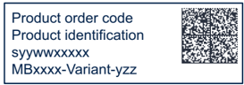

DT73589V1

#### Dual-sticker example:

Product order code Product identification Product order code Product identification and

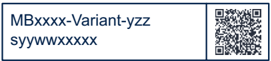

- Other boards if any: board reference with revision and serial number. Examples:

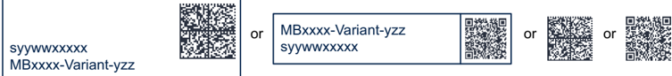

On the main board sticker, the first line provides the product order code, and the second line the product identification.

On all board stickers, the line formatted as 'MBxxxx-Variant-yzz' shows the board reference 'MBxxxx', the mounting variant 'Variant' when several exist (optional), the PCB revision 'y' , and the assembly revision 'zz' , for example B01. The other line shows the board serial number used for traceability.

Products and parts labeled as 'ES' or 'E' are not yet qualified or feature devices that are not yet qualified. STMicroelectronics disclaims any responsibility for consequences arising from their use. Under no circumstances will STMicroelectronics be liable for the customer's use of these engineering samples. Before deciding to use these engineering samples for qualification activities, contact STMicroelectronics' quality department.

'ES' or 'E' marking examples of location:

- On the targeted STM32 that is soldered on the board (for an illustration of STM32 marking, refer to the STM32 datasheet Package information paragraph at the www.st.com website).
- Next to the evaluation tool ordering part number that is stuck or silk-screen printed on the board.

Some boards feature a specific STM32 device version, which allows the operation of any bundled commercial stack/library available. This STM32 device shows a 'U' marking option at the end of the standard part number and is not available for sales.

To use the same commercial stack in their applications, the developers might need to purchase a part number specific to this stack/library. The price of those part numbers includes the stack/library royalties.

### 8.2 Product history

Table 34. Product history

| Order code    | Product identification   | Product details                                                                  | Product change description                          | Product limitations   |
|---------------|--------------------------|----------------------------------------------------------------------------------|-----------------------------------------------------|-----------------------|
| NUCLEO-F030R8 | NUCLEOF030R8/            | MCU: - STM32F030R8T6 silicon revision 'B' or '2' or '1'                          | Initial revision                                    | No limitation         |
| NUCLEO-F030R8 | NUCLEOF030R8/            | MCU errata sheet: - STM32F030x4/x6/x8/xC device errata (ES0219)                  | Initial revision                                    | No limitation         |
| NUCLEO-F030R8 | NUCLEOF030R8/            | Boards: - MB1136-F030R8-C01 - MB1136-F030R8-C03 - MB1136-F030R8-C04 (main board) | Initial revision                                    | No limitation         |
| NUCLEO-F030R8 | NUF030R8$AU1             | MCU: - STM32F030R8T6 silicon revision 'B' or '2' or '1'                          | Packaging: plastic blister replaced by a carton box | No limitation         |
| NUCLEO-F030R8 | NUF030R8$AU1             | MCU errata sheet: - STM32F030x4/x6/x8/xC device errata (ES0219)                  | Packaging: plastic blister replaced by a carton box | No limitation         |
| NUCLEO-F030R8 | NUF030R8$AU1             | Boards: - MB1136-F030R8-C04 (main board)                                         | Packaging: plastic blister replaced by a carton box | No limitation         |
| NUCLEO-F030R8 | NUF030R8$KU1             | MCU: - STM32F030R8T6 silicon revision 'B' or '2' or '1'                          | - Board stickers format changed                     | No limitation         |
| NUCLEO-F030R8 | NUF030R8$KU1             | MCU errata sheet: - STM32F030x4/x6/x8/xC device errata (ES0219)                  | - Board stickers format changed                     | No limitation         |
| NUCLEO-F030R8 | NUF030R8$KU1             | Boards: - MB1136-F030R8-C04 (main board)                                         | - Board stickers format changed                     | No limitation         |

90

Table 34. Product history (continued)

| Order code    | Product identification   | Product details                                                                  | Product change description                                                          | Product limitations   |
|---------------|--------------------------|----------------------------------------------------------------------------------|-------------------------------------------------------------------------------------|-----------------------|
| NUCLEO-F072RB | NUCLEOF072RB/            | MCU: - STM32F072RBT6 silicon revision 'Y' or '1'                                 | Initial revision                                                                    | No limitation         |
| NUCLEO-F072RB | NUCLEOF072RB/            | MCU errata sheet: - STM32F072x8/xB device errata (ES0223)                        | Initial revision                                                                    | No limitation         |
| NUCLEO-F072RB | NUCLEOF072RB/            | Boards: - MB1136-F072RB-C01 - MB1136-F072RB-C03 - MB1136-F072RB-C04 (main board) | Initial revision                                                                    | No limitation         |
| NUCLEO-F072RB | NUF072RB$AU1             | MCU: - STM32F072RBT6 silicon revision 'Y' or '1'                                 | - Main board revision changed - Packaging: plastic blister replaced by a carton box | No limitation         |
| NUCLEO-F072RB | NUF072RB$AU1             | MCU errata sheet: - STM32F072x8/xB device errata (ES0223)                        | - Main board revision changed - Packaging: plastic blister replaced by a carton box | No limitation         |
| NUCLEO-F072RB | NUF072RB$AU1             | Boards: - MB1136-F072RB-C05 (main board)                                         | - Main board revision changed - Packaging: plastic blister replaced by a carton box | No limitation         |
| NUCLEO-F072RB | NUF072RB$KU1             | MCU: - STM32F072RBT6 silicon revision '2'                                        | - MCU silicon revision changed - Board sticker format changed                       | No limitation         |
| NUCLEO-F072RB | NUF072RB$KU1             | MCU errata sheet: STM32F072x8/xB device errata (ES0223)                          | - MCU silicon revision changed - Board sticker format changed                       | No limitation         |
| NUCLEO-F072RB | NUF072RB$KU1             | Boards: MB1136-F072RB-C05 (main board)                                           | - MCU silicon revision changed - Board sticker format changed                       | No limitation         |

Table 34. Product history (continued)

| Order code    | Product identification   | Product details                                                                                              | Product change description                                                          | Product limitations   |
|---------------|--------------------------|--------------------------------------------------------------------------------------------------------------|-------------------------------------------------------------------------------------|-----------------------|
| NUCLEO-F103RB | NUCLEOF103RB/            | MCU: - STM32F103RBT6 silicon revision 'X' or '2'                                                             | Initial revision                                                                    | No limitation         |
| NUCLEO-F103RB | NUCLEOF103RB/            | MCU errata sheet: - STM32F101x8/B, STM32F102x8/B and STM32F103x8/B medium-density device limitations (ES096) | Initial revision                                                                    | No limitation         |
| NUCLEO-F103RB | NUCLEOF103RB/            | Boards: - MB1136-F103RB-C01 - MB1136-F103RB-C02 - MB1136-F103RB-C03 - MB1136-F103RB-C04 (main board)         | Initial revision                                                                    | No limitation         |
| NUCLEO-F103RB | NUF103RB$AU1             | MCU: - STM32F103RBT6 silicon revision 'X' or '2'                                                             | - Main board revision changed - Packaging: plastic blister replaced by a carton box | No limitation         |
| NUCLEO-F103RB | NUF103RB$AU1             | MCU errata sheet: - STM32F101x8/B, STM32F102x8/B and STM32F103x8/B medium-density device limitations (ES096) | - Main board revision changed - Packaging: plastic blister replaced by a carton box | No limitation         |
| NUCLEO-F103RB | NUF103RB$AU1             | Boards: - MB1136-F103RB-C05 (main board)                                                                     | - Main board revision changed - Packaging: plastic blister replaced by a carton box | No limitation         |
| NUCLEO-F103RB | NUF103RB$KU1             | MCU: - STM32F103RBT6 silicon revision 'X' or '2'                                                             | Board stickers format changed                                                       | No limitation         |
| NUCLEO-F103RB | NUF103RB$KU1             | MCU errata sheet: - STM32F101x8/B, STM32F102x8/B and STM32F103x8/B medium-density device limitations (ES096) | Board stickers format changed                                                       | No limitation         |
| NUCLEO-F103RB | NUF103RB$KU1             | Boards: - MB1136-F103RB-C05 (main board)                                                                     | Board stickers format changed                                                       | No limitation         |

90

Table 34. Product history (continued)

| Order code    | Product identification   | Product details                                                                                      | Product change description                          | Product limitations   |
|---------------|--------------------------|------------------------------------------------------------------------------------------------------|-----------------------------------------------------|-----------------------|
| NUCLEO-F302R8 | NUCLEOF302R8/            | MCU: - STM32F302R8T6 silicon revision 'Z'                                                            | Initial revision                                    | No limitation         |
| NUCLEO-F302R8 | NUCLEOF302R8/            | MCU errata sheet: - STM32F302x6/x8 device errata (ES0247)                                            | Initial revision                                    | No limitation         |
| NUCLEO-F302R8 | NUCLEOF302R8/            | Boards: - MB1136-F302R8-C01 - MB1136-F302R8-C02 - MB1136-F302R8-C03 - MB1136-F302R8-C04 (main board) | Initial revision                                    | No limitation         |
| NUCLEO-F302R8 | NUF302R8$AU1             | MCU: - STM32F302R8T6 silicon revision 'Z'                                                            | Packaging: plastic blister replaced by a carton box | No limitation         |
| NUCLEO-F302R8 | NUF302R8$AU1             | MCU errata sheet: - STM32F302x6/x8 device errata (ES0247)                                            | Packaging: plastic blister replaced by a carton box | No limitation         |
| NUCLEO-F302R8 | NUF302R8$AU1             | Boards: - MB1136-F302R8-C04 (main board)                                                             | Packaging: plastic blister replaced by a carton box | No limitation         |

Table 34. Product history (continued)

| Order code    | Product identification   | Product details                                                                                      | Product change description                          | Product limitations   |
|---------------|--------------------------|------------------------------------------------------------------------------------------------------|-----------------------------------------------------|-----------------------|
| NUCLEO-F401RE | NUCLEOF401RE/            | MCU: - STM32F401RET6 silicon revision 'Z' or '1'                                                     | Initial revision                                    | No limitation         |
| NUCLEO-F401RE | NUCLEOF401RE/            | MCU errata sheet: - STM32F401xD and STM32F401xE device errata (ES0299)                               | Initial revision                                    | No limitation         |
| NUCLEO-F401RE | NUCLEOF401RE/            | Boards: - MB1136-F401RE-C01 - MB1136-F401RE-C02 - MB1136-F401RE-C03 - MB1136-F401RE-C04 (main board) | Initial revision                                    | No limitation         |
| NUCLEO-F401RE | NUF401RE$AU1             | MCU: - STM32F401RET6 silicon revision 'Z' or '1'                                                     | Packaging: plastic blister replaced by a carton box | No limitation         |
| NUCLEO-F401RE | NUF401RE$AU1             | MCU errata sheet: - STM32F401xD and STM32F401xE device errata (ES0299)                               | Packaging: plastic blister replaced by a carton box | No limitation         |
| NUCLEO-F401RE | NUF401RE$AU1             | Boards: - MB1136-F401RE-C04 (main board)                                                             | Packaging: plastic blister replaced by a carton box | No limitation         |
| NUCLEO-F401RE | NUF401RE$KU1             | MCU: - STM32F401RET6 silicon revision 'Z' or '1'                                                     | Board stickers format changed                       | No limitation         |
| NUCLEO-F401RE | NUF401RE$KU1             | MCU errata sheet: - STM32F401xD and STM32F401xE device errata (ES0299)                               | Board stickers format changed                       | No limitation         |
| NUCLEO-F401RE | NUF401RE$KU1             | Boards: - MB1136-F401RE-C04 (main board)                                                             | Board stickers format changed                       | No limitation         |

90

Table 34. Product history (continued)

| Order code    | Product identification   | Product details                                                                                      | Product change description                                                          | Product limitations   |
|---------------|--------------------------|------------------------------------------------------------------------------------------------------|-------------------------------------------------------------------------------------|-----------------------|
| NUCLEO-L053R8 | NUCLEOL053R8/            | MCU: - STM32L053R8T6 silicon revision 'X'                                                            | Initial revision                                                                    | No limitation         |
| NUCLEO-L053R8 | NUCLEOL053R8/            | MCU errata sheet: - STM32L05xxx/L06xxx device errata (ES0251)                                        | Initial revision                                                                    | No limitation         |
| NUCLEO-L053R8 | NUCLEOL053R8/            | Boards: - MB1136-L053R8-C01 - MB1136-L053R8-C02 - MB1136-L053R8-C03 - MB1136-L053R8-C04 (main board) | Initial revision                                                                    | No limitation         |
| NUCLEO-L053R8 | NUL053R8$AU1             | MCU: - STM32L053R8T6 silicon revision 'X'                                                            | - Main board revision changed - Packaging: plastic blister replaced by a carton box | No limitation         |
| NUCLEO-L053R8 | NUL053R8$AU1             | MCU errata sheet: - STM32L05xxx/L06xxx device errata (ES0251)                                        | - Main board revision changed - Packaging: plastic blister replaced by a carton box | No limitation         |
| NUCLEO-L053R8 | NUL053R8$AU1             | Boards: - MB1136-L053R8-C05 (main board)                                                             | - Main board revision changed - Packaging: plastic blister replaced by a carton box | No limitation         |
| NUCLEO-L053R8 | NUL053R8$KU1             | MCU: - STM32L053R8T6 silicon revision 'X' or 'P'                                                     | Board stickers format changed                                                       | No limitation         |
| NUCLEO-L053R8 | NUL053R8$KU1             | MCU errata sheet: - STM32L05xxx/L06xxx device errata (ES0251)                                        | Board stickers format changed                                                       | No limitation         |
| NUCLEO-L053R8 | NUL053R8$KU1             | Boards: - MB1136-L053R8-C05 (main board)                                                             | Board stickers format changed                                                       | No limitation         |

Table 34. Product history (continued)

| Order code    | Product identification   | Product details                                                                                      | Product change description                                                          | Product limitations   |
|---------------|--------------------------|------------------------------------------------------------------------------------------------------|-------------------------------------------------------------------------------------|-----------------------|
| NUCLEO-L152RE | NUCLEOL152RE/            | MCU: - STM32L152RET6 silicon revision 'Z'                                                            | Initial revision                                                                    | No limitation         |
| NUCLEO-L152RE | NUCLEOL152RE/            | MCU errata sheet: - STM32L15xxE STM32L15xVD-X STM32L162xE STM32L162xVD-X device errata (ES0242)      | Initial revision                                                                    | No limitation         |
| NUCLEO-L152RE | NUCLEOL152RE/            | Boards: - MB1136-L152RE-C01 - MB1136-L152RE-C02 - MB1136-L152RE-C03 - MB1136-L152RE-C04 (main board) | Initial revision                                                                    | No limitation         |
| NUCLEO-L152RE | NUL152RE$AU1             | MCU: - STM32L152RET6 silicon revision 'Z'                                                            | - Main board revision changed - Packaging: plastic blister replaced by a carton box | No limitation         |
| NUCLEO-L152RE | NUL152RE$AU1             | MCU errata sheet: - STM32L15xxE STM32L15xVD-X STM32L162xE STM32L162xVD-X device errata (ES0242)      | - Main board revision changed - Packaging: plastic blister replaced by a carton box | No limitation         |
| NUCLEO-L152RE | NUL152RE$AU1             | Boards: - MB1136-L152RE-C05 (main board)                                                             | - Main board revision changed - Packaging: plastic blister replaced by a carton box | No limitation         |
| NUCLEO-L152RE | NUL152RE$KU1             | MCU: - STM32L152RET6 silicon revision 'Z'                                                            | Board sticker format changed                                                        | No limitation         |
| NUCLEO-L152RE | NUL152RE$KU1             | MCU errata sheet: STM32L15xxE STM32L15xVD-X STM32L162xE STM32L162xVD-X device errata (ES0242)        | Board sticker format changed                                                        | No limitation         |
| NUCLEO-L152RE | NUL152RE$KU1             | Boards: MB1136-L152RE-C05 (main board)                                                               | Board sticker format changed                                                        | No limitation         |

90

Table 34. Product history (continued)

| Order code    | Product identification   | Product details                                                                  | Product change description                                                          | Product limitations   |
|---------------|--------------------------|----------------------------------------------------------------------------------|-------------------------------------------------------------------------------------|-----------------------|
| NUCLEO-F091RC | NUCLEOF091RC/            | MCU: - STM32F091RCT6 silicon revision 'A'                                        | Initial revision                                                                    | No limitation         |
| NUCLEO-F091RC | NUCLEOF091RC/            | MCU errata sheet: - STM32F091xB/xC device errata (ES0282)                        | Initial revision                                                                    | No limitation         |
| NUCLEO-F091RC | NUCLEOF091RC/            | Boards: - MB1136-F091RC-C02 - MB1136-F091RC-C03 - MB1136-F091RC-C04 (main board) | Initial revision                                                                    | No limitation         |
| NUCLEO-F091RC | NUF091RC$AU1             | MCU: - STM32F091RCT6 silicon revision 'A'                                        | - Main board revision changed - Packaging: plastic blister replaced by a carton box | No limitation         |
| NUCLEO-F091RC | NUF091RC$AU1             | MCU errata sheet: - STM32F091xB/xC device errata (ES0282)                        | - Main board revision changed - Packaging: plastic blister replaced by a carton box | No limitation         |
| NUCLEO-F091RC | NUF091RC$AU1             | Boards: - MB1136-F091RC-C05 (main board)                                         | - Main board revision changed - Packaging: plastic blister replaced by a carton box | No limitation         |

Table 34. Product history (continued)

| Order code    | Product identification   | Product details                                                                           | Product change description                                                          | Product limitations   |
|---------------|--------------------------|-------------------------------------------------------------------------------------------|-------------------------------------------------------------------------------------|-----------------------|
| NUCLEO-F303RE | NUCLEOF303RE/            | MCU: - STM32F303RET6 silicon revision 'Y'                                                 | Initial revision                                                                    | No limitation         |
| NUCLEO-F303RE | NUCLEOF303RE/            | (ES0261) Boards: - MB1136-F303RE-C02 - MB1136-F303RE-C03 - MB1136-F303RE-C04 (main board) | Initial revision                                                                    | No limitation         |
| NUCLEO-F303RE | NUF303RE$AU1             | MCU: - STM32F303RET6 silicon revision 'Y'                                                 | - Main board revision changed - Packaging: plastic blister replaced by a carton box | No limitation         |
| NUCLEO-F303RE | NUF303RE$AU1             | MCU errata sheet: - STM32F303xD STM32F303xE Rev Y device limitations (ES0261)             | - Main board revision changed - Packaging: plastic blister replaced by a carton box | No limitation         |
| NUCLEO-F303RE | NUF303RE$AU1             | Boards: - MB1136-F303RE-C05 (main board)                                                  | - Main board revision changed - Packaging: plastic blister replaced by a carton box | No limitation         |

90

Table 34. Product history (continued)

| Order code    | Product identification   | Product details                                                                  | Product change description                                                          | Product limitations   |
|---------------|--------------------------|----------------------------------------------------------------------------------|-------------------------------------------------------------------------------------|-----------------------|
| NUCLEO-F334R8 | NUCLEOF334R8/            | MCU: - STM32F334R8T6 silicon revision 'Z'                                        | Initial revision                                                                    | No limitation         |
| NUCLEO-F334R8 | NUCLEOF334R8/            | MCU errata sheet: - STM32F334x4/x6/x8 Rev Z device limitations (ES0258)          | Initial revision                                                                    | No limitation         |
| NUCLEO-F334R8 | NUCLEOF334R8/            | Boards: - MB1136-F334R8-C02 - MB1136-F334R8-C03 - MB1136-F334R8-C04 (main board) | Initial revision                                                                    | No limitation         |
| NUCLEO-F334R8 | NUF334R8$AU1             | MCU: - STM32F334R8T6 silicon revision 'Z'                                        | - Main board revision changed - Packaging: plastic blister replaced by a carton box | No limitation         |
| NUCLEO-F334R8 | NUF334R8$AU1             | MCU errata sheet: - STM32F334x4/x6/x8 Rev Z device limitations (ES0258)          | - Main board revision changed - Packaging: plastic blister replaced by a carton box | No limitation         |
| NUCLEO-F334R8 | NUF334R8$AU1             | Boards: - MB1136-F334R8-C05 (main board)                                         | - Main board revision changed - Packaging: plastic blister replaced by a carton box | No limitation         |
| NUCLEO-F334R8 | NUF334R8$KU1             | MCU: - STM32F334R8T6 silicon revision 'Z' or '1'                                 | Board stickers format changed                                                       | No limitation         |
| NUCLEO-F334R8 | NUF334R8$KU1             | MCU errata sheet: - STM32F334x4/x6/x8 Rev Z device limitations (ES0258)          | Board stickers format changed                                                       | No limitation         |
| NUCLEO-F334R8 | NUF334R8$KU1             | Boards: - MB1136-F334R8-C05 (main board)                                         | Board stickers format changed                                                       | No limitation         |

Table 34. Product history (continued)

| Order code    | Product identification   | Product details                                                                  | Product change description                          | Product limitations   |
|---------------|--------------------------|----------------------------------------------------------------------------------|-----------------------------------------------------|-----------------------|
| NUCLEO-F411RE | NUCLEOF411RE/            | MCU: - STM32F411RET6 silicon revision 'A'                                        | Initial revision                                    | No limitation         |
| NUCLEO-F411RE | NUCLEOF411RE/            | MCU errata sheet: - STM32F411xC/xE device errata (ES0287)                        | Initial revision                                    | No limitation         |
| NUCLEO-F411RE | NUCLEOF411RE/            | Boards: - MB1136-F411RE-C02 - MB1136-F411RE-C03 - MB1136-F411RE-C04 (main board) | Initial revision                                    | No limitation         |
| NUCLEO-F411RE | NUF411RE$AU1             | MCU: - STM32F411RET6 silicon revision 'A'                                        | Packaging: plastic blister replaced by a carton box | No limitation         |
| NUCLEO-F411RE | NUF411RE$AU1             | MCU errata sheet: - STM32F411xC/xE device errata (ES0287)                        | Packaging: plastic blister replaced by a carton box | No limitation         |
| NUCLEO-F411RE | NUF411RE$AU1             | Boards: - MB1136-F411RE-C04 (main board)                                         | Packaging: plastic blister replaced by a carton box | No limitation         |
| NUCLEO-F411RE | NUF411RE$KU1             | MCU: - STM32F411RET6 silicon revision 'A' or '1'                                 | Board stickers format changed                       | No limitation         |
| NUCLEO-F411RE | NUF411RE$KU1             | MCU errata sheet: - STM32F411xC/xE device errata (ES0287)                        | Board stickers format changed                       | No limitation         |
| NUCLEO-F411RE | NUF411RE$KU1             | Boards: - MB1136-F411RE-C04 (main board)                                         | Board stickers format changed                       | No limitation         |

90

Table 34. Product history (continued)

| Order code    | Product identification   | Product details                                                    | Product change description                          | Product limitations   |
|---------------|--------------------------|--------------------------------------------------------------------|-----------------------------------------------------|-----------------------|
| NUCLEO-F410RB | NUCLEOF410RB/            | MCU: - STM32F410RBT6 silicon revision 'A'                          | Initial revision                                    | No limitation         |
| NUCLEO-F410RB | NUCLEOF410RB/            | MCU errata sheet: - STM32F410x8 STM32F410xB device errata (ES0325) | Initial revision                                    | No limitation         |
| NUCLEO-F410RB | NUCLEOF410RB/            | Boards: - MB1136-F410RB-C03 - MB1136-F410RB-C04 (main board)       | Initial revision                                    | No limitation         |
| NUCLEO-F410RB | NUF410RB$AU1             | MCU: - STM32F410RBT6 silicon revision 'A'                          | Packaging: plastic blister replaced by a carton box | No limitation         |
| NUCLEO-F410RB | NUF410RB$AU1             | MCU errata sheet: - STM32F410x8 STM32F410xB device errata (ES0325) | Packaging: plastic blister replaced by a carton box | No limitation         |
| NUCLEO-F410RB | NUF410RB$AU1             | Boards: - MB1136-F410RB-C04 (main board)                           | Packaging: plastic blister replaced by a carton box | No limitation         |

Table 34. Product history (continued)

| Order code    | Product identification   | Product details                                              | Product change description                          | Product limitations   |
|---------------|--------------------------|--------------------------------------------------------------|-----------------------------------------------------|-----------------------|
| NUCLEO-F446RE | NUCLEOF446RE/            | MCU: - STM32F446RET6 silicon revision 'A'                    | Initial revision                                    | No limitation         |
| NUCLEO-F446RE | NUCLEOF446RE/            | MCU errata sheet: - STM32F446xC/xE device errata (ES0298)    | Initial revision                                    | No limitation         |
| NUCLEO-F446RE | NUCLEOF446RE/            | Boards: - MB1136-F446RE-C03 - MB1136-F446RE-C04 (main board) | Initial revision                                    | No limitation         |
| NUCLEO-F446RE | NUF446RE$AU1             | MCU: - STM32F446RET6 silicon revision 'A'                    | Packaging: plastic blister replaced by a carton box | No limitation         |
| NUCLEO-F446RE | NUF446RE$AU1             | MCU errata sheet: - STM32F446xC/xE device errata (ES0298)    | Packaging: plastic blister replaced by a carton box | No limitation         |
| NUCLEO-F446RE | NUF446RE$AU1             | Boards: - MB1136-F446RE-C04 (main board)                     | Packaging: plastic blister replaced by a carton box | No limitation         |
| NUCLEO-F446RE | NUF446RE$KU1             | MCU: - STM32F446RET6 silicon revision 'A' or '1'             | Board stickers format changed                       | No limitation         |
| NUCLEO-F446RE | NUF446RE$KU1             | MCU errata sheet: - STM32F446xC/xE device errata (ES0298)    | Board stickers format changed                       | No limitation         |
| NUCLEO-F446RE | NUF446RE$KU1             | Boards: - MB1136-F446RE-C04 (main board)                     | Board stickers format changed                       | No limitation         |

90

Table 34. Product history (continued)

| Order code    | Product identification   | Product details                                              | Product change description                                                          | Product limitations   |
|---------------|--------------------------|--------------------------------------------------------------|-------------------------------------------------------------------------------------|-----------------------|
| NUCLEO-F070RB | NUCLEOF070RB/            | MCU: - STM32F070RBT6 silicon revision '1'                    | Initial revision                                                                    | No limitation         |
| NUCLEO-F070RB | NUCLEOF070RB/            | MCU errata sheet: - STM32F070x6/xB device errata (ES0291)    | Initial revision                                                                    | No limitation         |
| NUCLEO-F070RB | NUCLEOF070RB/            | Boards: - MB1136-F070RB-C03 - MB1136-F070RB-C04 (main board) | Initial revision                                                                    | No limitation         |
| NUCLEO-F070RB | NUF070RB$AU1             | MCU: - STM32F070RBT6 silicon revision '1'                    | - Main board revision changed - Packaging: plastic blister replaced by a carton box | No limitation         |
| NUCLEO-F070RB | NUF070RB$AU1             | MCU errata sheet: - STM32F070x6/xB device errata (ES0291)    | - Main board revision changed - Packaging: plastic blister replaced by a carton box | No limitation         |
| NUCLEO-F070RB | NUF070RB$AU1             | Boards: - MB1136-F070RB-C05 (main board)                     | - Main board revision changed - Packaging: plastic blister replaced by a carton box | No limitation         |
|               | NUF070RB$KU1             | MCU: - STM32F070RBT6 silicon revision '2'                    | - Board stickers format changed - MCU silicon revison changed                       | No limitation         |
|               | NUF070RB$KU1             | MCU errata sheet: - STM32F070x6/xB device errata (ES0291)    | - Board stickers format changed - MCU silicon revison changed                       | No limitation         |
|               | NUF070RB$KU1             | Boards: - MB1136-F070RB-C05 (main board)                     | - Board stickers format changed - MCU silicon revison changed                       | No limitation         |

Table 34. Product history (continued)

| Order code    | Product identification   | Product details                                               | Product change description                                                          | Product limitations   |
|---------------|--------------------------|---------------------------------------------------------------|-------------------------------------------------------------------------------------|-----------------------|
| NUCLEO-L073RZ | NUCLEOL073RZ/            | MCU: - STM32L073RZT6 silicon revision 'Z'                     | Initial revision                                                                    | No limitation         |
| NUCLEO-L073RZ | NUCLEOL073RZ/            | MCU errata sheet: - STM32L07xxx/L08xxx device errata (ES0292) | Initial revision                                                                    | No limitation         |
| NUCLEO-L073RZ | NUCLEOL073RZ/            | Boards: - MB1136-L073RZ-C03 - MB1136-L073RZ-C04 (main board)  | Initial revision                                                                    | No limitation         |
| NUCLEO-L073RZ | NUL073RZ$AU1             | MCU: - STM32L073RZT6 silicon revision 'Z'                     | - Main board revision changed - Packaging: plastic blister replaced by a carton box | No limitation         |
| NUCLEO-L073RZ | NUL073RZ$AU1             | MCU errata sheet: - STM32L07xxx/L08xxx device errata (ES0292) | - Main board revision changed - Packaging: plastic blister replaced by a carton box | No limitation         |
| NUCLEO-L073RZ | NUL073RZ$AU1             | Boards: - MB1136-L073RZ-C05 (main board)                      | - Main board revision changed - Packaging: plastic blister replaced by a carton box | No limitation         |
| NUCLEO-L073RZ | NUL073RZ$KU1             | MCU: - STM32L073RZT6 silicon revision 'Z' or 'P'              | Board stickers format changed                                                       | No limitation         |
| NUCLEO-L073RZ | NUL073RZ$KU1             | MCU errata sheet: - STM32L07xxx/L08xxx device errata (ES0292) | Board stickers format changed                                                       | No limitation         |
| NUCLEO-L073RZ | NUL073RZ$KU1             | Boards: - MB1136-L073RZ-C05 (main board)                      | Board stickers format changed                                                       | No limitation         |

90

Table 34. Product history (continued)

| Order code    | Product identification   | Product details                                              | Product change description                          | Product limitations   |
|---------------|--------------------------|--------------------------------------------------------------|-----------------------------------------------------|-----------------------|
| NUCLEO-L452RE | NUCLEOL452RE/            | MCU: - STM32L452RET6 silicon revision 'Y'                    | Initial revision                                    | No limitation         |
| NUCLEO-L452RE | NUCLEOL452RE/            | MCU errata sheet: - STM32L452xx device errata (ES0388)       | Initial revision                                    | No limitation         |
| NUCLEO-L452RE | NUCLEOL452RE/            | Boards: - MB1136-L452RE-C03 - MB1136-L452RE-C04 (main board) | Initial revision                                    | No limitation         |
| NUCLEO-L452RE | NUL452RE$AU1             | MCU: - STM32L452RET6 silicon revision 'Y'                    | Packaging: plastic blister replaced by a carton box | No limitation         |
| NUCLEO-L452RE | NUL452RE$AU1             | MCU errata sheet: - STM32L452xx device errata (ES0388)       | Packaging: plastic blister replaced by a carton box | No limitation         |
| NUCLEO-L452RE | NUL452RE$AU1             | Boards: - MB1136-L452RE-C05 (main board)                     | Packaging: plastic blister replaced by a carton box | No limitation         |
| NUCLEO-L452RE | NUL452RE$KU1             | MCU: - STM32L452RET6 silicon revision 'Y'                    | Board sticker format changed                        | No limitation         |
| NUCLEO-L452RE | NUL452RE$KU1             | MCU errata sheet: - STM32L452xx device errata (ES0388)       | Board sticker format changed                        | No limitation         |
| NUCLEO-L452RE | NUL452RE$KU1             | Boards: - MB1136-L452RE-C05 (main board)                     | Board sticker format changed                        | No limitation         |

Table 34. Product history (continued)

| Order code    | Product identification   | Product details                                                     | Product change description                                                          | Product limitations   |
|---------------|--------------------------|---------------------------------------------------------------------|-------------------------------------------------------------------------------------|-----------------------|
| NUCLEO-L476RG | NUCLEOL476RG/            | MCU: - STM32L476RGT6 silicon revision '4'                           | Initial revision                                                                    | No limitation         |
| NUCLEO-L476RG | NUCLEOL476RG/            | MCU errata sheet: - STM32L476xx/STM32L4 86xx device errata (ES0250) | Initial revision                                                                    | No limitation         |
| NUCLEO-L476RG | NUCLEOL476RG/            | Boards: - MB1136-L476RG-C03 - MB1136-L476RG-C04 (main board)        | Initial revision                                                                    | No limitation         |
| NUCLEO-L476RG | NUL476RG$AU1             | MCU: - STM32L476RGT6 silicon revision '4'                           | - Main board revision changed - Packaging: plastic blister replaced by a carton box | No limitation         |
| NUCLEO-L476RG | NUL476RG$AU1             | MCU errata sheet: - STM32L476xx/STM32L4 86xx device errata (ES0250) | - Main board revision changed - Packaging: plastic blister replaced by a carton box | No limitation         |
| NUCLEO-L476RG | NUL476RG$AU1             | Boards: - MB1136-L476RG-C05 (main board)                            | - Main board revision changed - Packaging: plastic blister replaced by a carton box | No limitation         |
| NUCLEO-L476RG | NUL476RG$KU1             | MCU: - STM32L476RGT6 silicon revision '4'                           | Board stickers format changed                                                       | No limitation         |
| NUCLEO-L476RG | NUL476RG$KU1             | MCU errata sheet: - STM32L476xx/STM32L4 86xx device errata (ES0250) | Board stickers format changed                                                       | No limitation         |
| NUCLEO-L476RG | NUL476RG$KU1             | Boards: - MB1136-L476RG-C05 (main board)                            | Board stickers format changed                                                       | No limitation         |

90

Table 34. Product history (continued)

| Order code    | Product identification   | Product details                                              | Product change description                          | Product limitations   |
|---------------|--------------------------|--------------------------------------------------------------|-----------------------------------------------------|-----------------------|
| NUCLEO-L010RB | NUCLEOL010RB/            | MCU: - STM32L010RBT6 silicon revision 'Z'                    | Initial revision                                    | No limitation         |
| NUCLEO-L010RB | NUCLEOL010RB/            | MCU errata sheet: - STM32L010xx device errata (ES0483)       | Initial revision                                    | No limitation         |
| NUCLEO-L010RB | NUCLEOL010RB/            | Boards: - MB1136-L010RB-C03 - MB1136-L010RB-C04 (main board) | Initial revision                                    | No limitation         |
| NUCLEO-L010RB | NUL010RB$AU1             | MCU: - STM32L010RBT6 silicon revision 'Z'                    | Packaging: plastic blister replaced by a carton box | No limitation         |
| NUCLEO-L010RB | NUL010RB$AU1             | MCU errata sheet: - STM32L010xx device errata (ES0483)       | Packaging: plastic blister replaced by a carton box | No limitation         |
| NUCLEO-L010RB | NUL010RB$AU1             | Boards: - MB1136-L010RB-C05 (main board)                     | Packaging: plastic blister replaced by a carton box | No limitation         |

### 8.3 Board revision history

Table 35. Board revision history

| Board reference     | Board variant and revision                                                                                                                                                                            | Board change description                                                                                                                                                                                                    | Board limitations   |
|---------------------|-------------------------------------------------------------------------------------------------------------------------------------------------------------------------------------------------------|-----------------------------------------------------------------------------------------------------------------------------------------------------------------------------------------------------------------------------|---------------------|
| MB1136 (main board) | F030R8-C01 F072RB-C01 F103RB-C01 F302R8-C01 F401RE-C01 L053R8-C01 L152RE-C01                                                                                                                          | Initial revision                                                                                                                                                                                                            | No limitation       |
| MB1136 (main board) | F072RB-C02 F091RC-C02 F103RB-C02 F302R8-C02 F303RE-C02 F334R8-C02 F401RE-C02 F411RE-C02 L053R8-C02                                                                                                    | Add LSE: - X2(32 KHz) - R34 and R36 changed from OFF to 0 Ω - C31 and C32 changed from OFF to 10 pF - SB48 and SB49 changed from ON to OFF Remove HSE: - SB16 and SB50 changed from OFF to ON - SB55 changed from ON to OFF | No limitation       |
| MB1136 (main board) | F030R8-C03 F070RB-C03 F072RB-C03 F091RC-C03 F103RB-C03 F302R8-C03 F303RE-C03 F334R8-C03 F401RE-C03 F410RB-C03 F411RE-C03 F446RE-C03 L010RB-C04 L053R8-C03 L073RZ-C03 L152RE-C03 L452RE-C03 L476RG-C03 | - X2 changed to ABS25-32.768KHZ-6-TB - C31 and C32 changed from 10 to 4.3 pF - C26 changed from 2.2 to 4.7 µF                                                                                                               | No limitation       |

90

Table 35. Board revision history (continued)

| Board reference     | Board variant and revision                                                                                                                                                                            | Board change description                                                                                 | Board limitations   |
|---------------------|-------------------------------------------------------------------------------------------------------------------------------------------------------------------------------------------------------|----------------------------------------------------------------------------------------------------------|---------------------|
| MB1136 (main board) | F030R8-C04 F070RB-C04 F072RB-C04 F091RC-C04 F103RB-C04 F302R8-C04 F303RE-C04 F334R8-C04 F401RE-C04 F410RB-C04 F411RE-C04 F446RE-C04 L010RB-C04 L053R8-C04 L073RZ-C04 L152RE-C04 L452RE-C04 L476RG-C04 | Reference for transistor (T2) changed from STMICROELECTRONICS STS7PF30L to STMICROELECTRONICS STS9P3LLH6 | No limitation       |
| MB1136 (main board) | F070RB-C05 F072RB-C05 F091RC-C05 F103RB-C05 F303RE-C05 F334R8-C05 L010RB-C05 L053R8-C05 L073RZ-C05 L152RE-C05 L452RE-C05                                                                              | - USB connector (CN1) changed - Buttons (B1 and B2) changed - Minor changes in serigraphy                | No limitation       |

## 9 Federal Communications Commission (FCC) and ISED Canada Compliance Statements

### 9.1 FCC Compliance Statement

#### Part 15.19

This device complies with Part 15 of the FCC Rules. Operation is subject to the following two conditions: (1) this device may not cause harmful interference, and (2) this device must accept any interference received, including interference that may cause undesired operation.

#### Part 15.21

Any changes or modifications to this equipment not expressly approved by STMicroelectronics may cause harmful interference and void the user's authority to operate this equipment.

#### Part 15.105

This equipment has been tested and found to comply with the limits for a Class B digital device, pursuant to part 15 of the FCC Rules. These limits are designed to provide reasonable protection against harmful interference in a residential installation. This equipment generates uses and can radiate radio frequency energy and, if not installed and used in accordance with the instructions, may cause harmful interference to radio communications. However, there is no guarantee that interference will not occur in a particular installation. If this equipment does cause harmful interference to radio or television reception which can be determined by turning the equipment off and on, the user is encouraged to try to correct interference by one or more of the following measures:

- Reorient or relocate the receiving antenna.
- Increase the separation between the equipment and receiver.
- Connect the equipment into an outlet on a circuit different from that to which the receiver is connected.
- Consult the dealer or an experienced radio/TV technician for help.

Use a shielded USB cable with a length of less than 0.5 m and ferrite on the computer side, like WURTH ELEKTRONIK 742 711 12.

#### Responsible party (in the USA)

Francesco Doddo STMicroelectronics, Inc. 200 Summit Drive | Suite 405 | Burlington, MA 01803 USA Telephone: +1 781-472-9634

#### Note:

90

### 9.2 ISED Compliance Statement

ISED Canada ICES-003 Compliance Label: CAN ICES-3 (B) / NMB-3 (B).

Étiquette de conformité à la NMB-003 d'ISDE Canada : CAN ICES-3 (B) / NMB-3 (B).

Note: Use a shielded USB cable with a length of less than 0.5 m and ferrite on the computer side, like WURTH ELEKTRONIK 742 711 12.

## 10 Product disposal

### Disposal of this product: WEEE (Waste Electrical and Electronic Equipment)

(Applicable in Europe)

This symbol on the product, accessories, or accompanying documents indicates that the product and its electronic accessories must not be disposed of with household waste at the end of their working life.

To prevent possible harm to the environment and human health from uncontrolled waste disposal, separate these items from other types of waste and recycle them responsibly at a designated collection point to promote the sustainable reuse of material resources.

### Household users:

Contact the retailer that you purchased the product from or your local authority for details of your nearest designated collection point.

Business users:

Contact your dealer or supplier for further information.

90

### Revision history

Table 36. Document revision history

| Date         |   Revision | Changes                                                                                                                                                                                                                                                                                                                                                                                                                                                                                                                                        |
|--------------|------------|------------------------------------------------------------------------------------------------------------------------------------------------------------------------------------------------------------------------------------------------------------------------------------------------------------------------------------------------------------------------------------------------------------------------------------------------------------------------------------------------------------------------------------------------|
| 10-Feb-2014  |          1 | Initial release.                                                                                                                                                                                                                                                                                                                                                                                                                                                                                                                               |
| 13-Feb-2014  |          2 | Updated Figure 1 , Chapter 5.5 and Table 10 .                                                                                                                                                                                                                                                                                                                                                                                                                                                                                                  |
| 11-Apr-2014  |          3 | Extended the applicability to NUCLEO-F302R8. Updated Table 1: Ordering information , Section 6.11: Arduino connectors and Section 6.12: ST morpho connector . Updated Figure 1                                                                                                                                                                                                                                                                                                                                                                 |
| 10-June-2014 |          4 | Updated the board figure: Figure 1 . Updated HSE and LSE configuration description: Section 6.7.1 , Section 5.5, and Section 6.7.2 . Extended the applicability to NUCLEO-F334R8, NUCLEO-F411RE, and NUCLEO-L053R8.                                                                                                                                                                                                                                                                                                                            |
| 20-June-2014 |          5 | Updated the electrical schematics figures: Figure 27 , Figure 28 , Figure 29, and Figure 30 . Refer to the AN2867 for the oscillator design guide for STM32 microcontrollers in Section 6.7.1: OSC clock supply and Section 6.7.2: OSC 32 KHz clock supply .                                                                                                                                                                                                                                                                                   |
| 30-Sept-2014 |          6 | Extended the applicability to NUCLEO-F091RC and NUCLEO- F303RE; Updated Table 1: Ordering information ; Updated Table 11: Arduino connectors on NUCLEO-F030R8, NUCLEO-F070RB, NUCLEO-F072RB, NUCLEO-F091RC ; Updated Table 26: ST morpho connector on NUCLEO-F072RB, NUCLEO-F091RC, NUCLEO-F303RE, NUCLEO-F334R8 ; Updated Figure 6: Typical configuration ; Added Figure 13: NUCLEO-F091RC ; Added Figure 16: NUCLEO-F303RE ; Updated Section 6.7.2: OSC 32 KHz clock supply ; Updated Figure 27: Top and Power(1/4) , Figure 28: STM32 MCU ; |

Table 36. Document revision history (continued)

| Date        |   Revision | Changes                                                                                                                                                                                                                                                                                                                                                                                                                                                                                                                                                                                                                                                                                                                                                                                                            |
|-------------|------------|--------------------------------------------------------------------------------------------------------------------------------------------------------------------------------------------------------------------------------------------------------------------------------------------------------------------------------------------------------------------------------------------------------------------------------------------------------------------------------------------------------------------------------------------------------------------------------------------------------------------------------------------------------------------------------------------------------------------------------------------------------------------------------------------------------------------|
| 19-Jan-2015 |          7 | Extended the applicability to NUCLEO-F070RB, NUCLEO- L073RZ, and NUCLEO-L476RG; Updated Table 1: Ordering information ; Updated Section 6.2: Embedded ST-LINK/V2-1 ; Updated Section 6.7.1: OSC clock supply ; Added Figure 11: NUCLEO-F070RB ; Added Figure 21: NUCLEO-L073RZ ; Added Figure 24: NUCLEO-L476RG Updated Table 11: Arduino connectors on NUCLEO-F030R8, NUCLEO-F070RB, NUCLEO-F072RB, NUCLEO-F091RC Added Table 18: Arduino connectors on NUCLEO-L073RZ Added Table 23: Arduino connectors on NUCLEO-L476RG Added Table 25: ST morpho connector on NUCLEO-F070RB Updated Table 30: ST morpho connector on NUCLEO-L053R8, NUCLEO-L073RZ, NUCLEO-L152RE Added Table 32: ST morpho connector on NUCLEO-L476RG Updated schematics from Figure 27: Top and Power(1/4) to Figure 30: Extension connectors |
| 08-Jul-2015 |          8 | Extended the applicability to Updated Table 1: Ordering information ; Added Figure 25: NUCLEO-F446RE and Figure 26: NUCLEO- F410RB Updated Section 6.11: Arduino connectors on page 37 and Section 6.12: ST morpho connector on page 53                                                                                                                                                                                                                                                                                                                                                                                                                                                                                                                                                                            |
| 04-Aug-2015 |          9 | Added Section 5.4: NUCLEO-L476RG bootloader limitations .                                                                                                                                                                                                                                                                                                                                                                                                                                                                                                                                                                                                                                                                                                                                                          |
| 17-Nov-2015 |         10 | Updated Section 6.9: Solder bridges and Section 6.7.1: OSC clock supply .                                                                                                                                                                                                                                                                                                                                                                                                                                                                                                                                                                                                                                                                                                                                          |
| 29-Nov-2015 |         11 | Updated Introduction , Section 3: Ordering information , Section 6.10: Extension connectors , Section 6.11: Arduino connectors , Section 6.12: ST morpho connector to add NUCLEO- L452RE.                                                                                                                                                                                                                                                                                                                                                                                                                                                                                                                                                                                                                          |
| 15-Dec-2017 |         12 | Updated document title and cover page. Updated Chapter 2: Product marking and Section 5.3: Development toolchains . Expanded document scope to NUCLEO-L010RB: - Updated Table 1: Ordering information - Updated Table 18: Arduino connectors on NUCLEO-L010RB and NUCLEO-L073RZ - Updated Table 21: NUCLEO-L073RZ and NUCLEO-L010RB - Updated Table 30: ST morpho connector on NUCLEO-L010RB, NUCLEO-L053R8, NUCLEO-L073RZ, NUCLEO-L152RE                                                                                                                                                                                                                                                                                                                                                                          |
| 3-Apr-2019  |         13 | Updated document title, Introduction , Chapter 2: Ordering information , Section 2.1: Product marking , Section 2.2: Codification , and Section 5.1: Getting started . Added Chapter 3: Development environment and Section 3.3: Demonstration software .                                                                                                                                                                                                                                                                                                                                                                                                                                                                                                                                                          |

90

Table 36. Document revision history (continued)

| Date        |   Revision | Changes                                                                                                                                                                                                                                                                                                                                                                                                                                                                                                                                           |
|-------------|------------|---------------------------------------------------------------------------------------------------------------------------------------------------------------------------------------------------------------------------------------------------------------------------------------------------------------------------------------------------------------------------------------------------------------------------------------------------------------------------------------------------------------------------------------------------|
| 19-Aug-2020 |         14 | Updated the connector reference in the description of SB54 and SB55 in Table 10: Solder bridges . Removed pin 10 duplicated rows in Table 11: ARDUINO ® connectors on NUCLEO-F030R8, NUCLEO-F070RB, NUCLEO- F072RB, NUCLEO-F091RC , Table 12: ARDUINO ® connectors on NUCLEO-F103RB , Table 16: ARDUINO ® connectors on NUCLEO-F401RE and NUCLEO-F411RE , and Table 19: ARDUINO ® connectors on NUCLEO-F446RE . Removed electrical schematics. Added Section 7 including Product marking , Board revision history , and Board known limitations . |
| 14-Apr-2025 |         15 | Added Section 3.4: EDA resources , Section 5: Safety recommendations , Table 34: Product history and Table 35: Board revision history , and Section 9: Federal Communications Commission (FCC) and ISED Canada Compliance Statements . Updated Section 3.1: System requirements , Figure 2: Hardware block diagram , Section 7.4: Embedded ST-LINK/V2-1 , Section 7.4.1: Driver , and Section 8.1: Product marking . Removed the references to Arm ® Mbed ™ .                                                                                     |
| 19-May-2025 |         16 | Updated Table 34: Product history .                                                                                                                                                                                                                                                                                                                                                                                                                                                                                                               |
| 30-Sep-2025 |         17 | Updated Table 34: Product history .                                                                                                                                                                                                                                                                                                                                                                                                                                                                                                               |

### IMPORTANT NOTICE - READ CAREFULLY

STMicroelectronics NV and its subsidiaries ('ST') reserve the right to make changes, corrections, enhancements, modifications, and improvements to ST products and/or to this document at an&lt;y time without notice.

In the event of any conflict between the provisions of this document and the provisions of any contractual arrangement in force between the purchasers and ST, the provisions of such contractual arrangement shall prevail.

The purchasers should obtain the latest relevant information on ST products before placing orders. ST products are sold pursuant to ST's terms and conditions of sale in place at the time of order acknowledgment.

The purchasers are solely responsible for the choice, selection, and use of ST products and ST assumes no liability for application assistance or the design of the purchasers' products.

No license, express or implied, to any intellectual property right is granted by ST herein.

Resale of ST products with provisions different from the information set forth herein shall void any warranty granted by ST for such product.

If the purchasers identify an ST product that meets their functional and performance requirements but that is not designated for the purchasers' market segment, the purchasers shall contact ST for more information.

ST and the ST logo are trademarks of ST. For additional information about ST trademarks, refer to www.st.com/trademarks . All other product or service names are the property of their respective owners.

Information in this document supersedes and replaces information previously supplied in any prior versions of this document.

© 2025 STMicroelectronics - All rights reserved

91

