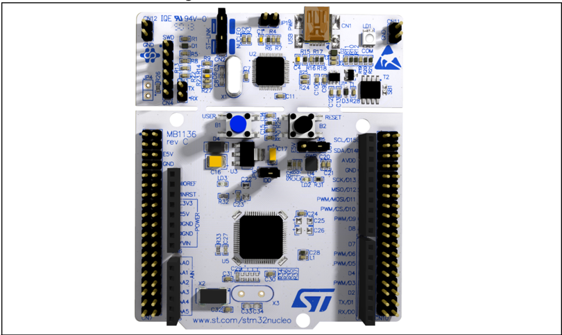

# Introduction

The STM32 Nucleo-64 boards based on the MB1136 reference board (NUCLEO-F030R8, NUCLEO-F070RB, NUCLEO-F072RB, NUCLEO-F091RC, NUCLEO-F103RB,

NUCLEO-F302R8, NUCLEO-F303RE, NUCLEO-F334R8, NUCLEO-F401RE,

NUCLEO-F410RB, NUCLEO-F411RE, NUCLEO-F446RE, NUCLEO-L010RB,

NUCLEO-L053R8, NUCLEO-L073RZ, NUCLEO-L152RE, NUCLEO-L452RE,

NUCLEO-L476RG) provide an affordable and flexible way for users to try out new concepts and build prototypes with the STM32 microcontrollers in the LQFP64 package, choosing from the various combinations of performance, power consumption, and features. The ARDUINO ® Uno V3 connectivity support and the ST morpho headers provide an easy means of expanding the functionality of the Nucleo open development platform with a wide choice of specialized shields. The STM32 Nucleo boards do not require any separate probe as they integrate the ST-LINK/V2-1 debugger and programmer. The STM32 Nucleo boards come with the comprehensive free software libraries and examples available with the STM32Cube MCU Packages.

Figure 1. STM32 Nucleo-64 board

Picture is not contractual.

## UM1724 User manual

## STM32 Nucleo-64 boards (MB1136)

1

## Contents

|   1 | Features . . . . . . . . . . . . . . . . . . . . . . . . . . . . . . . . . . . . . . . . . . . .   | . . . . . .                                                                                                                                                 | . 6   |
|-----|----------------------------------------------------------------------------------------------------|-------------------------------------------------------------------------------------------------------------------------------------------------------------|-------|
|   2 | Ordering information . . . . . . . . . . . . . . . . . . . . . . . . . . . . . . . . . .           | . . . . .                                                                                                                                                   | . 7   |
|     | 2.1                                                                                                | Codification . . . . . . . . . . . . . . . . . . . . . . . . . . . . . . . . . . . . . . . . . . . . . . . .                                                | . 8   |
|   3 | Development environment . . . . . . . . . . . . . . . . . . . . . . . . . . . . . . .              | . . . .                                                                                                                                                     | . 9   |
|     | 3.1                                                                                                | System requirements . . . . . . . . . . . . . . . . . . . . . . . . . . . . . . . . . . . . . . . .                                                         | . 9   |
|     | 3.2                                                                                                | Development toolchains . . . . . . . . . . . . . . . . . . . . . . . . . . . . . . . . . . . . . .                                                          | . 9   |
|     | 3.3                                                                                                | Demonstration software . . . . . . . . . . . . . . . . . . . . . . . . . . . . . . . . . . . . . .                                                          | . 9   |
|     | 3.4                                                                                                | EDA resources . . . . . . . . . . . . . . . . . . . . . . . . . . . . . . . . . . . . . . . . . . . . .                                                     | . 9   |
|   4 | Conventions . . . . . . . . . . . . . . . . . . . . . . . . . . . . . . . . . . . . . . . . . .    | . . . .                                                                                                                                                     | 10    |
|   5 | Safety recommendations . . . . . . . . . . . . . . . . . . . . . . . . . . . . . . .               | . . . . .                                                                                                                                                   | 11    |
|     | 5.1                                                                                                | Targeted audience . . . . . . . . . . . . . . . . . . . . . . . . . . . . . . . . . . . . . . . . . .                                                       | .11   |
|     | 5.2                                                                                                | Handling the board . . . . . . . . . . . . . . . . . . . . . . . . . . . . . . . . . . . . . . . . . .                                                      | .11   |
|   6 | Quick start . . . . . . . . . . . . . . . . . . . . . . . . .                                      | . . . . . . . . . . . . . . . . . . . . . . .                                                                                                               | 12    |
|     | 6.1                                                                                                | Getting started . . . . . . . . . . . . . . . . . . . . . . . . . . . . . . . . . . . . . . . . . . . . .                                                   | 12    |
|     | 6.2                                                                                                | Hardware configuration variants . . . . . . . . . . . . . . . . . . . . . . . . . . . . . . . .                                                             | 12    |
|   7 | Hardware layout and configuration . . . . . . . . . . . . . . . . . . . . . . .                    | . . . . .                                                                                                                                                   | 13    |
|     | 7.1                                                                                                | Board diagram and layout . . . . . . . . . . . . . . . . . . . . . . . . . . . . . . . . . . . .                                                            | 13    |
|     | 7.2                                                                                                | Mechanical dimensions . . . . . . . . . . . . . . . . . . . . . . . . . . . . . . . . . . . . . .                                                           | 16    |
|     | 7.3                                                                                                | Pre-cut PCB . . . . . . . . . . . . . . . . . . . . . . . . . . . . . . . . . . . . . . . . . . . . . . .                                                   | 17    |
|     | 7.4                                                                                                | Embedded ST-LINK/V2-1 . . . . . . . . . . . . . . . . . . . . . . . . . . . . . . . . . . . . .                                                             | 17    |
|     |                                                                                                    | 7.4.1 Driver . . . . . . . . . . . . . . . . . . . . . . . . . . . . . . . . . . . . . . . . . . . . . . . . . .                                            | . 18  |
|     |                                                                                                    | 7.4.2 ST-LINK/V2-1 firmware upgrade . . . . . . . . . . . . . . . . . . . . . . . . . . . . .                                                               | . 18  |
|     |                                                                                                    | 7.4.3 Mass storage interface . . . . . . . . . . . . . . . . . . . . . . . . . . . . . . . . . . . .                                                        | . 18  |
|     |                                                                                                    | 7.4.4 Using the ST-LINK/V2-1 to program and debug the STM32 on board                                                                                        | . 18  |
|     |                                                                                                    | 7.4.5 Using ST-LINK/V2-1 to program and debug an external STM32 application . . . . . . . . . . . . . . . . . . . . . . . . . . . . . . . . . . . . . . . . | . 19  |
|     |                                                                                                    | 7.5.1 Power supply input from the USB connector . . . . . . . . . . . . . . . . . . . .                                                                     | . 21  |

|                                                                          |                                                                                                                                             | 7.5.2                                                                                                                                       | External power supply inputs: VIN and E5V . . . . . . . . . . . . . . . . . . . .                                | . 22   |
|--------------------------------------------------------------------------|---------------------------------------------------------------------------------------------------------------------------------------------|---------------------------------------------------------------------------------------------------------------------------------------------|------------------------------------------------------------------------------------------------------------------|--------|
|                                                                          |                                                                                                                                             | 7.5.3                                                                                                                                       | External power supply input: +3.3V . . . . . . . . . . . . . . . . . . . . . . . . . . .                         | . 23   |
|                                                                          |                                                                                                                                             | 7.5.4                                                                                                                                       | External power supply output . . . . . . . . . . . . . . . . . . . . . . . . . . . . . . .                       | . 23   |
|                                                                          |                                                                                                                                             |                                                                                                                                             | 7.6 LEDs . . . . . . . . . . . . . . . . . . . . . . . . . . . . . . . . . . . . . . . . . . . . . . . . . . . . | 24     |
|                                                                          | 7.7                                                                                                                                         | Push-buttons                                                                                                                                | . . . . . . . . . . . . . . . . . . . . . . . . . . . . . . . . . . . . . . . . . . . . . .                      | 24     |
|                                                                          | 7.8                                                                                                                                         | JP6 (IDD) . . . . . . . . . . . . .                                                                                                         | . . . . . . . . . . . . . . . . . . . . . . . . . . . . . . . . . . . .                                          | 24     |
|                                                                          | 7.9                                                                                                                                         | OSC clock                                                                                                                                   | . . . . . . . . . . . . . . . . . . . . . . . . . . . . . . . . . . . . . . . . . . . . . . . .                  | 25     |
|                                                                          |                                                                                                                                             | 7.9.1 OSC clock supply .                                                                                                                    | . . . . . . . . . . . . . . . . . . . . . . . . . . . . . . . . . . . . . . . .                                  | 25     |
|                                                                          |                                                                                                                                             | 7.9.2                                                                                                                                       | OSC 32 KHz clock supply . . . . . . . . . . . . . . . . . . . . . . . . . . . . . . . . . .                      | . 26   |
|                                                                          | 7.10                                                                                                                                        | USART communication . .                                                                                                                     | . . . . . . . . . . . . . . . . . . . . . . . . . . . . . . . . . . . .                                          | 26     |
|                                                                          | 7.11                                                                                                                                        | Solder bridges . . . . . . . . .                                                                                                            | . . . . . . . . . . . . . . . . . . . . . . . . . . . . . . . . . . . .                                          | 27     |
|                                                                          | 7.12                                                                                                                                        | Extension connectors . . . .                                                                                                                | . . . . . . . . . . . . . . . . . . . . . . . . . . . . . . . . . . . .                                          | 29     |
|                                                                          | 7.13                                                                                                                                        | ARDUINO ® connectors . .                                                                                                                    | . . . . . . . . . . . . . . . . . . . . . . . . . . . . . . . . . . . .                                          | 38     |
|                                                                          | 7.14                                                                                                                                        | ST morpho connector . . . .                                                                                                                 | . . . . . . . . . . . . . . . . . . . . . . . . . . . . . . . . . . . .                                          | 54     |
| 8                                                                        | Nucleo-64 boards information .                                                                                                              | Nucleo-64 boards information .                                                                                                              | . . . . . . . . . . . . . . . . . . . . . . . . . . . . . . .                                                    | 64     |
|                                                                          | 8.1                                                                                                                                         | Product marking . . . . . . . .                                                                                                             | . . . . . . . . . . . . . . . . . . . . . . . . . . . . . . . . . . . .                                          | 64     |
|                                                                          | 8.2                                                                                                                                         | Product history . . . . . . . . .                                                                                                           | . . . . . . . . . . . . . . . . . . . . . . . . . . . . . . . . . . . .                                          | 65     |
|                                                                          | 8.3                                                                                                                                         | Board revision history . . . .                                                                                                              | . . . . . . . . . . . . . . . . . . . . . . . . . . . . . . . . . . . .                                          | 83     |
| 9                                                                        | Federal Communications Commission (FCC) and ISED Canada Compliance Statements . . . . . . . . . . . . . . . . . . . . . . . . . . . . . . . | Federal Communications Commission (FCC) and ISED Canada Compliance Statements . . . . . . . . . . . . . . . . . . . . . . . . . . . . . . . | . . . . . .                                                                                                      | 85     |
|                                                                          | 9.1                                                                                                                                         | FCC Compliance Statement                                                                                                                    | . . . . . . . . . . . . . . . . . . . . . . . . . . . . . . . . . . .                                            | 85     |
|                                                                          | 9.2                                                                                                                                         | ISED Compliance Statement                                                                                                                   | . . . . . . . . . . . . . . . . . . . . . . . . . . . . . . . . . .                                              | 86     |
| 10                                                                       | Product disposal . .                                                                                                                        | . . . . . . . .                                                                                                                             | . . . . . . . . . . . . . . . . . . . . . . . . . . . . . . . . .                                                | 87     |
| Revision history . . . . . . . . . . . . . . . . . . . . . . . . . . . . | Revision history . . . . . . . . . . . . . . . . . . . . . . . . . . . .                                                                    | Revision history . . . . . . . . . . . . . . . . . . . . . . . . . . . .                                                                    | . . . . . . . . . . . . . . . . . . . . . . . .                                                                  | 88     |

3

## List of tables

| Table 1.   | Ordering information . . . . . . . . . . . . . . . . . . . . . . . . . . . . . . . . . . . . . . . . . . . .                                                                                                                                | . . 7   |
|------------|---------------------------------------------------------------------------------------------------------------------------------------------------------------------------------------------------------------------------------------------|---------|
| Table 2.   | Codification explanation . . . . . . . . . . . . . . . . . . . . . . . . . . . . . . . . . . . . . . . . .                                                                                                                                  | . . 8   |
| Table 3.   | ON/OFF conventions . . . . . . . . . . . . . . . . . . . . . . . . . . . . . . . . . . . . . . . . . . .                                                                                                                                    | . 10    |
| Table 4.   | Jumper states . . . . . . . . . . . . . . . . . . . . . . . . . . . . . . . . . . . . . . . . . . . . . . . . .                                                                                                                             | . 17    |
| Table 5.   | Debug connector CN4 (SWD) . . . . . . . . . . . . . . . . . . . . . . . . . . . . . . . . . . . .                                                                                                                                           | . 20    |
| Table 6.   | JP1 configuration table . . . . . . . . . . . . . . . . . . . . . . . . . . . . . . . . . . . . . . . . . .                                                                                                                                 | . 21    |
| Table 7.   | External power sources . . . . . . . . . . . . . . . . . . . . . . . . . . . . . . . . . . . . . . . . .                                                                                                                                    | . 22    |
| Table 8.   | Power-related jumper . . . . . . . . . . . . . . . . . . . . . . . . . . . . . . . . . . . . . . . . . . .                                                                                                                                  | . 22    |
| Table 9.   | +3.3 V external power source. . . . . . . . . . . . . . . . . . . . . . . . . . . . . . . . . . . . .                                                                                                                                       | . 23    |
| Table 10.  | Solder bridges. . . . . . . . .                                                                                                                                                                                                             | . 27    |
| Table 11.  | . . . . . . . . . . . . . . . . . . . . . . . . . . . . . . . . . . . . . . . . ARDUINO ® connectors on NUCLEO-F030R8, NUCLEO-F070RB, NUCLEO-F072RB, NUCLEO-F091RC. . . . . . . . . . . . . . . . . . . . . . . . . . . . . . . . . . . . . | . .     |
|            | . . . . . . . .                                                                                                                                                                                                                             | 38      |
| Table 12.  | ARDUINO ® connectors on NUCLEO-F103RB. . . . . . . . .                                                                                                                                                                                      | . 40    |
| Table 13.  | ARDUINO ® connectors on NUCLEO-F302R8 . . . . . . . . . . . . . . . . . . . . . . . .                                                                                                                                                       | . 41    |
| Table 14.  | ARDUINO ® connectors on NUCLEO-F303RE. . . . . . . . . . . . . . . . . . . . . . . .                                                                                                                                                        | . 42    |
| Table 15.  | ARDUINO ® connectors on NUCLEO-F334R8 . . . . . . . . . . . . . . . . . . . . . . . .                                                                                                                                                       | . 43    |
| Table 16.  | ARDUINO ® connectors on NUCLEO-F401RE and NUCLEO-F411RE . . . . .                                                                                                                                                                           | . 44    |
| Table 17.  | ARDUINO ® connectors on NUCLEO-L053R8 . . . . . . . . . . . . . . . . . . . . . . . .                                                                                                                                                       | . 46    |
| Table 18.  | ARDUINO ® connectors on NUCLEO-L010RB and NUCLEO-L073RZ . . . . .                                                                                                                                                                           | . 47    |
| Table 19.  | ARDUINO ® connectors on NUCLEO-F446RE. . . . . . . . . . . . . . . . . . . . . . . .                                                                                                                                                        | . 48    |
| Table 20.  | ARDUINO ® connectors on NUCLEO-F410RB. . . . . . . . . . . . . . . . . . . . . . . .                                                                                                                                                        | . 50    |
| Table 21.  | ARDUINO ® connectors on NUCLEO-L152RE . . . . . . . . . . . . . . . . . . . . . . . .                                                                                                                                                       | . 51    |
| Table 22.  | ARDUINO ® connectors on NUCLEO-L452RE . . . . . . . . . . . . . . . . . . . . . . . .                                                                                                                                                       | . 52    |
| Table 23.  | ARDUINO ® connectors on NUCLEO-L476RG. . . . . . . . . . . . . . . . . . . . . . . .                                                                                                                                                        | . 53    |
| Table 24.  | ST morpho connector on NUCLEO-F030R8 . . . . . . . . . . . . . . . . . . . . . . . . .                                                                                                                                                      | . 54    |
| Table 25.  | ST morpho connector on NUCLEO-F070RB . . . . . . . . . . . . . . . . . . . . . . . . .                                                                                                                                                      | . 55    |
| Table 26.  | ST morpho connector on NUCLEO-F072RB, NUCLEO-F091RC, NUCLEO-F303RE, NUCLEO-F334R8.                                                                                                                                                          | . 56    |
| Table 27.  | ST morpho connector on NUCLEO-F103RB . . . . . . . . . . . . . . . . . . . . . . . . .                                                                                                                                                      | . 57    |
| Table 28.  | ST morpho connector on NUCLEO-F302R8 . . . . . . . . . . . . . . . . . . . . . . . . .                                                                                                                                                      | . 58    |
| Table 29.  | ST morpho connector on NUCLEO-F401RE, NUCLEO-F411RE, NUCLEO-F446RE. . . . . . . . . . . . . . . . . . . . . . . . .                                                                                                                         | . 59    |
| Table 30.  | . . . . . ST morpho connector on NUCLEO-L010RB, NUCLEO-L053R8, NUCLEO-L073RZ, NUCLEO-L152RE. . . . . . . . . . . . . . .                                                                                                                    | . 60    |
| Table 31.  | ST morpho connector on NUCLEO-L452RE . . . . . . . . . . . . . . . . . . . . . . . . .                                                                                                                                                      | . 61    |
| Table 32.  | ST morpho connector on NUCLEO-L476RG . . . . . . . . . . . . . . . . . . . . . . . . .                                                                                                                                                      | . 62    |
| Table 33.  | ST morpho connector on NUCLEO-F410RB . . . . . . . . . . . . . . . . . . . . . . . . .                                                                                                                                                      | . 63    |
| Table 34.  | Product history . . . . . . . . . . . . . . . . . . . . . . . . . . . . . . . . . . . . . . . . . . . . . . . .                                                                                                                             | . 65    |
| Table 35.  | Board revision history . . . . . . . . . . . . . . . . . . . . . . . . . . . . . . . . . . . . . . . . . . .                                                                                                                                | . 83    |
| Table 36.  | Document revision history . . . . . . . . . . . . . . . . . . . . . . . . . . . . . . . . . . . . . . .                                                                                                                                     | . 88    |

## List of figures

| Figure 1.   | STM32 Nucleo-64 board. . . . . . . . . . . . . . . . . . . . . . . . . . . . . . . . . . . .             | . . 1   |
|-------------|----------------------------------------------------------------------------------------------------------|---------|
| Figure 2.   | Hardware block diagram. . . . . . . . . . . . . . . . . . . . . . . . . . . . . . . . . . . .            | . 13    |
| Figure 3.   | Top layout . . . . . . . . . . . . . . . . . . . . . . . . . . . . . . . . . . . . . . . . . . . . . . . | . 14    |
| Figure 4.   | Bottom layout . . . . . . . . . . . . . . . . . . . . . . . . . . . . . . . . . . . . . . . . . . . .    | . 15    |
| Figure 5.   | STM32 Nucleo board mechanical dimensions . . . . . . . . . . . . . . . . . . .                           | . 16    |
| Figure 6.   | Updating the list of drivers in the Device Manager . . . . . . . . . . . . . . . .                       | . 18    |
| Figure 7.   | Connecting the STM32 Nucleo board to program the on-board STM32                                          | . 19    |
| Figure 8.   | Using ST-LINK/V2-1 to program the STM32 on an external application                                       | . 20    |
| Figure 9.   | NUCLEO-F030R8. . . . . . . . . . . . . . . . . . . . . . . . . . . . . . . . . . . . . . . . .           | . 29    |
| Figure 10.  | NUCLEO-F070RB . . . . . . . . . . . . . . . . . . . . . . . . . . . . . . . . . . . . . . . .            | . 29    |
| Figure 11.  | NUCLEO-F072RB . . . . . . . . . . . . . . . . . . . . . . . . . . . . . . . . . . . . . . . .            | . 30    |
| Figure 12.  | NUCLEO-F091RC . . . . . . . . . . . . . . . . . . . . . . . . . . . . . . . . . . . . . . . .            | . 30    |
| Figure 13.  | NUCLEO-F103RB . . . . . . . . . . . . . . . . . . . . . . . . . . . . . . . . . . . . . . . .            | . 31    |
| Figure 14.  | NUCLEO-F302R8. . . . . . . . . . . . . . . . . . . . . . . . . . . . . . . . . . . . . . . . .           | . 31    |
| Figure 15.  | NUCLEO-F303RE . . . . . . . . . . . . . . . . . . . . . . . . . . . . . . . . . . . . . . . .            | . 32    |
| Figure 16.  | NUCLEO-F334R8. . . . . . . . . . . . . . . . . . . . . . . . . . . . . . . . . . . . . . . . .           | . 32    |
| Figure 17.  | NUCLEO-F401RE . . . . . . . . . . . . . . . . . . . . . . . . . . . . . . . . . . . . . . . .            | . 33    |
| Figure 18.  | NUCLEO-F411RE . . . . . . . . . . . . . . . . . . . . . . . . . . . . . . . . . . . . . . . .            | . 33    |
| Figure 19.  | NUCLEO-L053R8. . . . . . . . . . . . . . . . . . . . . . . . . . . . . . . . . . . . . . . . .           | . 34    |
| Figure 20.  | NUCLEO-L073RZ and NUCLEO-L010RB . . . . . . . . . . . . . . . . . . . . . .                              | . 34    |
| Figure 21.  | NUCLEO-L152RE. . . . . . . . . . . . . . . . . . . . . . . . . . . . . . . . . . . . . . . . .           | . 35    |
| Figure 22.  | NUCLEO-L452RE. . . . . . . . . . . . . . . . . . . . . . . . . . . . . . . . . . . . . . . . .           | . 35    |
| Figure 23.  | NUCLEO-L476RG . . . . . . . . . . . . . . . . . . . . . . . . . . . . . . . . . . . . . . . .            | . 36    |
| Figure 24.  | NUCLEO-F446RE . . . . . . . . . . . . . . . . . . . . . . . . . . . . . . . . . . . . . . . .            | . 36    |
| Figure 25.  | NUCLEO-F410RB . . . . . . . . . . . . . . . . . . . . . . . . . . . . . . . . . . . . . . . .            | . 37    |

5
