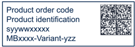

## 8 Nucleo-64 boards information

### 8.1 Product marking

The product and each board composing the product are identified with one or several stickers. The stickers, located on the top or bottom side of each PCB, provide product information:

- Main board featuring the target device: product order code, product identification, serial number, and board reference with revision. Single-sticker example:

DT73589V1

#### Dual-sticker example:

Product order code Product identification Product order code Product identification and

- Other boards if any: board reference with revision and serial number. Examples:

On the main board sticker, the first line provides the product order code, and the second line the product identification.

On all board stickers, the line formatted as 'MBxxxx-Variant-yzz' shows the board reference 'MBxxxx', the mounting variant 'Variant' when several exist (optional), the PCB revision 'y' , and the assembly revision 'zz' , for example B01. The other line shows the board serial number used for traceability.

Products and parts labeled as 'ES' or 'E' are not yet qualified or feature devices that are not yet qualified. STMicroelectronics disclaims any responsibility for consequences arising from their use. Under no circumstances will STMicroelectronics be liable for the customer's use of these engineering samples. Before deciding to use these engineering samples for qualification activities, contact STMicroelectronics' quality department.

'ES' or 'E' marking examples of location:

- On the targeted STM32 that is soldered on the board (for an illustration of STM32 marking, refer to the STM32 datasheet Package information paragraph at the www.st.com website).
- Next to the evaluation tool ordering part number that is stuck or silk-screen printed on the board.

Some boards feature a specific STM32 device version, which allows the operation of any bundled commercial stack/library available. This STM32 device shows a 'U' marking option at the end of the standard part number and is not available for sales.

To use the same commercial stack in their applications, the developers might need to purchase a part number specific to this stack/library. The price of those part numbers includes the stack/library royalties.

### 8.2 Product history

Table 34. Product history

| Order code    | Product identification   | Product details                                                                  | Product change description                          | Product limitations   |
|---------------|--------------------------|----------------------------------------------------------------------------------|-----------------------------------------------------|-----------------------|
| NUCLEO-F030R8 | NUCLEOF030R8/            | MCU: - STM32F030R8T6 silicon revision 'B' or '2' or '1'                          | Initial revision                                    | No limitation         |
| NUCLEO-F030R8 | NUCLEOF030R8/            | MCU errata sheet: - STM32F030x4/x6/x8/xC device errata (ES0219)                  | Initial revision                                    | No limitation         |
| NUCLEO-F030R8 | NUCLEOF030R8/            | Boards: - MB1136-F030R8-C01 - MB1136-F030R8-C03 - MB1136-F030R8-C04 (main board) | Initial revision                                    | No limitation         |
| NUCLEO-F030R8 | NUF030R8$AU1             | MCU: - STM32F030R8T6 silicon revision 'B' or '2' or '1'                          | Packaging: plastic blister replaced by a carton box | No limitation         |
| NUCLEO-F030R8 | NUF030R8$AU1             | MCU errata sheet: - STM32F030x4/x6/x8/xC device errata (ES0219)                  | Packaging: plastic blister replaced by a carton box | No limitation         |
| NUCLEO-F030R8 | NUF030R8$AU1             | Boards: - MB1136-F030R8-C04 (main board)                                         | Packaging: plastic blister replaced by a carton box | No limitation         |
| NUCLEO-F030R8 | NUF030R8$KU1             | MCU: - STM32F030R8T6 silicon revision 'B' or '2' or '1'                          | - Board stickers format changed                     | No limitation         |
| NUCLEO-F030R8 | NUF030R8$KU1             | MCU errata sheet: - STM32F030x4/x6/x8/xC device errata (ES0219)                  | - Board stickers format changed                     | No limitation         |
| NUCLEO-F030R8 | NUF030R8$KU1             | Boards: - MB1136-F030R8-C04 (main board)                                         | - Board stickers format changed                     | No limitation         |

90

Table 34. Product history (continued)

| Order code    | Product identification   | Product details                                                                  | Product change description                                                          | Product limitations   |
|---------------|--------------------------|----------------------------------------------------------------------------------|-------------------------------------------------------------------------------------|-----------------------|
| NUCLEO-F072RB | NUCLEOF072RB/            | MCU: - STM32F072RBT6 silicon revision 'Y' or '1'                                 | Initial revision                                                                    | No limitation         |
| NUCLEO-F072RB | NUCLEOF072RB/            | MCU errata sheet: - STM32F072x8/xB device errata (ES0223)                        | Initial revision                                                                    | No limitation         |
| NUCLEO-F072RB | NUCLEOF072RB/            | Boards: - MB1136-F072RB-C01 - MB1136-F072RB-C03 - MB1136-F072RB-C04 (main board) | Initial revision                                                                    | No limitation         |
| NUCLEO-F072RB | NUF072RB$AU1             | MCU: - STM32F072RBT6 silicon revision 'Y' or '1'                                 | - Main board revision changed - Packaging: plastic blister replaced by a carton box | No limitation         |
| NUCLEO-F072RB | NUF072RB$AU1             | MCU errata sheet: - STM32F072x8/xB device errata (ES0223)                        | - Main board revision changed - Packaging: plastic blister replaced by a carton box | No limitation         |
| NUCLEO-F072RB | NUF072RB$AU1             | Boards: - MB1136-F072RB-C05 (main board)                                         | - Main board revision changed - Packaging: plastic blister replaced by a carton box | No limitation         |
| NUCLEO-F072RB | NUF072RB$KU1             | MCU: - STM32F072RBT6 silicon revision '2'                                        | - MCU silicon revision changed - Board sticker format changed                       | No limitation         |
| NUCLEO-F072RB | NUF072RB$KU1             | MCU errata sheet: STM32F072x8/xB device errata (ES0223)                          | - MCU silicon revision changed - Board sticker format changed                       | No limitation         |
| NUCLEO-F072RB | NUF072RB$KU1             | Boards: MB1136-F072RB-C05 (main board)                                           | - MCU silicon revision changed - Board sticker format changed                       | No limitation         |

Table 34. Product history (continued)

| Order code    | Product identification   | Product details                                                                                              | Product change description                                                          | Product limitations   |
|---------------|--------------------------|--------------------------------------------------------------------------------------------------------------|-------------------------------------------------------------------------------------|-----------------------|
| NUCLEO-F103RB | NUCLEOF103RB/            | MCU: - STM32F103RBT6 silicon revision 'X' or '2'                                                             | Initial revision                                                                    | No limitation         |
| NUCLEO-F103RB | NUCLEOF103RB/            | MCU errata sheet: - STM32F101x8/B, STM32F102x8/B and STM32F103x8/B medium-density device limitations (ES096) | Initial revision                                                                    | No limitation         |
| NUCLEO-F103RB | NUCLEOF103RB/            | Boards: - MB1136-F103RB-C01 - MB1136-F103RB-C02 - MB1136-F103RB-C03 - MB1136-F103RB-C04 (main board)         | Initial revision                                                                    | No limitation         |
| NUCLEO-F103RB | NUF103RB$AU1             | MCU: - STM32F103RBT6 silicon revision 'X' or '2'                                                             | - Main board revision changed - Packaging: plastic blister replaced by a carton box | No limitation         |
| NUCLEO-F103RB | NUF103RB$AU1             | MCU errata sheet: - STM32F101x8/B, STM32F102x8/B and STM32F103x8/B medium-density device limitations (ES096) | - Main board revision changed - Packaging: plastic blister replaced by a carton box | No limitation         |
| NUCLEO-F103RB | NUF103RB$AU1             | Boards: - MB1136-F103RB-C05 (main board)                                                                     | - Main board revision changed - Packaging: plastic blister replaced by a carton box | No limitation         |
| NUCLEO-F103RB | NUF103RB$KU1             | MCU: - STM32F103RBT6 silicon revision 'X' or '2'                                                             | Board stickers format changed                                                       | No limitation         |
| NUCLEO-F103RB | NUF103RB$KU1             | MCU errata sheet: - STM32F101x8/B, STM32F102x8/B and STM32F103x8/B medium-density device limitations (ES096) | Board stickers format changed                                                       | No limitation         |
| NUCLEO-F103RB | NUF103RB$KU1             | Boards: - MB1136-F103RB-C05 (main board)                                                                     | Board stickers format changed                                                       | No limitation         |

90

Table 34. Product history (continued)

| Order code    | Product identification   | Product details                                                                                      | Product change description                          | Product limitations   |
|---------------|--------------------------|------------------------------------------------------------------------------------------------------|-----------------------------------------------------|-----------------------|
| NUCLEO-F302R8 | NUCLEOF302R8/            | MCU: - STM32F302R8T6 silicon revision 'Z'                                                            | Initial revision                                    | No limitation         |
| NUCLEO-F302R8 | NUCLEOF302R8/            | MCU errata sheet: - STM32F302x6/x8 device errata (ES0247)                                            | Initial revision                                    | No limitation         |
| NUCLEO-F302R8 | NUCLEOF302R8/            | Boards: - MB1136-F302R8-C01 - MB1136-F302R8-C02 - MB1136-F302R8-C03 - MB1136-F302R8-C04 (main board) | Initial revision                                    | No limitation         |
| NUCLEO-F302R8 | NUF302R8$AU1             | MCU: - STM32F302R8T6 silicon revision 'Z'                                                            | Packaging: plastic blister replaced by a carton box | No limitation         |
| NUCLEO-F302R8 | NUF302R8$AU1             | MCU errata sheet: - STM32F302x6/x8 device errata (ES0247)                                            | Packaging: plastic blister replaced by a carton box | No limitation         |
| NUCLEO-F302R8 | NUF302R8$AU1             | Boards: - MB1136-F302R8-C04 (main board)                                                             | Packaging: plastic blister replaced by a carton box | No limitation         |

Table 34. Product history (continued)

| Order code    | Product identification   | Product details                                                                                      | Product change description                          | Product limitations   |
|---------------|--------------------------|------------------------------------------------------------------------------------------------------|-----------------------------------------------------|-----------------------|
| NUCLEO-F401RE | NUCLEOF401RE/            | MCU: - STM32F401RET6 silicon revision 'Z' or '1'                                                     | Initial revision                                    | No limitation         |
| NUCLEO-F401RE | NUCLEOF401RE/            | MCU errata sheet: - STM32F401xD and STM32F401xE device errata (ES0299)                               | Initial revision                                    | No limitation         |
| NUCLEO-F401RE | NUCLEOF401RE/            | Boards: - MB1136-F401RE-C01 - MB1136-F401RE-C02 - MB1136-F401RE-C03 - MB1136-F401RE-C04 (main board) | Initial revision                                    | No limitation         |
| NUCLEO-F401RE | NUF401RE$AU1             | MCU: - STM32F401RET6 silicon revision 'Z' or '1'                                                     | Packaging: plastic blister replaced by a carton box | No limitation         |
| NUCLEO-F401RE | NUF401RE$AU1             | MCU errata sheet: - STM32F401xD and STM32F401xE device errata (ES0299)                               | Packaging: plastic blister replaced by a carton box | No limitation         |
| NUCLEO-F401RE | NUF401RE$AU1             | Boards: - MB1136-F401RE-C04 (main board)                                                             | Packaging: plastic blister replaced by a carton box | No limitation         |
| NUCLEO-F401RE | NUF401RE$KU1             | MCU: - STM32F401RET6 silicon revision 'Z' or '1'                                                     | Board stickers format changed                       | No limitation         |
| NUCLEO-F401RE | NUF401RE$KU1             | MCU errata sheet: - STM32F401xD and STM32F401xE device errata (ES0299)                               | Board stickers format changed                       | No limitation         |
| NUCLEO-F401RE | NUF401RE$KU1             | Boards: - MB1136-F401RE-C04 (main board)                                                             | Board stickers format changed                       | No limitation         |

90

Table 34. Product history (continued)

| Order code    | Product identification   | Product details                                                                                      | Product change description                                                          | Product limitations   |
|---------------|--------------------------|------------------------------------------------------------------------------------------------------|-------------------------------------------------------------------------------------|-----------------------|
| NUCLEO-L053R8 | NUCLEOL053R8/            | MCU: - STM32L053R8T6 silicon revision 'X'                                                            | Initial revision                                                                    | No limitation         |
| NUCLEO-L053R8 | NUCLEOL053R8/            | MCU errata sheet: - STM32L05xxx/L06xxx device errata (ES0251)                                        | Initial revision                                                                    | No limitation         |
| NUCLEO-L053R8 | NUCLEOL053R8/            | Boards: - MB1136-L053R8-C01 - MB1136-L053R8-C02 - MB1136-L053R8-C03 - MB1136-L053R8-C04 (main board) | Initial revision                                                                    | No limitation         |
| NUCLEO-L053R8 | NUL053R8$AU1             | MCU: - STM32L053R8T6 silicon revision 'X'                                                            | - Main board revision changed - Packaging: plastic blister replaced by a carton box | No limitation         |
| NUCLEO-L053R8 | NUL053R8$AU1             | MCU errata sheet: - STM32L05xxx/L06xxx device errata (ES0251)                                        | - Main board revision changed - Packaging: plastic blister replaced by a carton box | No limitation         |
| NUCLEO-L053R8 | NUL053R8$AU1             | Boards: - MB1136-L053R8-C05 (main board)                                                             | - Main board revision changed - Packaging: plastic blister replaced by a carton box | No limitation         |
| NUCLEO-L053R8 | NUL053R8$KU1             | MCU: - STM32L053R8T6 silicon revision 'X' or 'P'                                                     | Board stickers format changed                                                       | No limitation         |
| NUCLEO-L053R8 | NUL053R8$KU1             | MCU errata sheet: - STM32L05xxx/L06xxx device errata (ES0251)                                        | Board stickers format changed                                                       | No limitation         |
| NUCLEO-L053R8 | NUL053R8$KU1             | Boards: - MB1136-L053R8-C05 (main board)                                                             | Board stickers format changed                                                       | No limitation         |

Table 34. Product history (continued)

| Order code    | Product identification   | Product details                                                                                      | Product change description                                                          | Product limitations   |
|---------------|--------------------------|------------------------------------------------------------------------------------------------------|-------------------------------------------------------------------------------------|-----------------------|
| NUCLEO-L152RE | NUCLEOL152RE/            | MCU: - STM32L152RET6 silicon revision 'Z'                                                            | Initial revision                                                                    | No limitation         |
| NUCLEO-L152RE | NUCLEOL152RE/            | MCU errata sheet: - STM32L15xxE STM32L15xVD-X STM32L162xE STM32L162xVD-X device errata (ES0242)      | Initial revision                                                                    | No limitation         |
| NUCLEO-L152RE | NUCLEOL152RE/            | Boards: - MB1136-L152RE-C01 - MB1136-L152RE-C02 - MB1136-L152RE-C03 - MB1136-L152RE-C04 (main board) | Initial revision                                                                    | No limitation         |
| NUCLEO-L152RE | NUL152RE$AU1             | MCU: - STM32L152RET6 silicon revision 'Z'                                                            | - Main board revision changed - Packaging: plastic blister replaced by a carton box | No limitation         |
| NUCLEO-L152RE | NUL152RE$AU1             | MCU errata sheet: - STM32L15xxE STM32L15xVD-X STM32L162xE STM32L162xVD-X device errata (ES0242)      | - Main board revision changed - Packaging: plastic blister replaced by a carton box | No limitation         |
| NUCLEO-L152RE | NUL152RE$AU1             | Boards: - MB1136-L152RE-C05 (main board)                                                             | - Main board revision changed - Packaging: plastic blister replaced by a carton box | No limitation         |
| NUCLEO-L152RE | NUL152RE$KU1             | MCU: - STM32L152RET6 silicon revision 'Z'                                                            | Board sticker format changed                                                        | No limitation         |
| NUCLEO-L152RE | NUL152RE$KU1             | MCU errata sheet: STM32L15xxE STM32L15xVD-X STM32L162xE STM32L162xVD-X device errata (ES0242)        | Board sticker format changed                                                        | No limitation         |
| NUCLEO-L152RE | NUL152RE$KU1             | Boards: MB1136-L152RE-C05 (main board)                                                               | Board sticker format changed                                                        | No limitation         |

90

Table 34. Product history (continued)

| Order code    | Product identification   | Product details                                                                  | Product change description                                                          | Product limitations   |
|---------------|--------------------------|----------------------------------------------------------------------------------|-------------------------------------------------------------------------------------|-----------------------|
| NUCLEO-F091RC | NUCLEOF091RC/            | MCU: - STM32F091RCT6 silicon revision 'A'                                        | Initial revision                                                                    | No limitation         |
| NUCLEO-F091RC | NUCLEOF091RC/            | MCU errata sheet: - STM32F091xB/xC device errata (ES0282)                        | Initial revision                                                                    | No limitation         |
| NUCLEO-F091RC | NUCLEOF091RC/            | Boards: - MB1136-F091RC-C02 - MB1136-F091RC-C03 - MB1136-F091RC-C04 (main board) | Initial revision                                                                    | No limitation         |
| NUCLEO-F091RC | NUF091RC$AU1             | MCU: - STM32F091RCT6 silicon revision 'A'                                        | - Main board revision changed - Packaging: plastic blister replaced by a carton box | No limitation         |
| NUCLEO-F091RC | NUF091RC$AU1             | MCU errata sheet: - STM32F091xB/xC device errata (ES0282)                        | - Main board revision changed - Packaging: plastic blister replaced by a carton box | No limitation         |
| NUCLEO-F091RC | NUF091RC$AU1             | Boards: - MB1136-F091RC-C05 (main board)                                         | - Main board revision changed - Packaging: plastic blister replaced by a carton box | No limitation         |

Table 34. Product history (continued)

| Order code    | Product identification   | Product details                                                                           | Product change description                                                          | Product limitations   |
|---------------|--------------------------|-------------------------------------------------------------------------------------------|-------------------------------------------------------------------------------------|-----------------------|
| NUCLEO-F303RE | NUCLEOF303RE/            | MCU: - STM32F303RET6 silicon revision 'Y'                                                 | Initial revision                                                                    | No limitation         |
| NUCLEO-F303RE | NUCLEOF303RE/            | (ES0261) Boards: - MB1136-F303RE-C02 - MB1136-F303RE-C03 - MB1136-F303RE-C04 (main board) | Initial revision                                                                    | No limitation         |
| NUCLEO-F303RE | NUF303RE$AU1             | MCU: - STM32F303RET6 silicon revision 'Y'                                                 | - Main board revision changed - Packaging: plastic blister replaced by a carton box | No limitation         |
| NUCLEO-F303RE | NUF303RE$AU1             | MCU errata sheet: - STM32F303xD STM32F303xE Rev Y device limitations (ES0261)             | - Main board revision changed - Packaging: plastic blister replaced by a carton box | No limitation         |
| NUCLEO-F303RE | NUF303RE$AU1             | Boards: - MB1136-F303RE-C05 (main board)                                                  | - Main board revision changed - Packaging: plastic blister replaced by a carton box | No limitation         |

90

Table 34. Product history (continued)

| Order code    | Product identification   | Product details                                                                  | Product change description                                                          | Product limitations   |
|---------------|--------------------------|----------------------------------------------------------------------------------|-------------------------------------------------------------------------------------|-----------------------|
| NUCLEO-F334R8 | NUCLEOF334R8/            | MCU: - STM32F334R8T6 silicon revision 'Z'                                        | Initial revision                                                                    | No limitation         |
| NUCLEO-F334R8 | NUCLEOF334R8/            | MCU errata sheet: - STM32F334x4/x6/x8 Rev Z device limitations (ES0258)          | Initial revision                                                                    | No limitation         |
| NUCLEO-F334R8 | NUCLEOF334R8/            | Boards: - MB1136-F334R8-C02 - MB1136-F334R8-C03 - MB1136-F334R8-C04 (main board) | Initial revision                                                                    | No limitation         |
| NUCLEO-F334R8 | NUF334R8$AU1             | MCU: - STM32F334R8T6 silicon revision 'Z'                                        | - Main board revision changed - Packaging: plastic blister replaced by a carton box | No limitation         |
| NUCLEO-F334R8 | NUF334R8$AU1             | MCU errata sheet: - STM32F334x4/x6/x8 Rev Z device limitations (ES0258)          | - Main board revision changed - Packaging: plastic blister replaced by a carton box | No limitation         |
| NUCLEO-F334R8 | NUF334R8$AU1             | Boards: - MB1136-F334R8-C05 (main board)                                         | - Main board revision changed - Packaging: plastic blister replaced by a carton box | No limitation         |
| NUCLEO-F334R8 | NUF334R8$KU1             | MCU: - STM32F334R8T6 silicon revision 'Z' or '1'                                 | Board stickers format changed                                                       | No limitation         |
| NUCLEO-F334R8 | NUF334R8$KU1             | MCU errata sheet: - STM32F334x4/x6/x8 Rev Z device limitations (ES0258)          | Board stickers format changed                                                       | No limitation         |
| NUCLEO-F334R8 | NUF334R8$KU1             | Boards: - MB1136-F334R8-C05 (main board)                                         | Board stickers format changed                                                       | No limitation         |

Table 34. Product history (continued)

| Order code    | Product identification   | Product details                                                                  | Product change description                          | Product limitations   |
|---------------|--------------------------|----------------------------------------------------------------------------------|-----------------------------------------------------|-----------------------|
| NUCLEO-F411RE | NUCLEOF411RE/            | MCU: - STM32F411RET6 silicon revision 'A'                                        | Initial revision                                    | No limitation         |
| NUCLEO-F411RE | NUCLEOF411RE/            | MCU errata sheet: - STM32F411xC/xE device errata (ES0287)                        | Initial revision                                    | No limitation         |
| NUCLEO-F411RE | NUCLEOF411RE/            | Boards: - MB1136-F411RE-C02 - MB1136-F411RE-C03 - MB1136-F411RE-C04 (main board) | Initial revision                                    | No limitation         |
| NUCLEO-F411RE | NUF411RE$AU1             | MCU: - STM32F411RET6 silicon revision 'A'                                        | Packaging: plastic blister replaced by a carton box | No limitation         |
| NUCLEO-F411RE | NUF411RE$AU1             | MCU errata sheet: - STM32F411xC/xE device errata (ES0287)                        | Packaging: plastic blister replaced by a carton box | No limitation         |
| NUCLEO-F411RE | NUF411RE$AU1             | Boards: - MB1136-F411RE-C04 (main board)                                         | Packaging: plastic blister replaced by a carton box | No limitation         |
| NUCLEO-F411RE | NUF411RE$KU1             | MCU: - STM32F411RET6 silicon revision 'A' or '1'                                 | Board stickers format changed                       | No limitation         |
| NUCLEO-F411RE | NUF411RE$KU1             | MCU errata sheet: - STM32F411xC/xE device errata (ES0287)                        | Board stickers format changed                       | No limitation         |
| NUCLEO-F411RE | NUF411RE$KU1             | Boards: - MB1136-F411RE-C04 (main board)                                         | Board stickers format changed                       | No limitation         |

90

Table 34. Product history (continued)

| Order code    | Product identification   | Product details                                                    | Product change description                          | Product limitations   |
|---------------|--------------------------|--------------------------------------------------------------------|-----------------------------------------------------|-----------------------|
| NUCLEO-F410RB | NUCLEOF410RB/            | MCU: - STM32F410RBT6 silicon revision 'A'                          | Initial revision                                    | No limitation         |
| NUCLEO-F410RB | NUCLEOF410RB/            | MCU errata sheet: - STM32F410x8 STM32F410xB device errata (ES0325) | Initial revision                                    | No limitation         |
| NUCLEO-F410RB | NUCLEOF410RB/            | Boards: - MB1136-F410RB-C03 - MB1136-F410RB-C04 (main board)       | Initial revision                                    | No limitation         |
| NUCLEO-F410RB | NUF410RB$AU1             | MCU: - STM32F410RBT6 silicon revision 'A'                          | Packaging: plastic blister replaced by a carton box | No limitation         |
| NUCLEO-F410RB | NUF410RB$AU1             | MCU errata sheet: - STM32F410x8 STM32F410xB device errata (ES0325) | Packaging: plastic blister replaced by a carton box | No limitation         |
| NUCLEO-F410RB | NUF410RB$AU1             | Boards: - MB1136-F410RB-C04 (main board)                           | Packaging: plastic blister replaced by a carton box | No limitation         |

Table 34. Product history (continued)

| Order code    | Product identification   | Product details                                              | Product change description                          | Product limitations   |
|---------------|--------------------------|--------------------------------------------------------------|-----------------------------------------------------|-----------------------|
| NUCLEO-F446RE | NUCLEOF446RE/            | MCU: - STM32F446RET6 silicon revision 'A'                    | Initial revision                                    | No limitation         |
| NUCLEO-F446RE | NUCLEOF446RE/            | MCU errata sheet: - STM32F446xC/xE device errata (ES0298)    | Initial revision                                    | No limitation         |
| NUCLEO-F446RE | NUCLEOF446RE/            | Boards: - MB1136-F446RE-C03 - MB1136-F446RE-C04 (main board) | Initial revision                                    | No limitation         |
| NUCLEO-F446RE | NUF446RE$AU1             | MCU: - STM32F446RET6 silicon revision 'A'                    | Packaging: plastic blister replaced by a carton box | No limitation         |
| NUCLEO-F446RE | NUF446RE$AU1             | MCU errata sheet: - STM32F446xC/xE device errata (ES0298)    | Packaging: plastic blister replaced by a carton box | No limitation         |
| NUCLEO-F446RE | NUF446RE$AU1             | Boards: - MB1136-F446RE-C04 (main board)                     | Packaging: plastic blister replaced by a carton box | No limitation         |
| NUCLEO-F446RE | NUF446RE$KU1             | MCU: - STM32F446RET6 silicon revision 'A' or '1'             | Board stickers format changed                       | No limitation         |
| NUCLEO-F446RE | NUF446RE$KU1             | MCU errata sheet: - STM32F446xC/xE device errata (ES0298)    | Board stickers format changed                       | No limitation         |
| NUCLEO-F446RE | NUF446RE$KU1             | Boards: - MB1136-F446RE-C04 (main board)                     | Board stickers format changed                       | No limitation         |

90

Table 34. Product history (continued)

| Order code    | Product identification   | Product details                                              | Product change description                                                          | Product limitations   |
|---------------|--------------------------|--------------------------------------------------------------|-------------------------------------------------------------------------------------|-----------------------|
| NUCLEO-F070RB | NUCLEOF070RB/            | MCU: - STM32F070RBT6 silicon revision '1'                    | Initial revision                                                                    | No limitation         |
| NUCLEO-F070RB | NUCLEOF070RB/            | MCU errata sheet: - STM32F070x6/xB device errata (ES0291)    | Initial revision                                                                    | No limitation         |
| NUCLEO-F070RB | NUCLEOF070RB/            | Boards: - MB1136-F070RB-C03 - MB1136-F070RB-C04 (main board) | Initial revision                                                                    | No limitation         |
| NUCLEO-F070RB | NUF070RB$AU1             | MCU: - STM32F070RBT6 silicon revision '1'                    | - Main board revision changed - Packaging: plastic blister replaced by a carton box | No limitation         |
| NUCLEO-F070RB | NUF070RB$AU1             | MCU errata sheet: - STM32F070x6/xB device errata (ES0291)    | - Main board revision changed - Packaging: plastic blister replaced by a carton box | No limitation         |
| NUCLEO-F070RB | NUF070RB$AU1             | Boards: - MB1136-F070RB-C05 (main board)                     | - Main board revision changed - Packaging: plastic blister replaced by a carton box | No limitation         |
|               | NUF070RB$KU1             | MCU: - STM32F070RBT6 silicon revision '2'                    | - Board stickers format changed - MCU silicon revison changed                       | No limitation         |
|               | NUF070RB$KU1             | MCU errata sheet: - STM32F070x6/xB device errata (ES0291)    | - Board stickers format changed - MCU silicon revison changed                       | No limitation         |
|               | NUF070RB$KU1             | Boards: - MB1136-F070RB-C05 (main board)                     | - Board stickers format changed - MCU silicon revison changed                       | No limitation         |

Table 34. Product history (continued)

| Order code    | Product identification   | Product details                                               | Product change description                                                          | Product limitations   |
|---------------|--------------------------|---------------------------------------------------------------|-------------------------------------------------------------------------------------|-----------------------|
| NUCLEO-L073RZ | NUCLEOL073RZ/            | MCU: - STM32L073RZT6 silicon revision 'Z'                     | Initial revision                                                                    | No limitation         |
| NUCLEO-L073RZ | NUCLEOL073RZ/            | MCU errata sheet: - STM32L07xxx/L08xxx device errata (ES0292) | Initial revision                                                                    | No limitation         |
| NUCLEO-L073RZ | NUCLEOL073RZ/            | Boards: - MB1136-L073RZ-C03 - MB1136-L073RZ-C04 (main board)  | Initial revision                                                                    | No limitation         |
| NUCLEO-L073RZ | NUL073RZ$AU1             | MCU: - STM32L073RZT6 silicon revision 'Z'                     | - Main board revision changed - Packaging: plastic blister replaced by a carton box | No limitation         |
| NUCLEO-L073RZ | NUL073RZ$AU1             | MCU errata sheet: - STM32L07xxx/L08xxx device errata (ES0292) | - Main board revision changed - Packaging: plastic blister replaced by a carton box | No limitation         |
| NUCLEO-L073RZ | NUL073RZ$AU1             | Boards: - MB1136-L073RZ-C05 (main board)                      | - Main board revision changed - Packaging: plastic blister replaced by a carton box | No limitation         |
| NUCLEO-L073RZ | NUL073RZ$KU1             | MCU: - STM32L073RZT6 silicon revision 'Z' or 'P'              | Board stickers format changed                                                       | No limitation         |
| NUCLEO-L073RZ | NUL073RZ$KU1             | MCU errata sheet: - STM32L07xxx/L08xxx device errata (ES0292) | Board stickers format changed                                                       | No limitation         |
| NUCLEO-L073RZ | NUL073RZ$KU1             | Boards: - MB1136-L073RZ-C05 (main board)                      | Board stickers format changed                                                       | No limitation         |

90

Table 34. Product history (continued)

| Order code    | Product identification   | Product details                                              | Product change description                          | Product limitations   |
|---------------|--------------------------|--------------------------------------------------------------|-----------------------------------------------------|-----------------------|
| NUCLEO-L452RE | NUCLEOL452RE/            | MCU: - STM32L452RET6 silicon revision 'Y'                    | Initial revision                                    | No limitation         |
| NUCLEO-L452RE | NUCLEOL452RE/            | MCU errata sheet: - STM32L452xx device errata (ES0388)       | Initial revision                                    | No limitation         |
| NUCLEO-L452RE | NUCLEOL452RE/            | Boards: - MB1136-L452RE-C03 - MB1136-L452RE-C04 (main board) | Initial revision                                    | No limitation         |
| NUCLEO-L452RE | NUL452RE$AU1             | MCU: - STM32L452RET6 silicon revision 'Y'                    | Packaging: plastic blister replaced by a carton box | No limitation         |
| NUCLEO-L452RE | NUL452RE$AU1             | MCU errata sheet: - STM32L452xx device errata (ES0388)       | Packaging: plastic blister replaced by a carton box | No limitation         |
| NUCLEO-L452RE | NUL452RE$AU1             | Boards: - MB1136-L452RE-C05 (main board)                     | Packaging: plastic blister replaced by a carton box | No limitation         |
| NUCLEO-L452RE | NUL452RE$KU1             | MCU: - STM32L452RET6 silicon revision 'Y'                    | Board sticker format changed                        | No limitation         |
| NUCLEO-L452RE | NUL452RE$KU1             | MCU errata sheet: - STM32L452xx device errata (ES0388)       | Board sticker format changed                        | No limitation         |
| NUCLEO-L452RE | NUL452RE$KU1             | Boards: - MB1136-L452RE-C05 (main board)                     | Board sticker format changed                        | No limitation         |

Table 34. Product history (continued)

| Order code    | Product identification   | Product details                                                     | Product change description                                                          | Product limitations   |
|---------------|--------------------------|---------------------------------------------------------------------|-------------------------------------------------------------------------------------|-----------------------|
| NUCLEO-L476RG | NUCLEOL476RG/            | MCU: - STM32L476RGT6 silicon revision '4'                           | Initial revision                                                                    | No limitation         |
| NUCLEO-L476RG | NUCLEOL476RG/            | MCU errata sheet: - STM32L476xx/STM32L4 86xx device errata (ES0250) | Initial revision                                                                    | No limitation         |
| NUCLEO-L476RG | NUCLEOL476RG/            | Boards: - MB1136-L476RG-C03 - MB1136-L476RG-C04 (main board)        | Initial revision                                                                    | No limitation         |
| NUCLEO-L476RG | NUL476RG$AU1             | MCU: - STM32L476RGT6 silicon revision '4'                           | - Main board revision changed - Packaging: plastic blister replaced by a carton box | No limitation         |
| NUCLEO-L476RG | NUL476RG$AU1             | MCU errata sheet: - STM32L476xx/STM32L4 86xx device errata (ES0250) | - Main board revision changed - Packaging: plastic blister replaced by a carton box | No limitation         |
| NUCLEO-L476RG | NUL476RG$AU1             | Boards: - MB1136-L476RG-C05 (main board)                            | - Main board revision changed - Packaging: plastic blister replaced by a carton box | No limitation         |
| NUCLEO-L476RG | NUL476RG$KU1             | MCU: - STM32L476RGT6 silicon revision '4'                           | Board stickers format changed                                                       | No limitation         |
| NUCLEO-L476RG | NUL476RG$KU1             | MCU errata sheet: - STM32L476xx/STM32L4 86xx device errata (ES0250) | Board stickers format changed                                                       | No limitation         |
| NUCLEO-L476RG | NUL476RG$KU1             | Boards: - MB1136-L476RG-C05 (main board)                            | Board stickers format changed                                                       | No limitation         |

90

Table 34. Product history (continued)

| Order code    | Product identification   | Product details                                              | Product change description                          | Product limitations   |
|---------------|--------------------------|--------------------------------------------------------------|-----------------------------------------------------|-----------------------|
| NUCLEO-L010RB | NUCLEOL010RB/            | MCU: - STM32L010RBT6 silicon revision 'Z'                    | Initial revision                                    | No limitation         |
| NUCLEO-L010RB | NUCLEOL010RB/            | MCU errata sheet: - STM32L010xx device errata (ES0483)       | Initial revision                                    | No limitation         |
| NUCLEO-L010RB | NUCLEOL010RB/            | Boards: - MB1136-L010RB-C03 - MB1136-L010RB-C04 (main board) | Initial revision                                    | No limitation         |
| NUCLEO-L010RB | NUL010RB$AU1             | MCU: - STM32L010RBT6 silicon revision 'Z'                    | Packaging: plastic blister replaced by a carton box | No limitation         |
| NUCLEO-L010RB | NUL010RB$AU1             | MCU errata sheet: - STM32L010xx device errata (ES0483)       | Packaging: plastic blister replaced by a carton box | No limitation         |
| NUCLEO-L010RB | NUL010RB$AU1             | Boards: - MB1136-L010RB-C05 (main board)                     | Packaging: plastic blister replaced by a carton box | No limitation         |

### 8.3 Board revision history

Table 35. Board revision history

| Board reference     | Board variant and revision                                                                                                                                                                            | Board change description                                                                                                                                                                                                    | Board limitations   |
|---------------------|-------------------------------------------------------------------------------------------------------------------------------------------------------------------------------------------------------|-----------------------------------------------------------------------------------------------------------------------------------------------------------------------------------------------------------------------------|---------------------|
| MB1136 (main board) | F030R8-C01 F072RB-C01 F103RB-C01 F302R8-C01 F401RE-C01 L053R8-C01 L152RE-C01                                                                                                                          | Initial revision                                                                                                                                                                                                            | No limitation       |
| MB1136 (main board) | F072RB-C02 F091RC-C02 F103RB-C02 F302R8-C02 F303RE-C02 F334R8-C02 F401RE-C02 F411RE-C02 L053R8-C02                                                                                                    | Add LSE: - X2(32 KHz) - R34 and R36 changed from OFF to 0 Ω - C31 and C32 changed from OFF to 10 pF - SB48 and SB49 changed from ON to OFF Remove HSE: - SB16 and SB50 changed from OFF to ON - SB55 changed from ON to OFF | No limitation       |
| MB1136 (main board) | F030R8-C03 F070RB-C03 F072RB-C03 F091RC-C03 F103RB-C03 F302R8-C03 F303RE-C03 F334R8-C03 F401RE-C03 F410RB-C03 F411RE-C03 F446RE-C03 L010RB-C04 L053R8-C03 L073RZ-C03 L152RE-C03 L452RE-C03 L476RG-C03 | - X2 changed to ABS25-32.768KHZ-6-TB - C31 and C32 changed from 10 to 4.3 pF - C26 changed from 2.2 to 4.7 µF                                                                                                               | No limitation       |

90

Table 35. Board revision history (continued)

| Board reference     | Board variant and revision                                                                                                                                                                            | Board change description                                                                                 | Board limitations   |
|---------------------|-------------------------------------------------------------------------------------------------------------------------------------------------------------------------------------------------------|----------------------------------------------------------------------------------------------------------|---------------------|
| MB1136 (main board) | F030R8-C04 F070RB-C04 F072RB-C04 F091RC-C04 F103RB-C04 F302R8-C04 F303RE-C04 F334R8-C04 F401RE-C04 F410RB-C04 F411RE-C04 F446RE-C04 L010RB-C04 L053R8-C04 L073RZ-C04 L152RE-C04 L452RE-C04 L476RG-C04 | Reference for transistor (T2) changed from STMICROELECTRONICS STS7PF30L to STMICROELECTRONICS STS9P3LLH6 | No limitation       |
| MB1136 (main board) | F070RB-C05 F072RB-C05 F091RC-C05 F103RB-C05 F303RE-C05 F334R8-C05 L010RB-C05 L053R8-C05 L073RZ-C05 L152RE-C05 L452RE-C05                                                                              | - USB connector (CN1) changed - Buttons (B1 and B2) changed - Minor changes in serigraphy                | No limitation       |

