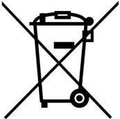

## 10 Product disposal

### Disposal of this product: WEEE (Waste Electrical and Electronic Equipment)

(Applicable in Europe)

This symbol on the product, accessories, or accompanying documents indicates that the product and its electronic accessories must not be disposed of with household waste at the end of their working life.

To prevent possible harm to the environment and human health from uncontrolled waste disposal, separate these items from other types of waste and recycle them responsibly at a designated collection point to promote the sustainable reuse of material resources.

### Household users:

Contact the retailer that you purchased the product from or your local authority for details of your nearest designated collection point.

Business users:

Contact your dealer or supplier for further information.

90

### Revision history

Table 36. Document revision history

| Date         |   Revision | Changes                                                                                                                                                                                                                                                                                                                                                                                                                                                                                                                                        |
|--------------|------------|------------------------------------------------------------------------------------------------------------------------------------------------------------------------------------------------------------------------------------------------------------------------------------------------------------------------------------------------------------------------------------------------------------------------------------------------------------------------------------------------------------------------------------------------|
| 10-Feb-2014  |          1 | Initial release.                                                                                                                                                                                                                                                                                                                                                                                                                                                                                                                               |
| 13-Feb-2014  |          2 | Updated Figure 1 , Chapter 5.5 and Table 10 .                                                                                                                                                                                                                                                                                                                                                                                                                                                                                                  |
| 11-Apr-2014  |          3 | Extended the applicability to NUCLEO-F302R8. Updated Table 1: Ordering information , Section 6.11: Arduino connectors and Section 6.12: ST morpho connector . Updated Figure 1                                                                                                                                                                                                                                                                                                                                                                 |
| 10-June-2014 |          4 | Updated the board figure: Figure 1 . Updated HSE and LSE configuration description: Section 6.7.1 , Section 5.5, and Section 6.7.2 . Extended the applicability to NUCLEO-F334R8, NUCLEO-F411RE, and NUCLEO-L053R8.                                                                                                                                                                                                                                                                                                                            |
| 20-June-2014 |          5 | Updated the electrical schematics figures: Figure 27 , Figure 28 , Figure 29, and Figure 30 . Refer to the AN2867 for the oscillator design guide for STM32 microcontrollers in Section 6.7.1: OSC clock supply and Section 6.7.2: OSC 32 KHz clock supply .                                                                                                                                                                                                                                                                                   |
| 30-Sept-2014 |          6 | Extended the applicability to NUCLEO-F091RC and NUCLEO- F303RE; Updated Table 1: Ordering information ; Updated Table 11: Arduino connectors on NUCLEO-F030R8, NUCLEO-F070RB, NUCLEO-F072RB, NUCLEO-F091RC ; Updated Table 26: ST morpho connector on NUCLEO-F072RB, NUCLEO-F091RC, NUCLEO-F303RE, NUCLEO-F334R8 ; Updated Figure 6: Typical configuration ; Added Figure 13: NUCLEO-F091RC ; Added Figure 16: NUCLEO-F303RE ; Updated Section 6.7.2: OSC 32 KHz clock supply ; Updated Figure 27: Top and Power(1/4) , Figure 28: STM32 MCU ; |

Table 36. Document revision history (continued)

| Date        |   Revision | Changes                                                                                                                                                                                                                                                                                                                                                                                                                                                                                                                                                                                                                                                                                                                                                                                                            |
|-------------|------------|--------------------------------------------------------------------------------------------------------------------------------------------------------------------------------------------------------------------------------------------------------------------------------------------------------------------------------------------------------------------------------------------------------------------------------------------------------------------------------------------------------------------------------------------------------------------------------------------------------------------------------------------------------------------------------------------------------------------------------------------------------------------------------------------------------------------|
| 19-Jan-2015 |          7 | Extended the applicability to NUCLEO-F070RB, NUCLEO- L073RZ, and NUCLEO-L476RG; Updated Table 1: Ordering information ; Updated Section 6.2: Embedded ST-LINK/V2-1 ; Updated Section 6.7.1: OSC clock supply ; Added Figure 11: NUCLEO-F070RB ; Added Figure 21: NUCLEO-L073RZ ; Added Figure 24: NUCLEO-L476RG Updated Table 11: Arduino connectors on NUCLEO-F030R8, NUCLEO-F070RB, NUCLEO-F072RB, NUCLEO-F091RC Added Table 18: Arduino connectors on NUCLEO-L073RZ Added Table 23: Arduino connectors on NUCLEO-L476RG Added Table 25: ST morpho connector on NUCLEO-F070RB Updated Table 30: ST morpho connector on NUCLEO-L053R8, NUCLEO-L073RZ, NUCLEO-L152RE Added Table 32: ST morpho connector on NUCLEO-L476RG Updated schematics from Figure 27: Top and Power(1/4) to Figure 30: Extension connectors |
| 08-Jul-2015 |          8 | Extended the applicability to Updated Table 1: Ordering information ; Added Figure 25: NUCLEO-F446RE and Figure 26: NUCLEO- F410RB Updated Section 6.11: Arduino connectors on page 37 and Section 6.12: ST morpho connector on page 53                                                                                                                                                                                                                                                                                                                                                                                                                                                                                                                                                                            |
| 04-Aug-2015 |          9 | Added Section 5.4: NUCLEO-L476RG bootloader limitations .                                                                                                                                                                                                                                                                                                                                                                                                                                                                                                                                                                                                                                                                                                                                                          |
| 17-Nov-2015 |         10 | Updated Section 6.9: Solder bridges and Section 6.7.1: OSC clock supply .                                                                                                                                                                                                                                                                                                                                                                                                                                                                                                                                                                                                                                                                                                                                          |
| 29-Nov-2015 |         11 | Updated Introduction , Section 3: Ordering information , Section 6.10: Extension connectors , Section 6.11: Arduino connectors , Section 6.12: ST morpho connector to add NUCLEO- L452RE.                                                                                                                                                                                                                                                                                                                                                                                                                                                                                                                                                                                                                          |
| 15-Dec-2017 |         12 | Updated document title and cover page. Updated Chapter 2: Product marking and Section 5.3: Development toolchains . Expanded document scope to NUCLEO-L010RB: - Updated Table 1: Ordering information - Updated Table 18: Arduino connectors on NUCLEO-L010RB and NUCLEO-L073RZ - Updated Table 21: NUCLEO-L073RZ and NUCLEO-L010RB - Updated Table 30: ST morpho connector on NUCLEO-L010RB, NUCLEO-L053R8, NUCLEO-L073RZ, NUCLEO-L152RE                                                                                                                                                                                                                                                                                                                                                                          |
| 3-Apr-2019  |         13 | Updated document title, Introduction , Chapter 2: Ordering information , Section 2.1: Product marking , Section 2.2: Codification , and Section 5.1: Getting started . Added Chapter 3: Development environment and Section 3.3: Demonstration software .                                                                                                                                                                                                                                                                                                                                                                                                                                                                                                                                                          |

90

Table 36. Document revision history (continued)

| Date        |   Revision | Changes                                                                                                                                                                                                                                                                                                                                                                                                                                                                                                                                           |
|-------------|------------|---------------------------------------------------------------------------------------------------------------------------------------------------------------------------------------------------------------------------------------------------------------------------------------------------------------------------------------------------------------------------------------------------------------------------------------------------------------------------------------------------------------------------------------------------|
| 19-Aug-2020 |         14 | Updated the connector reference in the description of SB54 and SB55 in Table 10: Solder bridges . Removed pin 10 duplicated rows in Table 11: ARDUINO ® connectors on NUCLEO-F030R8, NUCLEO-F070RB, NUCLEO- F072RB, NUCLEO-F091RC , Table 12: ARDUINO ® connectors on NUCLEO-F103RB , Table 16: ARDUINO ® connectors on NUCLEO-F401RE and NUCLEO-F411RE , and Table 19: ARDUINO ® connectors on NUCLEO-F446RE . Removed electrical schematics. Added Section 7 including Product marking , Board revision history , and Board known limitations . |
| 14-Apr-2025 |         15 | Added Section 3.4: EDA resources , Section 5: Safety recommendations , Table 34: Product history and Table 35: Board revision history , and Section 9: Federal Communications Commission (FCC) and ISED Canada Compliance Statements . Updated Section 3.1: System requirements , Figure 2: Hardware block diagram , Section 7.4: Embedded ST-LINK/V2-1 , Section 7.4.1: Driver , and Section 8.1: Product marking . Removed the references to Arm ® Mbed ™ .                                                                                     |
| 19-May-2025 |         16 | Updated Table 34: Product history .                                                                                                                                                                                                                                                                                                                                                                                                                                                                                                               |
| 30-Sep-2025 |         17 | Updated Table 34: Product history .                                                                                                                                                                                                                                                                                                                                                                                                                                                                                                               |

### IMPORTANT NOTICE - READ CAREFULLY

STMicroelectronics NV and its subsidiaries ('ST') reserve the right to make changes, corrections, enhancements, modifications, and improvements to ST products and/or to this document at an&lt;y time without notice.

In the event of any conflict between the provisions of this document and the provisions of any contractual arrangement in force between the purchasers and ST, the provisions of such contractual arrangement shall prevail.

The purchasers should obtain the latest relevant information on ST products before placing orders. ST products are sold pursuant to ST's terms and conditions of sale in place at the time of order acknowledgment.

The purchasers are solely responsible for the choice, selection, and use of ST products and ST assumes no liability for application assistance or the design of the purchasers' products.

No license, express or implied, to any intellectual property right is granted by ST herein.

Resale of ST products with provisions different from the information set forth herein shall void any warranty granted by ST for such product.

If the purchasers identify an ST product that meets their functional and performance requirements but that is not designated for the purchasers' market segment, the purchasers shall contact ST for more information.

ST and the ST logo are trademarks of ST. For additional information about ST trademarks, refer to www.st.com/trademarks . All other product or service names are the property of their respective owners.

Information in this document supersedes and replaces information previously supplied in any prior versions of this document.

© 2025 STMicroelectronics - All rights reserved

91
